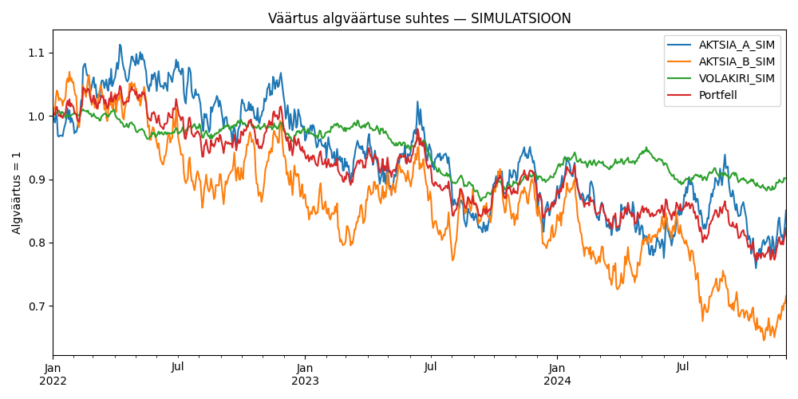
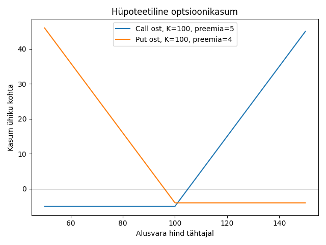
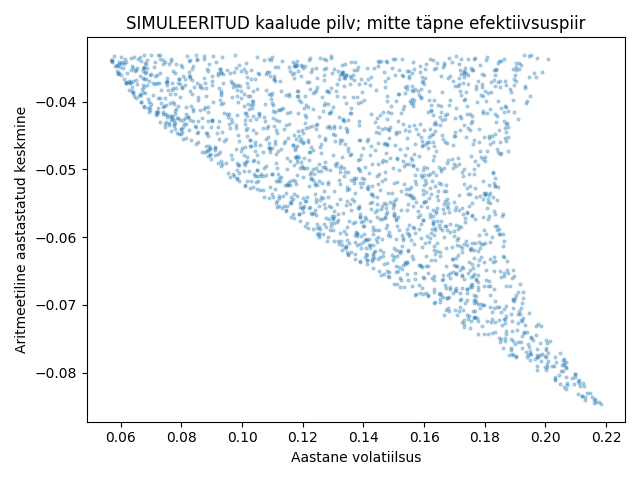

# Investeerimine, Python ja AI — eestikeelne praktiline kursus

Versioon 1.0 · 27.10.2026 · 13 õppemoodulit.

See on iseseisvalt sõnastatud kompaktne põhikursus Stefan Pappi raamatu teemadel, mitte tõlge. Näited, ülesanded ja kood on selle kursuse jaoks loodud. Eesmärk on osata meetodeid kasutada, kontrollida ja õpetada.

**Ulatuse aus kirjeldus.** Kogu PDF oli tekstina kättesaadav (370 lehekülge; trükitud põhitekst algab PDF-i lk 25). Kaardistatud on kõigi 13 peatüki sisukord, kõigi peatükkide kokkuvõtted ning valitud meetodi- ja koodilõigud. See ei ole kogu 966 140 märgi lausehaaval kontroll ega kõigi autori programmide audit. Sisuliste atribuutide aluseks on kontrollitud jaotised; täiendused on märgitud. Kõik põhivaldkonnad on kursuses esindatud, kuid osa edasijõudnud teemasid on sissejuhatavad: täielik optsioonihindamine, närvivõrkude praktikum, produktsiooniagendid ja põhjalik idufirma lepingumudel vajavad jätkumooduleid.

**Viitamine.** „Lk” tähendab raamatu trükitud lehekülge; põhiteksti PDF-lehekülg = trükitud lk + 24. Manning märgib ilmumiseks septembri 2025; lisatud PDF-i autoriõigus on ©2026. Kasutame lisatud väljaande peatükke.

**Märgistus.** [RAAMAT] tähistab kontrollitud autori teemat; [SELGITUS] pedagoogilist selgitust; [NÄIDE] meie illustratsiooni; [TÄIENDUS] lisatud või põhjalikumalt arendatud käsitlust. Kõik ülesannete arvud on illustratiivsed, kui pole selgelt märgitud vastupidist. Meie kood ei ole autori koodi koopia.

**Õppimisviis.** Intuitsioon → arvuline näide → mõiste ja valem → kood → andmete kontroll → tõlgendus → õpetamine. Alusta Thonnyst, kasuta Colabi pikemateks eksperimentideks. VS Code pole nõutav. Tootlusnäited ei ole tulevase tootluse lubadused.

**Lugemisjärjekord.** Loe mooduleid 01–13. Ülesanded asuvad `HARJUTUSED.md`, lahendused `LAHENDUSED.md`, tunnikavad `OPETAJA.md`. Käivitamine: `SEADISTUS.md`; allikad ja piirangud: `ALLIKAD.md`, `KVALITEET.md`.


---

# 01. Investeerimise loogika ja finantsinstrumendid

**Allikas:** raamatu ptk 1, lk 1–18; 2.3, lk 32; lisad indeksite ja fondistruktuuride kohta.

**Õpitulemus:** Õppija eristab vara omamist, raha laenamist ja hinnariski ülekandmist ning koostab investeerimise eesmärgi.

## A. Intuitsioon

[SELGITUS] Aktsionär omab ettevõttest osa, võlakirjaomanik laenab ettevõttele või riigile raha. Fond ühendab paljude investorite raha. Tuletisinstrument jagab tulevase hinnamuutuse mõju lepingupoolte vahel. Kõigepealt küsi, **millisest rahavoost või ostja nõudlusest tootlus tekib**.

[RAAMAT] Peatükk 1 seob varaklassid, investeerimise eesmärgid ning programmeerija andmepõhise tööviisi. Programmeerimisoskus aitab kontrollida väiteid; see ei anna automaatselt turueelist. Investeerimistees peab sisaldama ka tingimust, mille korral tunnistad selle valeks.

## B. Mõisted ja võrdlus

| Instrument | Tootlusmehhanism | Peamine risk | Kulud ja likviidsus | Tüüpkasutus |
|---|---|---|---|---|
| Aktsia (stock/share) | Hinnamuutus ja dividend | Ettevõtte ebaõnnestumine; turulangus | Komisjoni- ja valuutakulu, ostu-müügi vahe; likviidsus varieerub | Osa ettevõtte tulevasest väärtusest |
| Võlakiri (bond) | Kupong ja hinnamuutus | Maksejõuetus, intress, inflatsioon | Spread, tehingutasu; osa emissioone vähelikviidsed | Rahavoogude ja tähtaja sobitamine |
| ETF | Alusvarade tootlus miinus kulud | Alusvarade, kontsentratsiooni ja struktuuri risk | Jooksvad kulud, spread, maakleritasu | Hajutatud portfell või kindel turupositsioon |
| Muu investeerimisfond (mutual fund) | Fondi varade tootlus | Strateegia ja haldur | Jooksvad ning võimalikud sisenemis-/väljumiskulud | Ühine varahaldus; tehing sageli puhasväärtusega |
| Krüptovara | Hinnamuutus; mõnel tokenil staking | Hinnakrahh, võtmekadu, protokoll, platvorm | Võrgutasu, spread; likviidsus pole kriisis tagatud | Spetsiifiline protokollipositsioon |
| Optsioon (option) | Lepingulise õiguse väärtuse muutus | Ostjal preemia kaotus, müüjal kohustus | Preemia, spread, tehingukulud | Riskikaitse või tingimuslik positsioon |
| Futuur (future) | Alusvara hinna muutus kordajaga | Võimendus ja tagatisnõue | Spread, komisjon, lepingute vahetamise mõju | Riskikaitse, hinnapositsioon |
| Erakapital (private equity) | Ettevõtte kasv ja väljumine | Täielik kaotus, lahjenemine | Pikk lukustus, fonditasud | Pikaajaline omand noteerimata firmas |
| Valuuta (FX) | Vahetuskursi muutus; intressivahe | Kursirisk, võimendus | Spread, finantseerimine | Välisvaluutariski juhtimine |

[TÄIENDUS] Indeks (index) on arvutusreegel ja selle tulemus, mitte fond. S&P 500 ja Nasdaq-100 on eri koosseisu ning reeglitega indeksid; ükski ei tähenda kõiki USA aktsiaid. Indeksfond järgib indeksit. ETF on börsil kaubeldav **fond**; ostad selle **osakut**. ETF võib olla aktiivselt juhitud ning indeksfond ei pea olema ETF. Kõnekeelne „indeksaktsia” võib tähendada indeksit järgiva ETF-i osakut, kuid ei ole kõigi ETF-ide täpne nimetus.

[TÄIENDUS] Euroopa jaeinvestor kontrollib enne USA ETF-i ostu toote kättesaadavust ning PRIIPSi põhiteabedokumenti (KID). USA ETF võib sobiva KID puudumise tõttu maakleri kaudu kättesaamatu olla; Euroopa UCITS-fond on võimalik võrreldav lahendus, mitte automaatselt identne toode. Võrdle indeksit, ISIN-i, fondi asukohariiki, koguvat/jaotavat osakuklassi, kulusid ja jälgimiserinevust. EUR-is kauplemine ei kaota USD-alusvarade valuutariski. Maksukäsitlust tuleb kontrollida investori residentsuse ja konto järgi; siin ei eeldata konkreetset maksumäära. Allikas: Euroopa Komisjoni PRIIPSi ülevaade, vt `ALLIKAD.md`.

## C. Matemaatika

[SELGITUS] Perioodi kogutootlus on $r=(P_1-P_0+D)/P_0$, kus $P_0$ on ostuhind, $P_1$ lõpphind ja $D$ saadud rahaline väljamakse. Valem eeldab üht perioodi, väljamaksete reinvesteerimist ei modelleerita ning kulud puuduvad.

[NÄIDE] Hind 100 → 108, dividend 2: $r=(108-100+2)/100=10\%$. Kui hinnad on juba dividendidega korrigeeritud, ei lisa dividendi teist korda.

Reaaltootlus $r_{reaal}=(1+r)/(1+\pi)-1$, kus $\pi$ on inflatsioon. 10% nominaaltootlus ja 4% inflatsioon annavad 5,77% ostujõukasvu, mitte täpselt 6%.

## D. Investeerimisolukord

[NÄIDE] Võrdle SPY-d kui USA indeksit järgiva ETF-i uurimisobjekti ja ühe ettevõtte aktsiat. ETF-i osak ei tähenda garanteeritud tootlust. Kui vajaksid raha kahe kuu pärast, ei muuda suur varade arv tururiski olematuks. Tickerid on uurimisnäited, mitte ostusoovitused.

## E–G. Praktika ja õpetamine

Käivita `kood/m01.py`. Muuda hinda, dividendi ja inflatsiooni ükshaaval. Selgita iga kord, milline rahavoog muutus. Seejärel lase paarilisel liigitada neli toodet kahe sõltumatu tunnuse järgi: fondi juhtimine (aktiivne/passiivne) ja kaubeldavus (börsil/mujal).

## Käivitatav demonstratsioon

**Praktikum:** Thonny või Colab; tasuta offline-demo, API-võtit pole vaja. Põhipaketid: `requirements.txt`. Selle mooduli lühidemo kasutab ainult standardteeki või kursuse tuuma; tuuma importimiseks paigalda NumPy ja pandas. Tüüpilised vead: vale Pythoni keskkond, puuduv pakett, kursuse kaustast välja tõstetud fail. Käivita `.py` fail algses `kood` kaustas.

Fail: `kood/m01.py`.

```python
p0,p1,d,inf=100,108,2,0.04
r=(p1-p0+d)/p0
print(f"Kogutootlus {r:.2%}; reaaltootlus {(1+r)/(1+inf)-1:.2%}")
```

Täpne kontrolljooksu väljund: `valjund/m01.txt`. Väljundi tõlgendus on mooduli tekstis; simuleeritud andmete tulemused ei kirjelda päris aktsiaid.


---

# 02. Aruanded, suhtarvud ja kasvutees

**Allikas:** raamatu ptk 2, lk 19–51; 4, lk 78–104.

**Õpitulemus:** Õppija seob aruanded, arvutab suhtarvud ning koostab kontrollitava kasvuteesi.

## A. Intuitsioon

[SELGITUS] Kasum ütleb, kuidas arvestuslikult läks; rahavoog ütleb, kas raha liikus; bilanss näitab seisu kindlal kuupäeval. Kasumlik ettevõte võib rahapuudusse sattuda, kui kliendid ei maksa õigel ajal.

## B. Teooria

[RAAMAT] Peatükk 2 käsitleb kasumiaruannet, bilanssi, rahavooge, sektoreid, suurust, suhtarve, omanikke, ESG-d, reitinguid ja sihthindu. Peatükk 4 arendab LiDAR-sektori näitel investeerimisteesi: nõudlus, konkurendid, tehnoloogia, juhtkond, võlad, tuluprognoosid ning pidev jälgimine.

[SELGITUS] Kolmas põhiaruanne on **rahavoogude aruanne**, mitte vaba rahavoo aruanne. Vaba rahavoog (free cash flow, FCF) on tuletatud näitaja; tavapärane lihtvariant on äritegevuse rahavoog miinus kapitalikulud. Current ratio leitakse bilansist. Kasuta neid täpsemaid määratlusi ka siis, kui raamat lihtsustab sõnastust.

| Näitaja | Valem | Mida kontrollida |
|---|---|---|
| Omakapital | varad − kohustised | Negatiivne omakapital ja sektori eripära |
| Turuväärtus (market cap) | hind × aktsiate arv | Kas arv sisaldab lahjendust? |
| EPS | lihtaktsionäride kasum / kaalutud keskmine aktsiate arv | Ühekordsed kasumid, lahjendatud EPS |
| P/E | aktsiahind / EPS | Kahjumi korral tavapärane tõlgendus ei tööta |
| P/S | turuväärtus / müügitulu | Ei arvesta kulusid ega kasumlikkust |
| Puhaskasumi marginaal | puhaskasum / müügitulu | Ühekordsed mõjud ja sektori erinevused |
| Current ratio | käibevara / lühiajalised kohustised | Varude ning nõuete tegelik likviidsus |
| ROE | kasum / keskmine omakapital | Võimendus võib suhtarvu paisutada |
| Dividendide väljamaksemäär | dividendid / kasum | Negatiivne või ebastabiilne kasum |

## C. Arvutus ja eeldused

[NÄIDE] Hüpoteetiline ettevõte: müügitulu 1000, kasum 100, 50 aktsiat, hind 30. EPS=100/50=2; P/E=30/2=15; marginaal=100/1000=10%. Rahavoog äritegevusest 140 ja kapitalikulud 60 annavad FCF=80. Kõik aruandesummad peavad olema samas ühikus; praktikas võib tabel näidata miljoneid.

Tulude kasv $g=(R_t/R_{t-1})-1$: 800 → 1000 annab 25%. See ei tõenda, et aktsia peaks kallinema 25%: ootus võis olla hinnas ja aktsiate arv kasvada.

[TÄIENDUS] Lihtne diskonteeritud rahavoog (DCF): $PV=\sum CF_t/(1+k)^t$. $CF_t$ on tulevane rahavoog ja $k$ nõutav tootlus. Kahe aasta 100 ja 110 ühikut, $k=10\%$: $100/1,1+110/1,1^2=181,82$. See on vaid kahe rahavoo nüüdisväärtus; ettevõtte koguväärtuseks pole seda ilma edasiste rahavoogudeta alust nimetada. Ettevõtte väärtuse mudelist omakapitali väärtuseni jõudmiseks arvesta muu hulgas netovõlga.

## D. Tees ja vastuväide

[NÄIDE] USA tehnoloogiafirma uurimise tees: „Tulud kasvavad, sest kliendid uuendavad seadmeid.” Tõend: aruandes avaldatud segmentide käive. Vastuväide: kasv tuleb hinnatõusust, kliendiarv langeb. Kontroll: erista kogus, hind, valuutamõju ja omandatud ettevõtted. Juhtkonna ootus on prognoos, mitte fakt.

Võrdle ettevõtet sama tegevusala konkurendiga. Panga võlg ja tarkvarafirma võlg ei tähenda ärimudelis sama. Analüütiku sihthind pole mõõtmine. ESG-skoori puhul uuri, mida teenusepakkuja mõõdab; erinevad hinnangud võivad kasutada erinevaid kaale.

## E–G. Praktika

`kood/m02.py` arvutab näitajaid etteantud andmetega. Pärisaruande praktikumis vali üks 10-K, kirjuta iga numbri juurde periood, ühik, tabel ja avaldamise aeg. Märgi puuduva EPS-i puhul P/E „ei ole tõlgendatav”, mitte null. Õpeta paarilisele, miks positiivne kasum ei taga maksevõimet.

## Käivitatav demonstratsioon

**Praktikum:** Thonny või Colab; tasuta offline-demo, API-võtit pole vaja. Põhipaketid: `requirements.txt`. Selle mooduli lühidemo kasutab ainult standardteeki või kursuse tuuma; tuuma importimiseks paigalda NumPy ja pandas. Tüüpilised vead: vale Pythoni keskkond, puuduv pakett, kursuse kaustast välja tõstetud fail. Käivita `.py` fail algses `kood` kaustas.

Fail: `kood/m02.py`.

```python
revenue,profit,shares,price=1000,100,50,30
print('EPS',profit/shares,'P/E',price/(profit/shares),'FCF',140-60)
print('Kahe rahavoo PV',round(100/1.1+110/1.1**2,2))
```

Täpne kontrolljooksu väljund: `valjund/m02.txt`. Väljundi tõlgendus on mooduli tekstis; simuleeritud andmete tulemused ei kirjelda päris aktsiaid.


---

# 03. Andmed ja korratav uurimistöö

**Allikas:** raamatu ptk 3, lk 52–77; lisa lk 330–338.

**Õpitulemus:** Õppija loob kontrollitud hinnatabeli ja eristab andmete kuupäeva nende kättesaamise ajast.

## A–B. Andmeahel

[RAAMAT] Peatükk 3 eristab fundamentaalseid, hinna- ja mittefinantsandmeid ning näitab yfinance'i ja alternatiivseid teenuseid (Finviz, EODHD, Alpha Vantage, OpenBB). Kursuse põhinäited ei sõltu nende kommertsteenuste konto olemasolust.

[SELGITUS] Reprodutseeritav uurimus algab algandmete koopiast, mitte mudelist. Salvesta allikas, laadimisaeg, periood, tickerite tähendus, valuuta, hinnakorrektsioonid ja eemaldatud read. Ticker ei ole üle aegade unikaalne identifikaator; kasuta vajadusel ISIN-i või SEC-i CIK-i.

| Andmeviga | Mõju | Kontroll |
|---|---|---|
| Split 2 : 1 kajastamata | Näiline −50% krahh | Corporate actions ja korrigeeritud hind |
| Dividend lisatud korrigeeritud tootlusele | Topelt arvestatud tulu | Üks läbiv kogutootluse meetod |
| Puuduv hind täidetud nulliga | Võlts −100% tootlus | Puudumine jääb puudumiseks |
| Päevade juhuslik järjestus | Vale tootlus | Sorteeri indeks, kontrolli kordusi |
| Tänased indeksiliikmed minevikus | Ellujääjate nihe | Point-in-time koosseis või selge piirang |
| Parandatud makroandmed | Tulevikuinfo minevikus | ALFRED/FRED avaldamisversioonid |
| Jooksva aasta finantsnäitaja vanal kuupäeval | Andmeleke | Aruande avaldamise aeg |

## C. Lihtne arvutus

[NÄIDE] Hinnad 100, 102, 101 annavad päevatootlused 2% ja −0,9804%; kogutootlus 1%. Hinnaühik USD ei ole protsent. `pct_change(fill_method=None)` annab suhtarvu 0,02, mille protsendina kuvamiseks kasutame 100-kordset väärtust või vormingut `.2%`.

## D–E. Pärisandmete praktikum

`laadi_yahoo.py` küsib SPY, AAPL ja MSFT päevahinnad perioodiks 2019-01-01 kuni 2025-01-01 (lõppkuupäev ei kuulu päringusse), määrab `auto_adjust=True` ja salvestab CSV koos päritolu JSON-iga. Yahoo/yfinance pole ametlik börsiandmete garantii; õppepäring võib katkeda, andmed muutuda või kasutusõigus piirata edasijagamist. Dokumentatsioon kontrollitud 27.10.2026; võrgupäringut selles paketis eduka turuandmete laadimisena ei esitata.

SEC EDGARi avalikud ettevõtteandmete API-d ei nõua API-võtit. Kasuta kirjeldavat User-Agent'i, kohalikku vahemälu ja teenuse lubatud päringusagedust. 10-K on aastaaruanne, 10-Q kvartaliaruanne, 8-K sündmuspõhine teade. XBRL-i `end` on perioodi lõpp ja `filed` esitamise kuupäev: need pole samad. Kvartaliandmed ja aasta kumulatiivsed andmed võivad esineda sama tag'i all; ära summeeri neid pimesi.

FRED API v1 vajab isiklikku võtit. `realtime_start`, `realtime_end` ja `vintage_dates` aitavad uurida ajalooliselt kättesaadavaid versioone. Makrorea väärtuse kuupäev ei pruugi olla avaldamispäev. Kursus ei kasuta FRED-i värskeid väärtusi ilma avaldamisajata kauplemissignaalis.

## F–G. Harjutus

`m03.py` näitab väikest kontrollitud tabelit. Lisa duplikaatkuupäev ja nullhind eraldi katsetes; selgita vea tekkimist. Õpetamisel lase õppijal kõigepealt toorandmestik ära rikkuda ja siis kontrollreegliga viga leida. Enne pärisandmetega katsetamist peab offline-versioon töötama.

## Käivitatav demonstratsioon

**Praktikum:** Thonny või Colab; tasuta offline-demo, API-võtit pole vaja. Põhipaketid: `requirements.txt`. Tüüpilised vead: vale Pythoni keskkond, puuduv pakett, kursuse kaustast välja tõstetud fail. Käivita `.py` fail algses `kood` kaustas.

Fail: `kood/m03.py`.

```python
import pandas as pd
from tuum import tootlused
p=pd.DataFrame({'hind':[100.,102.,101.]},index=pd.date_range('2024-01-01',periods=3))
print(tootlused(p).round(6).to_string())
```

Täpne kontrolljooksu väljund: `valjund/m03.txt`. Väljundi tõlgendus on mooduli tekstis; simuleeritud andmete tulemused ei kirjelda päris aktsiaid.


---

# 04. Tootlus, portfell ja võrdlusindeks

**Allikas:** raamatu ptk 6, lk 123–142; 7.6, lk 169–178; arvutuslikud täiendused.

**Õpitulemus:** Õppija arvutab liittootluse, volatiilsuse ja portfelli väärtuse ning eristab tasakaalustamist ostmisest ja hoidmisest.

## A–B. Portfelli loogika

[SELGITUS] Portfell on kaalutud riskide kogum, mitte nimekiri tickeritest. Kaks eri nimega tehnoloogiafondi võivad omada samu ettevõtteid. Kontrolli alusvarade kattuvust.

[RAAMAT] Raamat seob portfelli jälgimise, varade valuutaühtlustuse, Markowitzi optimeerimise ja tasakaalustamise. Kursus alustab võrdsest algjaotusest, sest keeruka optimeerija sisendid võivad olla ebastabiilsed.

## C. Valemid ja näited

Perioodide liittootlus $R=\prod_t(1+r_t)-1$. Tootlused +20% ja −20% annavad $1,2\times0,8-1=-4\%$. Algne 100 muutub 96-ks; aritmeetiline keskmine 0% ei ole vara kasv.

Aastane liitkasv $CAGR=(V_T/V_0)^{1/Y}-1$, kus $Y$ on aastate arv. 100 → 121 kahe aastaga annab 10% aastas. Päevasarjas kasutab kood ligikaudu $Y=n/252$; 252 on börsipäevade konventsioon, mitte krüpto universaalne aastapikkus.

Aastane volatiilsus $\sigma_{a}=s(r)\sqrt{252}$, kus $s$ on päevatootluste valimi standardhälve (`ddof=1`). Päevane 1% annab ligikaudu 15,87%. Ruutjuurreegel eeldab muu hulgas sobivat ajalist skaleerumist; tugev sõltuvus ja režiimimuutused piiravad seda.

Päevaportfelli tootlus $r_p=\sum_i w_i r_i$, kus $w_i$ on **perioodi alguse** kaal. 60% varas tootlusega 10% ja 40% varas tootlusega −5%: 4%. Sama kaalu kasutamine iga päev eeldab igapäevast tasakaalustamist ja võib tekitada kulusid.

Osta-ja-hoia puhul on $V_t/V_0=\sum_i w_{i,0}P_{i,t}/P_{i,0}$. Kui kaks võrdselt kaalutud vara liiguvad 100 → 120 ja 100 → 100, kasvab portfell 10%, aga esimese vara kaal on nüüd 120/220=54,55%.

Kahe vara dispersioon $\sigma_p^2=w_1^2\sigma_1^2+w_2^2\sigma_2^2+2w_1w_2\rho\sigma_1\sigma_2$. Kahe 20% volatiilsusega vara võrdsed kaalud ja nullkorrelatsioon annavad $\sqrt{0,02}=14,14\%$ volatiilsust. Korrelatsioon 1 annaks 20%. Hajutamine ei tähenda kahjumi võimatust.

## D. Õiglane võrdlus

[NÄIDE] Võrdle aktsiaportfelli SPY kogutootluse lähendiga samal perioodil ja samas valuutas. Hinnaindeksi ning dividende sisaldava portfelli võrdlus on ebaõiglane. Võlakirjarohke portfelli puhul ei ole ainult aktsiaindeks alati sobiv riskivõrdlus; lisa sama varajaotusega baasportfell.

Sisse- ja väljamaksed muudavad lihtsa alg-lõpp suhte eksitavaks. Rahavoogudest puhastatud ajaline tootlus (TWR) korrutab välisrahavoogude vaheliste alamperioodide tootlusi. Rahakaalutud tootlus (MWR/IRR) peegeldab ka sissemaksete ajastust. Kursuse põhiprojekt eeldab väliste rahavoogude puudumist.

## E–G. Praktika

`m04.py` arvutab kontrollnäite; `projekt.py` simuleeritud mitme vara portfelli. Ülesanne: lisa igakuine tasakaalustamine koos kuluga ja võrdle ostmise-hoidmisega. Ära nimetagi igapäevast kaalutud tootlussummat automaatselt osta-ja-hoia tulemuseks. Õpetaja palub enne koodi käivitamist arvutada kahe vara kaalude triivi käsitsi.

## Käivitatav demonstratsioon

**Praktikum:** Thonny või Colab; tasuta offline-demo, API-võtit pole vaja. Põhipaketid: `requirements.txt`. Tüüpilised vead: vale Pythoni keskkond, puuduv pakett, kursuse kaustast välja tõstetud fail. Käivita `.py` fail algses `kood` kaustas.

Fail: `kood/m04.py`.

```python
import pandas as pd
from tuum import osta_hoia
p=pd.DataFrame({'A':[100,120],'B':[100,100]})
print(f"Portfelli tootlus {osta_hoia(p,[.5,.5]).iloc[0]:.2%}")
print(f"A lõppkaal {120/220:.2%}")
```

Täpne kontrolljooksu väljund: `valjund/m04.txt`. Väljundi tõlgendus on mooduli tekstis; simuleeritud andmete tulemused ei kirjelda päris aktsiaid.


---

# 05. Tuluportfell, võlakirjad ja krüpto

**Allikas:** raamatu ptk 5, lk 105–122; YTM-i arvutus on täiendus.

**Õpitulemus:** Õppija eristab rahalist väljamakset kogutootlusest ning arvutab lihtsa võlakirja hinna ja tootluse.

## A–B. Rahavoog pole tasuta lisatulu

[RAAMAT] Peatükk 5 käsitleb dividende, REIT-e, võlakirju, krüpto staking'ut ja varase pensioni ideed. Tuluportfell keskendub väljamaksetele, kuid selle väärtus kõigub endiselt.

[SELGITUS] Dividend tuleb ettevõtte varast. Kõrge dividendimäär võib tekkida ka hinna kukkumisest ning väljamakse võib väheneda. REIT-i puhul kontrolli kinnisvara rahavoogu, võlga ja intressitundlikkust; üksnes raamatupidamislik P/E võib amortisatsiooni tõttu olla halb võrdlus.

Kupongimäär (coupon rate) võrdleb kupongi nimiväärtusega. Jooksev tootlus (current yield) võrdleb aastakupongi turuhinnaga. Tootlus tähtajani (yield to maturity, YTM) seob kõik lubatud rahavood ostuhinnaga. Ükski neist ei taga realiseeruvat tootlust maksejõuetuse korral.

## C. Võlakirja hind

[TÄIENDUS] Aastase fikseeritud kupongiga võlakirja hind on

$$P=\sum_{t=1}^{n}\frac{C}{(1+y)^t}+\frac{F}{(1+y)^n}.$$

$F$ on nimiväärtus, $C$ aastakupong, $n$ aastat ja $y$ aastane YTM. Eeldame kupongikuupäeval ostmist, aastast intressiperioodi, maksete laekumist ja lunastamisõiguse puudumist. Pärisvõlakirjas tuleb eristada puhast hinda (clean price), kogunenud intressi ja makstavat hinda (dirty price).

[NÄIDE] $F=1000$, $C=50$, $n=3$, $y=6\%$. Hind on ligikaudu 973,27. Kupongimäär 5%, jooksev tootlus 50/973,27=5,14%, YTM 6%. Turunõutava tootluse kasv langetab olemasolevate fikseeritud maksete nüüdisväärtust.

YTM on sisemine tasuvusmäär; sama liittootluse realiseerumine kuni tähtajani eeldab muu hulgas kupongide reinvesteerimist sama määraga ja lubatud maksete laekumist. Võlakirjafondil pole tavaliselt samasugust ühist lõpptähtaega nagu ühel võlakirjal.

## D. Krüpto ja pension

[NÄIDE] 10 tokenit, staking-tasu 5% tokenites ja tokeni hind langeb 40%. Lõppväärtuse suhe on 1,05×0,60=0,63 ehk −37%. Tasu ei kompenseeri hinnariski. Staking sisaldab ka slashing'u, lukustuse, tehnoloogia ja teenusepakkuja riske; see pole pangahoiuse intress. Bitcoin ei kasuta proof-of-stake'i.

[TÄIENDUS] Kui aastakulu on 24 000 ja hüpoteetiline väljavõtumäär 4%, saad orientiiriks 600 000. See on aritmeetika, mitte jätkusuutlikkuse garantii. Väljavõtu algusaastate langus võib portfelli kahjustada eriti tugevalt (sequence-of-returns risk). Testi eri inflatsiooni-, eluea- ja turustsenaariume.

## E–G. Praktika

`m05.py` lahendab hinna ja YTM-i binaarotsinguga. Muuda nõutavat tootlust 4%, 6%, 8%; esita hindade tabel. Õpetamisel kujuta võlakirja fikseeritud maksete jadana ja küsi: miks maksaks ostja vana väikese kupongi eest nimiväärtust, kui võrreldav uus risk annab rohkem?

## Käivitatav demonstratsioon

**Praktikum:** Thonny või Colab; tasuta offline-demo, API-võtit pole vaja. Põhipaketid: `requirements.txt`. Selle mooduli lühidemo kasutab ainult standardteeki või kursuse tuuma; tuuma importimiseks paigalda NumPy ja pandas. Tüüpilised vead: vale Pythoni keskkond, puuduv pakett, kursuse kaustast välja tõstetud fail. Käivita `.py` fail algses `kood` kaustas.

Fail: `kood/m05.py`.

```python
from tuum import bond_price,ytm
p=bond_price()
print(f"Hind {p:.2f}; jooksev tootlus {50/p:.2%}; YTM {ytm(p):.2%}")
for y in [.04,.06,.08]: print(y,round(bond_price(y=y),2))
```

Täpne kontrolljooksu väljund: `valjund/m05.txt`. Väljundi tõlgendus on mooduli tekstis; simuleeritud andmete tulemused ei kirjelda päris aktsiaid.


---

# 06. Varamonitor, valuuta ja SQL

**Allikas:** raamatu ptk 6, lk 123–142.

**Õpitulemus:** Õppija ühendab positsioonid, hinnad ja valuutakursid ning kontrollib tulemuse päritolu.

## A–B. Üks vaade, mitu allikat

[RAAMAT] Varamonitor ühendab maaklerite positsioonid, rikastab neid turuinfoga ning esitab varad ühtses vaates. Raamatus on Alpaca, Interactive Brokers, Google Sheets ja krüptovarade näited. Kursus kasutab nende asemel kohalikku positsioonitabelit ning SQLite'i: kontot ega kauplemisõigust ei ole vaja.

[SELGITUS] Eralda **positsioon** (mitu ühikut), **hind** (ühiku turuväärtus), **tehing** (rahavoo sündmus) ja **instrument** (identiteet). Positsioonide hetktabel ei ole piisav ajaloolise tootluse arvutamiseks, sest puuduvad sisse- ja väljamaksed, müügid ning dividendide ajalugu.

Soovitatav andmeskeem: `instrument(id, symbol, currency)`, `position(asof, instrument_id, quantity)`, `price(date, instrument_id, value, source)`, `fx(date, currency, eur_per_unit)`, `transaction(time, instrument_id, quantity, cash, fee)`. Unikaalsusvõtmed väldivad ühe hinna dubleerimist liitmisel.

## C. Valuutaarvutus

[NÄIDE] 10 aktsiat hinnaga 100 USD, kurss 0,92 EUR/USD: väärtus $10×100×0,92=920$ EUR. Kui kursi tabel annab USD ühe EUR kohta, tuleb jagada, mitte korrutada. Lisa 500 EUR raha: koguvara 1420 EUR ja aktsia kaal 64,79%.

Valem $V_{EUR}=\sum_i q_iP_iFX_i$, kus $q_i$ on kogus, $P_i$ hind ja $FX_i$ eurot hinnavaluuta ühiku eest. Eeldus: kõik hinnad ning kursid on sobiva sama hindamishetkega. Eri ajavööndite turgude sulgemisi ei tohi ekslikult pidada üheaegseks.

## D–E. Praktika

`m06.py` loob mälus SQL-tabeli ja summeerib euroväärtused. `projekt.py` salvestab hinnad püsivasse `valjund/kursus.sqlite` faili. See on õppeprojekti vahetatav väljund, mitte kasutaja olemasolev andmebaas.

Hinnale lisa aegumiskontroll: reedesed andmed võivad esmaspäeva hommikul olla normaalsed, aga sama vana hind aktiivsel kauplemispäeval kahtlane. Märgi puuduva hinna puhul „hind puudub”; null tekitaks vale portfellikrahhi. Maakleri tickeri ja andmeteenuse tickeri vastavus peab olema eraldi kaardistus, mitte juhuslik stringiasendus.

## F–G. Õpetamine

Ehita tööleht, kus ühel positsioonil puudub valuutakurss. Õppija peab leidma puuduse enne summat. Edasijõudnu lisab parameetritega SQL-päringu ning kontrollib, et liitmine ei suurenda positsioonide arvu. Varamonitor annab ülevaate, mitte automaatse otsuse vara sobivuse kohta.

## Käivitatav demonstratsioon

**Praktikum:** Thonny või Colab; tasuta offline-demo, API-võtit pole vaja. Põhipaketid: `requirements.txt`. Selle mooduli lühidemo kasutab ainult standardteeki või kursuse tuuma; tuuma importimiseks paigalda NumPy ja pandas. Tüüpilised vead: vale Pythoni keskkond, puuduv pakett, kursuse kaustast välja tõstetud fail. Käivita `.py` fail algses `kood` kaustas.

Fail: `kood/m06.py`.

```python
import sqlite3
with sqlite3.connect(':memory:') as c:
    c.execute('CREATE TABLE pos(nimi TEXT, kogus REAL, hind REAL, eur_kurss REAL)')
    c.executemany('INSERT INTO pos VALUES (?,?,?,?)',[('Aktsia',10,100,.92),('EUR',500,1,1)])
    print('Väärtus EUR',c.execute('SELECT SUM(kogus*hind*eur_kurss) FROM pos').fetchone()[0])
```

Täpne kontrolljooksu väljund: `valjund/m06.txt`. Väljundi tõlgendus on mooduli tekstis; simuleeritud andmete tulemused ei kirjelda päris aktsiaid.


---

# 07. Risk, optsioonid ja futuurid

**Allikas:** raamatu ptk 7, lk 143–180; optsioonide/futuuride detailne arvutus on [TÄIENDUS].

**Õpitulemus:** Õppija mõõdab kahju eri viisidel ning modelleerib tuletisinstrumendi rahalist tulemust.

## A–B. Riski tähendus

[RAAMAT] Riskijuhtimise peatükk hõlmab stop-loss'i, VaR-i, korrelatsiooni, inimkäitumist, hajutamist, paariskauplemist, mittefinantsriske ja portfelli optimeerimist. Risk ei kao sellest, et mõõdik on üks arv.

[SELGITUS] Stop-loss on korraldus, mitte kindlustatud müügihind. Hinnahüppe või likviidsuspuuduse korral võib täitmine toimuda palju halvemini. Paariskauplemisel (pair trading) võib kahe vara seos katkeda ja lühikese positsiooni laenukulu suureneda.

## C. Riskimõõdikud

Maksimaalne langus (maximum drawdown) on $\min_t(V_t/\max_{s\le t}V_s-1)$. Väärtused 100, 120, 90, 110: halvim on 90/120−1=−25%. Lisame arvutusse algväärtuse, et esimese päeva kahjum ei kaoks.

Kahjumuutuja $L=-rV$ korral on 95% VaR kahjude 95. protsentiil. Kui päevane 95% VaR on 200 eurot, tähendab see mudelis 5% tõenäosust suuremaks kahjumiks, mitte „maksimaalne kahju 200”. Expected shortfall (ES) kirjeldab halvimasse sabasse jäävate kahjude keskmist. Väikeses valimis mõjutab tulemust protsentiili määratlus; koodis kasutatakse NumPy vaikimisi lineaarset interpolatsiooni.

Sharpe'i suhe $S=(\bar r-r_f)/s_r$ võrdleb sama perioodi liigtootlust standardhälbega; päevase suhte aastastamisel korrutatakse ligikaudu $\sqrt{252}$-ga. Aastane tootlus 8%, võrreldav riskivaba määr 2%, volatiilsus 15% annavad ligikaudu 0,4. Seda lihtarvutust ei tohi segada CAGR-i ja aritmeetiliste päevakeskmiste eri definitsioonidega.

## D. Optsioonid

[TÄIENDUS] Call annab ostjale õiguse osta alusvara täitmishinnaga (strike) $K$; put annab müügiõiguse. Ostja maksab preemia $c$ või $p$. Tähtajal on call'i väljamakse $\max(S_T-K,0)$ ja ostja kasum ühiku kohta $\max(S_T-K,0)-c$. Put'i kasum on $\max(K-S_T,0)-p$. Need on tähtaja, mitte enne tähtaega turuhinna valemid; finantseerimist ja tasusid siin ei arvestata.

[NÄIDE] $K=100$, call'i preemia 5: $S_T=90$ → −5; 105 → 0; 120 → +15 ühiku kohta. Kui lepingu kordaja on 100, on viimane kasum 1500. Kordajat tuleb lepingust kontrollida. Katmata call'i müüja kahjum võib olla piiramatu; ostja kaotab kuni makstud preemia ja kulud.

Kaitsev put: aktsia ost 100, put $K=95$, preemia 3. Aktsia langeb 70-le: −30+25−3=−8. Väärtuskaitse maksab raha. Kaetud call (covered call) piirab ülespoole osalemist, aga jätab olulise aktsia langusriski.

Enne tähtaega sõltub optsioonihind alusvarast, ajast, volatiilsusest, intressist ja dividendidest. Delta kirjeldab lokaalset tundlikkust alusvara hinnale, vega volatiilsusele ja theta ajakulumisele. Kreeklased pole konstantsed ega garanteeritud prognoosid. Ameerika tüüpi optsioonil võib olla ennetähtaegne täitmine.

## E. Futuur ja võimendus

[TÄIENDUS] Pika futuuri kasum on $(F_T-F_0)M$, kus $M$ on lepingu kordaja. Hind 100 → 103 ja $M=50$: kasum 150. Nominaalpositsioon algul 5000; kui tagatis 500, on kasum tagatise suhtes 30%, kuid alusvara liikus vaid 3%. Tagatis pole maksimaalse kahju piir. Igapäevane ümberhindlus võib tekitada lisatagatise vajaduse juba enne lõpptähtaega. Füüsiline tarne, rahaline arveldus ja lepingu pikendamine sõltuvad lepingust. CME selgitab tagatise olemust; vt allikaloend.

## F–G. Praktika

`m07.py` teeb payoff-tabeli ning näitab drawdown'i. Muuda preemiat ja leia uus tasuvuspunkt. Õpetaja nõuab iga tuletisinstrumendi juures nii euro-/dollarikasumit kui nominaalpositsiooni, et tagatisepõhine protsent ei varjaks riski.

## Käivitatav demonstratsioon

**Praktikum:** Thonny või Colab; tasuta offline-demo, API-võtit pole vaja. Põhipaketid: `requirements.txt`. Tüüpilised vead: vale Pythoni keskkond, puuduv pakett, kursuse kaustast välja tõstetud fail. Käivita `.py` fail algses `kood` kaustas.

Fail: `kood/m07.py`.

```python
from tuum import moodikud
import numpy as np
for s in [90,100,105,120]: print('Hind',s,'call kasum',max(s-100,0)-5,'put kasum',max(100-s,0)-4)
print('Maksimaalne langus',moodikud(np.array([.2,-.25,110/90-1]))['max_langus'])
```

Täpne kontrolljooksu väljund: `valjund/m07.txt`. Väljundi tõlgendus on mooduli tekstis; simuleeritud andmete tulemused ei kirjelda päris aktsiaid.


---

# 08. Masinõpe: baasmeetodist ausa hindamiseni

**Allikas:** raamatu ptk 8.1, lk 181–197; XGBoost ja laiendatud valideerimine on [TÄIENDUS].

**Õpitulemus:** Õppija ehitab ajapõhise prognoosikatse ning oskab põhjendada, miks mudel pole turueelise tõend.

## A. Millist probleemi lahendame?

[RAAMAT] Peatükk 8 näitab tootluse-volatiilsuse põhist K-means-klasterdamist, juhendatud õppimist ning Random Foresti hinnaprognoosi. Raamatu näide eraldab treeningu ja testi ajalises järjekorras (`shuffle=False`). Kursus lisab purgitud piiri, kõndiva valideerimise ja kohustuslikud baasmeetodid.

[SELGITUS] Hinnatase on tugevalt seotud eilse hinnaga. Graafikul väga hästi kattuv prognoos võib jääda alla reeglile „homme sama hind”. Siin prognoosime **järgmise vaatluse tootlust**, mitte garanteeritud kasumit. Andmete sünteetiline iseloom on teadlik: saame testida koodi, kuid ei tõenda turul toimimist.

## B. Meetodite kaart

| Meetod | Kuidas töötab | Väljund ja sobivus | Lihtsam võrdlus |
|---|---|---|---|
| Lineaarne regressioon / Ridge | Kaalutud tunnustesumma; Ridge piirab suuri kordajaid | Arvuline tootlus; läbipaistev algmudel | Nulltootlus / ajalooline keskmine |
| Logistiline regressioon | Teisendab tunnustesumma tõenäosuseks | Nt järgmise päeva tõusu tõenäosus | Enamuse klass |
| Random Forest | Eri andme- ja tunnusevalimitel puud, keskmistatud prognoos | Mittelineaarsed tabeliseosed | Ridge |
| XGBoost | Järjest lisatud puud parandavad eelmiste vigu | Tabelandmed, keerukad interaktsioonid | Väike mets / Ridge |
| Närvivõrk | Õpib kihtide kaupa mittelineaarseid teisendusi | Mahukad keerukad andmed; suur häälestusrisk | Lihtne tabelimudel |
| K-means | Minimeerib kauguse klastrikeskmetest | Sarnaste ettevõtete rühmad | Sektoripõhine jaotus |
| Sentimentanalüüs | Seob teksti hinnanguklassi või skooriga | Uudiste tonaalsus | Väike märksõnareegel |

[TÄIENDUS] XGBoosti `n_estimators`, `max_depth` ja `learning_rate` reguleerivad puude arvu, keerukust ja sammu suurust. Varajane peatamine kasutab ainult valideerimisosa, mitte lõputesti. Närvivõrgu lisamine on valikuline järgmine uurimus, mitte selle paketi töötav eraldi mudel.

## C. Matemaatika

Regressioon $\hat y=b+\sum_jw_jx_j$. Kui $b=0$, $w=0,2$ ja tänane tootlus 1%, siis prognoos 0,2%; see on mudeli arvutus, mitte põhjendatud turureegel.

$RMSE=\sqrt{\frac1n\sum(y_i-\hat y_i)^2}$. Tegelikud tootlused [0,01; −0,01], prognoos [0; 0]: RMSE=0,01 ehk 1 protsendipunkt. RMSE mõõdab viga, mitte investeerimise tootlust.

Klassifitseerimise täpsus on õigete prognooside arv / kõigi arv. Kui 60 päeva 100-st tõuseb, saab „alati tõuseb” baasmeetod 60%. Tõenäosusi kontrolli ka Brieri skoori ja kalibreerimisega: 70% prognoosiga juhtudest peaks pikas valimis umbes 70% realiseeruma. Suunatabamus ei arvesta tõusude ja languste suurust.

## D. Ajajoon ja andmeleke

Päeva t sulgemise järel on tänane tootlus, viimase viie päeva tootlus ning 20 päeva volatiilsus teada. Siht on t+1 tootlus. Viimane treeningrida ei tohi kasutada sihti, mida mudeli sobitamise hetkel veel ei teata. Kood jätab piiril ühe rea välja ning kasutab `TimeSeriesSplit(gap=1)`. Viiepäevase kattuva sihi korral tuleb ajavahe kohandada tegelikule sildihorisondile.

Standardiseerija sobitatakse ainult treeningule `Pipeline`-is. Ei kasuta kogu andmestiku keskmist ega juhuslikku ridade segamist. Lõputest on viimane 20%; selle korduv vaatamine hüperparameetrite muutmiseks muudaks selle valideerimiskogumiks. Mitme mudeli lõputulemuse esitamine on võrdlus; võitja järgi edasine häälestamine vajab uut testi.

## E–G. Praktika

`m08.py` näitab nullbaasi, Ridge'i ja Random Foresti CV- ning test-RMSE-d. `ml_lisad.py` lisab klassifitseerimise ja klasterdamise; XGBoost on valikuline lüliti. Kui keerukas mudel baasmeetodit ei ületa, on korrektne järeldus „selles katses lisaväärtust ei leitud”. Õpetaja laseb kõigepealt nullprognoosi käsitsi hinnata, seejärel mudeli tulemust sellega võrrelda.

## Käivitatav demonstratsioon

**Praktikum:** Thonny või Colab; tasuta offline-demo, API-võtit pole vaja. Põhipaketid: `requirements.txt`. Tüüpilised vead: vale Pythoni keskkond, puuduv pakett, kursuse kaustast välja tõstetud fail. Käivita `.py` fail algses `kood` kaustas.

Fail: `kood/m08.py`.

```python
from tuum import demo_hinnad,ml_vordlus
result,split=ml_vordlus(demo_hinnad().iloc[:,0])
print(result.round(6).to_string(index=False));print(split)
```

Täpne kontrolljooksu väljund: `valjund/m08.txt`. Väljundi tõlgendus on mooduli tekstis; simuleeritud andmete tulemused ei kirjelda päris aktsiaid.


---

# 09. LLM, RAG ja piiratud uurimisagent

**Allikas:** raamatu ptk 8.2–8.4, lk 198–215; 9, lk 216–238.

**Õpitulemus:** Õppija eristab arvutamist, teksti analüüsi ja agendi tööriistavalikut ning kontrollib väiteid allikast.

## A–B. Milleks milline tööriist?

[RAAMAT] Raamat tutvustab LLM-e uurimisabilistena, promptimist, tööriistade kasutamist, planeerimist, refleksiooni, mitme agendi mustrit, raamistikuta töövoogu, LangChaini, RAG-i ja MCP-d. Kursus alustab ühe väikese agendiga.

[SELGITUS] Python teeb kontrollitava arvutuse. LLM muudab teksti struktureeritud väideteks ja aitab vastuolusid märgata. Agent valib järgmise tegevuse saadud tulemuse põhjal. Kindla järjekorraga kolm API-kutset on töövoog, mitte tingimata autonoomne agent.

RAG (retrieval-augmented generation) tähendab, et enne vastuse genereerimist leitakse asjakohased allikalõigud. Ahel: dokument → lõigud ja metaandmed → otsing → vastus koos viidetega → kontroll. Vektorandmebaas pole väikese korpuse puhul kohustuslik. Meie esimene versioon kasutab TF-IDF-i ning koosinussarnasust.

MCP standardiseerib tööriistade ja allikate ühendamist; see ei asenda andmete kvaliteedikontrolli ega taga otsitud teabe tõesust. Agendiraamistiku vajadus tekib siis, kui käsitsi oleku- ja tööriistahaldus muutub raskemaks kui sõltuvuste lisamine.

## C. Mõõdetav kvaliteet

[TÄIENDUS] Koosinussarnasus on $s(a,b)=a\cdot b/(\|a\|\|b\|)$. Vektorid (1,0) ja (1,1) annavad $1/\sqrt2≈0,707$. See mõõdab suunalisust tunnusruumis, mitte väite tõeväärtust.

Kui 10 kontrollküsimuse jaoks leitakse õige tõend 8 korral, on antud märgenduse recall@k 80%. Kui 20 faktilisest väitest toetab viidatud lõik 17, on tõendatud väidete osakaal 85%. Lisa ka oluliste väidete kaetus: väheste väidete esitamine võib muidu skoori kunstlikult tõsta.

## D. Finantsaruande analüüs

[NÄIDE] Hüpoteetilises aruandes on käive 120 ja eelmisel aastal 100 miljonit. LLM leiab summad ning perioodid; Python arvutab kasvu 20%. „Kasv jätkub” jääb prognoosiks ja vajab eraldi põhjendust. Tsiteeritud allika olemasolu üksi ei tähenda, et allikas väidet toetab.

Sentimentanalüüsi puhul erista pealkirja toon ettevõtte väärtuse muutusest. „Kahjum vähenes oodatust rohkem” sisaldab sõna „kahjum”, ent võib olla turu jaoks positiivne üllatus. Märksõnademo näitab piirangut, mitte kvaliteetset sentimentmudelit. Õpeta mudelit märgendatud finantstekstidel ning hinda ajaliselt hilisematel uudistel; hoiduge sama uudise kordustrükkide jagamisest treeningu ja testi vahel.

## E. Töötav piiratud agent

`uurimisagent.py` lubab ainult kahte tööriista: `otsi` (kohalikud õppelõigud) ja `moodikud` (simuleeritud hinnad). LLM saab valida tööriista, vaadata tulemust ning esitada lõppvastuse tõendi-ID-dega. Iga tegevuse skeem kontrollitakse; üle nelja sammu ei lubata. Ei käivitata mudeli loodud koodi, vaba SQL-i ega tehinguid.

Ilma API-ta töötab sama fail **skriptitud töövoo demonstratsioonina**, mitte teeseldud AI-na. `--live` kasutab Responses API-t, vajab keskkonnamuutujaid `OPENAI_API_KEY` ja `OPENAI_MODEL` ning võib olla tasuline. Selles paketis on live-haru staatiliselt kontrollitud, kuid tasulist päringut pole käivitatud. Kohalikud õppetõendid on fiktiivsed ja nii märgitud.

## F–G. Õpetamine ja piirangud

Agendile söödetud dokument võib sisaldada pahatahtlikku juhist. Allikatekst on andmed, mitte õigus tööriistade lubatud ulatust muuta. Agent peab puuduliku tõendi korral vastamata jätma või määramatust tunnistama. Hindamisel võrdle agendi aega, hinda ja vigu käsitsi RAG-töövooga. Mitme agendi üksmeel ei ole sõltumatu tõend, kui kõik kasutavad sama vigast allikat.

## Käivitatav demonstratsioon

**Praktikum:** Thonny või Colab; tasuta offline-demo, API-võtit pole vaja. Põhipaketid: `requirements.txt`. Valikuline live-agent vajab võtit ja võib olla tasuline; vaikimisi on skriptitud demo. Tüüpilised vead: vale Pythoni keskkond, puuduv pakett, kursuse kaustast välja tõstetud fail. Käivita `.py` fail algses `kood` kaustas.

Fail: `kood/m09.py`.

```python
from uurimisagent import run
run(live=False)
```

Täpne kontrolljooksu väljund: `valjund/m09.txt`. Väljundi tõlgendus on mooduli tekstis; simuleeritud andmete tulemused ei kirjelda päris aktsiaid.


---

# 10. Graafikud ja tehnilised indikaatorid

**Allikas:** raamatu ptk 10, lk 239–272; RSI on täiendav praktikum.

**Õpitulemus:** Õppija loeb hinnagraafikut ning arvutab indikaatori ilma seda ekslikult prognoosigarantiiks pidamata.

## A–B. Hind on vaatlus, muster hüpotees

[RAAMAT] Peatükk 10 käsitleb hinnagraafikuid, mustreid, küünlaid, alternatiivseid diagramme, keskmisi, Bollingeri vööndeid, Ichimoku pilve ja Streamlitiga visualiseerimist. Kursuse väljund on PNG ja Colabi graafik; Streamliti rakendust siia ei lisata.

OHLC tähendab avanemist, kõrgeimat, madalaimat ja sulgemishinda. Küünla keha näitab avamise-sulgemise vahet ja vari päeva äärmusi. Pikem ülemine vari ei tõesta, et järgmine päev langeb. Lineaarne telg võrdleb absoluutseid muutusi, logaritmiline telg suhtelisi muutusi. 10 → 20 ja 100 → 110 pole sama protsendimuutus.

Renko- ja point-and-figure-graafikud korraldavad infot hinnamuutuste järgi; nende horisontaalsammud ei ole tavapärased võrdsed ajavahemikud. Graafikutel nähtud muster vajab eelnevalt sõnastatud testitavat reeglit.

## C. Indikaatorite arvutus

Lihtne liikuv keskmine (SMA) $SMA_t=(P_t+\ldots+P_{t-n+1})/n$. Hinnad 10, 11, 12 annavad SMA3=11. SMA silub ja hilineb; külgsuunalisel turul võib ristumine tekitada palju tehinguid.

Eksponentsiaalne keskmine $EMA_t=\alpha P_t+(1-\alpha)EMA_{t-1}$, sageli $\alpha=2/(n+1)$. Kui $n=3$, eelmine EMA=10 ja hind=12, siis uus EMA=11. Algväärtustamise viis mõjutab algust.

Bollingeri vööndid on tavaliselt SMA ± 2 liikuvat standardhälvet. SMA=100 ja hälve=3 annavad 94 ja 106. Piirid ei tähenda üldjuhul hinnale garanteeritud 95% usaldusvahemikku.

RSI = $100-100/(1+RS)$, kus $RS$ on keskmine positiivne hinnamuutus jagatud keskmise negatiivse muutuse absoluutväärtusega. Kasvukeskmine 2 ja languskeskmine 1 annavad 66,67. Levinud RSI kasutab Wilderi silumist; kursuse fail kasutab selgelt märgitud lihtsat 14 perioodi keskmist, seega võib platvormide näidust erineda.

Ichimoku põhimõte: 9 ja 26 perioodi kõrgeima-madalaima keskpunktid kirjeldavad eri pikkusega tasakaalu, pilv lisab pikema vaate. Joonte nihutamine graafikul tulevikku ei tee tulevikku teadaolevaks. Järeltestis peab iga väärtus säilitama tegeliku arvutusaja; Chikou joone tagasinihe võib naiivses tabelis tekitada tulevikuandmete lekke.

## D–G. Praktika

[NÄIDE] Hüpoteetiline aktsia jääb tõusutrendis kaua RSI>70 juurde. „Üleostetud” pole automaatne müügikäsk. `m10.py` annab indikaatoritabeli; vaata esimesi puuduvate väärtustega ridu. Ära täida 60-päevase keskmise algust tulevase keskmisega. Õpetaja laseb sama sarja joonistada nii lineaarse kui logaritmilise teljega ning küsib, kas andmed muutusid.

## Käivitatav demonstratsioon

**Praktikum:** Thonny või Colab; tasuta offline-demo, API-võtit pole vaja. Põhipaketid: `requirements.txt`. Tüüpilised vead: vale Pythoni keskkond, puuduv pakett, kursuse kaustast välja tõstetud fail. Käivita `.py` fail algses `kood` kaustas.

Fail: `kood/m10.py`.

```python
from tuum import demo_hinnad,indikaatorid
print(indikaatorid(demo_hinnad().iloc[:,0]).tail().round(3).to_string())
```

Täpne kontrolljooksu väljund: `valjund/m10.txt`. Väljundi tõlgendus on mooduli tekstis; simuleeritud andmete tulemused ei kirjelda päris aktsiaid.


---


## Täiendav mõistete selgitus: WMA, HMA ja MACD

[RAAMAT] Peatüki 10 lõpu kokkuvõttes on ka kaalutud keskmine (WMA), Hulli keskmine (HMA), keskmiste lint ning MACD.

[SELGITUS] WMA annab vaatlusele etteantud kaalu: hindade 10, 11, 12 ning kaalude 1, 2, 3 korral on WMA=(10×1+11×2+12×3)/6=11,33. Kaalu suurenemine uuemate hindade suunas teeb reaktsiooni kiiremaks, kuid ei lisa tulevikuinfot.

HMA ühendab lühema ja pikema WMA, tavaliselt kujul WMA ruutjuurepikkusel aknal avaldisest 2×WMA(n/2)−WMA(n). Perioodide ümardamise kokkulepe tuleb dokumenteerida. Eesmärk on vähendada viivitust ja säilitada silumist; selle mehhanismi detailne kood jääb laiendusülesandeks.

MACD põhijoon on tavaliselt EMA12−EMA26, signaalijoon selle EMA9 ja histogramm nende vahe. Kui EMA12=105, EMA26=100 ning signaalijoon=4, siis MACD=5 ja histogramm=1. See mõõdab keskmiste suhet, mitte tõusu tõenäosust. Keskmiste lint kasutab mitut akent; nende kokkutõmbumine võib kirjeldada vaadeldavat konsolideerumist, kuid vajab enne kauplemist täpset testitavat reeglit.

[TÄIENDUS] Tootluste histogramm aitab hinnata asümmeetriat ja sabasid. Normaaljaotusele sarnane pilt ei tõenda riskimudeli piisavust ega sõltumatuid vaatlusi. Ainuüksi visuaalsest kontrollist ei piisa.


---

# 11. Algoritmiline kauplemine ja järeltest

**Allikas:** raamatu ptk 11, lk 273–296.

**Õpitulemus:** Õppija kirjeldab strateegia ajastuse ning hindab tulemusi koos tehingukulude ja baasstrateegiaga.

## A–B. Strateegia on täielik reeglistik

[RAAMAT] Peatükk 11 käsitleb mittefinantsandmeid, katalüsaatoreid (ühinemised, raskustes ettevõtted, tulemused, katastroofid, intressid), järeltestimist ning orderitüüpe. Raamatu SMA näite kõrvale lisame rangema täitmisajastuse.

Reegel peab ütlema: millal info saab teada; millal otsus tehakse; mis hinnaga ja millal tehing täidetakse; kui suur positsioon võetakse; kuidas arvestatakse kulusid, raha ja lõpetamist. Hüpoteesi „osta positiivse uudise järel” jaoks on vaja uudise avaldamiskellaaega, viivitust ja tegelikku täitmishinda.

Turukorraldus (market order) eelistab täitmist, mitte hinda. Piirhinnaga korraldus (limit order) piirab hinda, kuid ei taga täitmist. Stop-order käivitub tingimuse täitumisel; stop-limit võib järsu languse ajal üldse täitmata jääda. Maakler vahendab, börs või muu kauplemiskoht sobitab korraldusi. Kursuse kood ei ühendu ühegagi neist.

## C. Kulud ja ajastus

[NÄIDE] Brutoeelis tehingu kohta 0,15%, ostukulu 0,10% ja müügikulu 0,10%: ligikaudu −0,05% enne muid kulusid. Sage kauplemine võib hea signaali väärtuse ära kasutada.

Koodis on $r_{net,t}=(1+w_t r_t)(1-c\tau_t)-1$, kus $w_t$ on perioodi jooksul hoitud positsioon, $c$ ühe suuna proportsionaalne kulu ja $\tau_t$ sulgemisel toimuv positsioonimuutus. See on lihtne koguvara ulatuses pikk/raha mudel. Rohkema vara, osaliste positsioonide või lühikeseks müügi jaoks on vaja detailsemat rahaarvestust.

**Täpselt meie ajastus:** t sulgemise järel arvutatakse SMA20>SMA60; t+1 sulgemisel muudetakse positsiooni; esimene uus teenitav tootlus on t+1 → t+2. Seetõttu kasutatakse tootluse juures signaali `shift(2)`, kulu juures täidetavat sihtpositsiooni `shift(1)`. Viimasel kuupäeval arvestatakse lõpp-positsiooni sulgemiskulu. Raha intress on null.

## D. Aus võrdlus

Võrdle sama perioodi osta-ja-hoia strateegiaga, arvestades ka selle sisenemis- ja väljumiskulu. Näita nii kogu perioodi kui soojendusjärgset tulemust: strateegia alguse 60 päeva rahas hoidmine on osa valitud reeglist, kuid võib võrdlust mõjutada. Raporteeri tootlus, maksimaalne langus, tehingusagedus ja turul oldud aja osakaal.

Andmeleke pole ainus viga. Olulised on ellujääjate nihe, parameetrite kaevandamine (data snooping), spread, libisemine (slippage), maksud, turumõju, lühikese positsiooni laen ja peatatud kauplemine. Meie demo ei modelleeri neid kõiki; tulemuseks pole tootmiskõlblik kauplemissüsteem.

## E–G. Praktika

`m11.py` võrdleb SMA strateegiat ostmise-hoidmisega. Lisa kulutasemed 0%, 0,1%, 0,3%. Enne reaalseid andmeid käivita ühiktest, mis muudab tulevikuhindu ja kontrollib, et varasemad signaalid ei muutu. Õpetaja palub õppijal ajajoone sõnadega läbi rääkida: „teadsin, otsustasin, täitsin, teenisin”.

## Käivitatav demonstratsioon

**Praktikum:** Thonny või Colab; tasuta offline-demo, API-võtit pole vaja. Põhipaketid: `requirements.txt`. Tüüpilised vead: vale Pythoni keskkond, puuduv pakett, kursuse kaustast välja tõstetud fail. Käivita `.py` fail algses `kood` kaustas.

Fail: `kood/m11.py`.

```python
from tuum import demo_hinnad,backtest,moodikud,tootlused
p=demo_hinnad().iloc[:,0]
for c in [0,.001,.003]:
    bt=backtest(p,cost=c)
    bh=tootlused(p.to_frame()).iloc[:,0].copy()
    bh.iloc[0]=(1+bh.iloc[0])*(1-c)-1
    bh.iloc[-1]=(1+bh.iloc[-1])*(1-c)-1
    print('Kulu',c,'SMA',moodikud(bt.neto),'osta-hoia',moodikud(bh))
```

Täpne kontrolljooksu väljund: `valjund/m11.txt`. Väljundi tõlgendus on mooduli tekstis; simuleeritud andmete tulemused ei kirjelda päris aktsiaid.


---

# 12. Erakapital ja iduettevõtete hindamine

**Allikas:** raamatu ptk 12, lk 297–320.

**Õpitulemus:** Õppija arvutab osaluse, lahjenemise ja stsenaariumipõhise tulemuse ning mõistab likviidsuspiirangut.

## A–B. Ärimudel enne tabelit

[RAAMAT] Peatükk 12 jälgib ideest MVP-ni, seed-etapist kasvurahastuse ja väljumiseni, käsitleb VC-fonde, ingelvõrgustikke, riiklikke investeerimisfonde, väärtuse hindamist, lahjenemist ja skoorimist. Etappide nimetused ei ole kõigi ettevõtete puhul ühesugused küpsusgarantiid.

[SELGITUS] Noteerimata osalusel pole pidevat turuhinda ega lihtsat väljumist. DCF võib anda väga täpse numbri väga ebakindlatest eeldustest. Hinda meeskonda, turgu, konkurentsieelist, klientide püsimist, kapitalivajadust ja rahavaru. SPV ühendab investorite osaluse ühe juriidilise üksuse alla; fondi või SPV kulud võivad erineda otseinvesteeringust.

## C. Arvutused

Post-money väärtus = pre-money väärtus + uus investeering, kui muid samaaegseid muudatusi pole. Uue investori osalus = investeering / post-money. Pre-money 4 miljonit ja investeering 1 miljon annavad post-money 5 miljonit ning osaluse 20%.

Olemasoleva omaniku osalus pärast 20% uue osaluse loomist: $a_{uus}=a_{vana}(1-0,20)$. Algne 10% muutub 8%-ks, kui omanik uut raha ei lisa. Osaluse protsent väheneb, kuid euroväärtus võib kasvada.

Runway ehk rahavaru kestus = vaba raha / kuine netopõletus (net burn). 600 000 / 50 000 = 12 kuud, kui netokulu ei muutu. Kui kulud kasvavad, on see optimistlik lihtmudel.

[NÄIDE] 10 investeeringut summas 1000 igaüks: üheksa kaotavad kõik, üks tagastab 15 000. Portfell 10 000 → 15 000 ehk +50% enne kulusid. Kui see võtab kümme aastat, on CAGR ligikaudu 4,14%, mitte 50% aastas.

[TÄIENDUS] Likvideerimiseelistus (liquidation preference), optsiooniplaan, konverteeritav laen ja SAFE võivad muuta lihtsat osalusarvutust. Exit'i müügihind ei jagune alati omanike vahel proportsionaalselt. Need lepingulised mehhanismid on siin sissejuhataval tasemel; täielikku cap table'i mudelit ei ole.

## D–G. Praktika

`m12.py` arvutab osaluse, lahjenemise ja runway. Koosta kolme stsenaariumi tabel: täielik kaotus, aeglane kasv, edukas müük. Tõenäosuste nimetamine ei tee neid usaldusväärseks; märgi, kuidas neid põhjendad. Õpetaja laseb osaluse arvutada enne ja pärast uut vooru ning küsib eraldi likviidsuse kohta: kas paberil väärtust saab täna kulutada?

## Käivitatav demonstratsioon

**Praktikum:** Thonny või Colab; tasuta offline-demo, API-võtit pole vaja. Põhipaketid: `requirements.txt`. Selle mooduli lühidemo kasutab ainult standardteeki või kursuse tuuma; tuuma importimiseks paigalda NumPy ja pandas. Tüüpilised vead: vale Pythoni keskkond, puuduv pakett, kursuse kaustast välja tõstetud fail. Käivita `.py` fail algses `kood` kaustas.

Fail: `kood/m12.py`.

```python
pre,investment=4_000_000,1_000_000
print(f"Uue investori osalus {investment/(pre+investment):.1%}")
print(f"Vana 10% osalus pärast vooru {.1*(1-.2):.1%}")
print('Runway kuudes',600_000/50_000)
print(f"Kümne aasta CAGR {(15000/10000)**.1-1:.2%}")
```

Täpne kontrolljooksu väljund: `valjund/m12.txt`. Väljundi tõlgendus on mooduli tekstis; simuleeritud andmete tulemused ei kirjelda päris aktsiaid.


---

# 13. Otsustusprotsess, lõpp-projekt ja õpetamine

**Allikas:** raamatu ptk 13, lk 321–329; kogu kursuse süntees.

**Õpitulemus:** Õppija koostab kontrollitava analüüsi, kaitseb piiranguid ja õpetab ühte meetodit teistele.

## A–B. Õppimise tulemus on korratav protsess

[RAAMAT] Lõpupeatükk rõhutab nõu küsimist, uudishimu, sõltumatut mõtlemist, eetikat, kontrollmehhanisme, distantsi võtmist ja otsuste tagasivaatamist. Autor puudutab ka liikuvust ja residentsust; kursus ei teisenda seda konkreetseks maksunõuandeks.

[SELGITUS] Hea otsus võib anda halva tulemuse ja halb otsus hea tulemuse. Seepärast kirjuta enne tulemust: milline info oli teada, mida eeldasid, mis muudaks järeldust ning kuidas mõõdad õnnestumist. See vähendab tagantjärele tarkust (hindsight bias) ja kinnituskallet (confirmation bias).

Otsusepäeviku väljad: kuupäev, eesmärk, ajahorisont, allikad, faktid, eeldused, baasstsenaarium, kahjustsenaarium, piirangud, kontrollimise kuupäev, tegelik tulemus ja õppetund. Aktiivse investeerimise lisatulu tuleb võrrelda nii kulude kui kulunud ajaga.

## C. Hinda ka tööprotsessi

[NÄIDE] Skript säästab aruande kohta 20 minutit, seda kasutatakse 12 korda aastas: 240 minutit ehk 4 tundi. Kui arendus ja hooldus võtsid 10 tundi, ei ole esimese aasta ajavõit veel positiivne. Õppeväärtus võib siiski olla suur. LLM-i lisamiseks määra lisaks ajale valeväidete arv, tõendite kaetus ja kululimiit.

## D. Lõpp-projekti kaitsmine

Õppija esitab andmete päritolu, portfelli ja baasi, riskid, mudelivõrdluse, ühe allikatega dokumendianalüüsi ning demonstratsiooni. Kõik prognoosid märgitakse prognoosideks. Simulatsioon ei ole ajalooline turu-uuring; pärisandmetega jooksu puhul lisa kasutatud CSV päritolufail ja kuupäevad.

Põhiprojekt genereerib raporti ühe käsuga. Fundamentaalanalüüs ja piiratud uurimisagent on eraldi käivitatavad osad; `koik_etapid.py` käivitab need sama õppedemona ning loob ühise koondraporti. See ei sisalda maaklerit, tootmissüsteemi automaatset ajastust ega täielikku pärisettevõtte RAG-korpust.

## E–G. Õpetamise proov

Vali üks teema ja anna 10-minutiline minitund: 2 min intuitsioon, 3 min arvuline näide, 3 min kood, 2 min arusaamise kontroll. Õpilane peab lõpuks oskama öelda, millal meetodit **mitte** kasutada. Hea demonstratsioon sisaldab ka üht sihilikku viga ja selle parandust.

`m13.py` kontrollib otsusepäeviku minimaalset struktuuri. Lõputöö hindamisel ei anta punkte kõrge tootluse eest; punkte antakse põhjendatuse, korrektsuse ja ausa ebakindluse käsitlemise eest.

## Käivitatav demonstratsioon

**Praktikum:** Thonny või Colab; tasuta offline-demo, API-võtit pole vaja. Põhipaketid: `requirements.txt`. Selle mooduli lühidemo kasutab ainult standardteeki või kursuse tuuma; tuuma importimiseks paigalda NumPy ja pandas. Tüüpilised vead: vale Pythoni keskkond, puuduv pakett, kursuse kaustast välja tõstetud fail. Käivita `.py` fail algses `kood` kaustas.

Fail: `kood/m13.py`.

```python
entry={'eesmark':'Õppida riskimõõdikuid','allikas':'SIMULATSIOON',
       'eeldused':['Väliseid rahavooge pole'],'risk':'Reaalne turg võib erineda',
       'kontroll':'Võrdlen käsitsi arvutatud näitega'}
required={'eesmark','allikas','eeldused','risk','kontroll'}
assert required<=entry.keys()
print('Päeviku struktuur korras; sisuline kvaliteet vajab inimese kontrolli.')
```

Täpne kontrolljooksu väljund: `valjund/m13.txt`. Väljundi tõlgendus on mooduli tekstis; simuleeritud andmete tulemused ei kirjelda päris aktsiaid.

---

# Kontrolljooksu visuaalsed näited

[NÄIDE] Kõik järgnevad hinnad ja portfellid on simuleeritud või hüpoteetilised.



Portfell kasutab võrdseid algkaale; hiljem kaalud triivivad. Ühine langus näitab, et hajutamine ei välista kahjumit.



Preemia nihutab kasumigraafiku payoff-graafikust allapoole. Graafik on ühiku kohta, lepingu tulemus vajab kordajat.



Punktid kirjeldavad samast simuleeritud ajaloo valimist arvutatud variante. Pilve ilus kuju ei tõesta tulevaste tootluste prognoositavust ega täpset efektiivsuspiiri.


## Turuefektiivsus ja prognoosi majanduslik tähendus

[RAAMAT] Peatükk 8 puudutab turuefektiivsust ning turu prognoosimise raskusi. [SELGITUS] Efektiivse turu hüpotees käsitleb seda, milline info on juba hindades: nõrk vorm ajaloolist turuinfot, pooltugev avalikku infot, tugev kogu infot. Hüpotees ei tähenda, et hind oleks igal hetkel täpselt teada oleva „tegeliku väärtusega” võrdne. Raskus seisneb selles, kas olemasoleva infoga saab teenida püsivat riskiga kohandatud lisatootlust pärast kulusid. Näiline eelis võib olla tasu suurema riski eest või mitme katse seast välja valitud juhus.

[NÄIDE] Kui analüüs prognoosib ettevõtte käibe kasvu 10%, aga turu ootus oli 15%, võib aktsiahind langeda isegi kasvu korral. Otsuse jaoks loeb sageli erinevus ootusega, mitte ainult näitaja märk.
