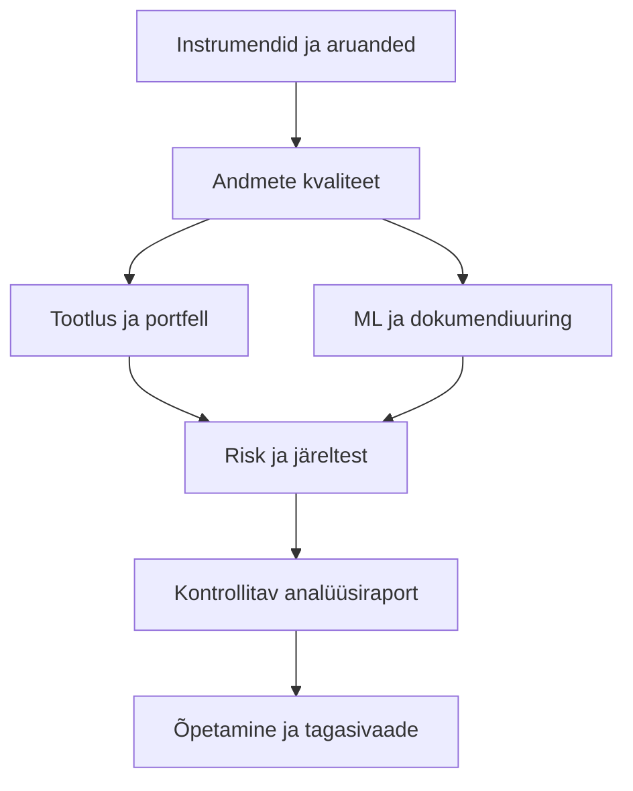

# Õppeprogramm ja raamatu teemakaart

## Eesmärk ja maht

Kursus sobib matemaatika- ja Pythoni kogemusega õppijale. Põhitee: **13 × 90 minutit kontaktõpet + 45,5 tundi iseseisvat tööd + 15 tundi lõpuprojekti = 80 tundi**. Süvaõpe ja pärisandmete kvaliteetne uurimine võivad vajada lisaks 20–40 tundi. Need on 60-minutilised tunnid, mitte akadeemilised tunnid.

Praktiline rütm: 8 nädalat × ligikaudu 10 tundi. Nädalad 1–6: kaks moodulit nädalas; nädal 7: moodul 13 ja projekti arendus; nädal 8: kontroll, raport ja õpetamise proov. Kontaktkohtumine annab sissejuhatuse, mitte kogu teema ammendava omandamise.

## Eelteadmiste kaart

| Eelteadmine | Kus vajalik | Kiirkontroll |
|---|---|---|
| Protsendid ja liitkasv | M1, M4–M7 | Selgita, miks +20% ja −20% annavad −4%. |
| Keskmine, standardhälve, korrelatsioon | M4, M7, M8 | Erista hajuvust ja keskmist. |
| Funktsioon, tsükkel, tingimus | Kõik koodipraktikumid | Kirjuta tootluse funktsioon. |
| pandas indeks, veerg, puuduv väärtus | M3 edasi | Sorteeri kuupäevad ja leia duplikaadid. |
| SQL SELECT, JOIN, GROUP BY | M6, valikuline | Selgita, kuidas mitmene liitmine summat suurendab. |
| Treening, test ja regressioon | Õpitakse M8-s | Vajalikku ML-eelteadmist ei eeldata. |

Kui mõni kiirkontroll ei õnnestu, kuluta enne vastavat moodulit 1–2 tundi kordamisele.

## Raamatu kõigi peatükkide kaart

Leheküljed on trükitud; PDF-i põhiteksti leht on +24. Teemad on kontrollitud sisukorra ja peatükikokkuvõtete järgi, valitud meetodid ka põhitekstist.

| Ptk | Raamatu pealkiri ja lk | Olulised mõisted/oskused | Kursuse koht |
|---|---|---|---|
| 1 | The analytical investor, 1–18 | Varaklassid, eesmärk, kvantitatiivne ja kvalitatiivne uurimine, risk | M1, M13 |
| 2 | Investment essentials, 19–51 | Kasumiaruanne, bilanss, FCF, GICS, kapitalisatsioon, likviidsus, võlg, kasum, hindamine, dividend, omanikud, ESG, välised hinnangud | M2 |
| 3 | Collecting data, 52–77 | Fundamentaal-, hinna- ja muu info; notebooks; yfinance; Finviz, EODHD, Alpha Vantage, OpenBB | M3 |
| 4 | Growth portfolios, 78–104 | Investeerimistees, LiDAR näide, konkurendid, juhtkond, tehnoloogia, partnerid, kasvuprognoos, meedia ja sentiment | M2, M9 |
| 5 | Income portfolios, 105–122 | Dividend, REIT, võlakiri, krüpto staking, varane pension | M5 |
| 6 | Building an asset monitor, 123–142 | Arhitektuur, tabel, maaklerid, rikastamine, valuutad, eri varad | M4, M6 |
| 7 | Risk management, 143–180 | Stop-loss, riskiliigid, VaR, korrelatsioon, psühholoogia, hedging, pair trading, mittefinantsrisk, Markowitz, CAPE, tasakaalustamine | M4, M7; lisalugemine allpool |
| 8 | AI for financial research, 181–215 | K-means, juhendatud õpe, hinnaprognoos, Random Forest, ML-i piirangud, LLM, promptimine | M8, M9 |
| 9 | AI agents, 216–238 | Refleksioon, tööriistad, planeerimine, mitme agendi muster, raamistikuta töövoog, LangChain, RAG, MCP | M9 |
| 10 | Charts and technical analysis, 239–272 | Graafikud, mustrid, küünlad, alternatiivsed graafikud, keskmised, Bollinger, Ichimoku, Streamlit | M10 |
| 11 | Algorithmic trading, 273–296 | Mittefinantsandmed, katalüsaatorid, järeltest, signaalid, börs/maakler, orderid | M11 |
| 12 | Private equity: Investing in start-ups, 297–320 | Rahastusetapid, VC, inglid, riiklikud fondid, DCF, lahjenemine, skoorimine | M12 |
| 13 | The road goes ever on and on, 321–329 | Nõu, uudishimu, eetika, residentsuse teema, kontrollmehhanismid, päevik | M13 |
| Lisa | Setting up the environment, 330–338 | Keskkond, kontod, kood ja väljundid | SEADISTUS.md |

## Pedagoogiline järjekord ja õpitulemused

| Moodul | Kontakt / iseseisev (h) | Valmiv oskus või tulemus |
|---|---:|---|
| M1 Instrumendid | 1,5 / 3,5 | Liigitab instrumendid ja arvutab kogutootluse |
| M2 Aruanded ja kasvutees | 1,5 / 3,5 | Suhtarvud, kontrollitav tees, allikaühikud |
| M3 Andmed | 1,5 / 3,5 | Kontrollitud CSV ja päritolumärge |
| M4 Portfell | 1,5 / 3,5 | Liittootlus, kaalude triiv ja võrdlusbaas |
| M5 Tuluportfell | 1,5 / 3,5 | Võlakirjahind, YTM ja rahavoo risk |
| M6 Varamonitor | 1,5 / 3,5 | Ühtne valuuta ja SQLite-tabel |
| M7 Risk ja tuletisinstrumendid | 1,5 / 3,5 | Drawdown, VaR piirang ja payoff-tabel |
| M8 ML | 1,5 / 3,5 | Ajajaotus, baas, regressioon ja klassifitseerimine |
| M9 LLM ja agent | 1,5 / 3,5 | Tõendiotsing, lubatud tööriistad, kontrollitud väited |
| M10 Tehniline analüüs | 1,5 / 3,5 | Indikaatorite arvutus ja piirangud |
| M11 Järeltest | 1,5 / 3,5 | Signaali ja täitmise eristus; netotulemus |
| M12 Erakapital | 1,5 / 3,5 | Osalus, lahjenemine ja runway |
| M13 Süntees | 1,5 / 3,5 | Põhjendatud raport ja minitund |
| Lõpp-projekt | 0 / 15 | Töötav süsteem, kontrollid ja kaitsmine |

## Seosed

Risk tuleb õppesse enne agressiivset strateegiate häälestamist. Tehniliste indikaatorite ja järeltesti moodulid võib võtta kohe pärast M7; ML ja agent tulevad siis M8–M9-na hiljem. Kõik lõpuprojekti komponendid peavad kasutama sama andmete päritolu ja ajastuse põhimõtet.

## Täiendavad raamatu mõisted, mida põhikursus käsitleb lühidalt

[SELGITUS] **Väärtusinvesteerimine (value investing)** võrdleb hinda põhjendatud väärtushinnanguga. Madal P/E üksi ei ole piisav: odav hind võib peegeldada püsivat äririski. Kasvu- ja väärtusinvesteerimine pole loogilised vastandid; mõlemad vajavad hinna ja tulevaste rahavoogude võrdlust.

[SELGITUS] **Shilleri CAPE** jagab hinna ligikaudu kümne aasta inflatsiooniga korrigeeritud keskmise kasumiga. Kui hind 200 ja võrreldav keskmine reaalkasum 10, CAPE=20. Tegelik rakendus nõuab ühise hinnataseme ning sama indeksimetoodika kasutamist. See pole täpne turu pöördumise kell.

[SELGITUS] **Markowitzi portfell** minimeerib riski etteantud oodatava tootluse juures või vastupidi. `lisapraktikumid.py` joonistab juhukaalude pilve ja leiab selle valimi vähima dispersiooniga portfelli. See ei ole pideva optimeerimisülesande täpne efektiivsuspiir. Minevikukeskmistega optimeerimine võib anda väga ebastabiilse jaotuse.

[SELGITUS] **Riskimaatriks** eristab tõenäosust ja mõju. Geopoliitilise sündmuse „väike tõenäosus × suur mõju” ei muutu väikseks riskiks ainult ühe punktisumma tõttu. Lisa vastumeede, vastutaja ja jälgitav varajane märk.

[SELGITUS] **Riiklik investeerimisfond (sovereign wealth fund)** haldab riigi vara vastavalt mandaadile; eesmärk ei pruugi olla sama mis eraisiku portfellil. **Hedge fund** võib kasutada erinevaid aktiivseid, ka võimendusega strateegiaid; nimetus ei taga riskikaitset.

## Jätkumoodulid, mida see versioon ei esita valminud süvakursusena

1. Optsioonide hinnastamine (Black–Scholes, binoompuu), kreeklaste arvutamine ja optsioonide ajalooliste noteeringutega järeltest.
2. Täielik point-in-time SEC/FRED andmeladu koos avaldamiskellaaegade ja parandustega.
3. Närvivõrgu praktikum ja süsteemne XGBoosti häälestus koos mitme tururežiimi hindamisega.
4. Pärisaruannete suure korpuse RAG koos semantilise otsingu, märgendatud hindamisandmete ja API-integratsioonitestidega.
5. Täielik tootmissüsteem, ajastus, logihaldus, autentimine ja monitooring; samuti Streamliti kasutajaliides.

Põhikursuse 13 moodulit, ülesanded ja offline-projekt on kasutatavad; loetletud jätkumoodulid vajavad eraldi arendamist.
