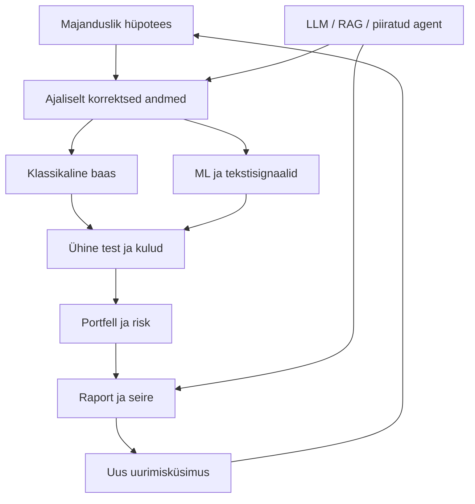

# Raamatu struktuur ja õppekava seos

Aluseks kasutaja lisatud PDF, 827 lehte. PDF-leht on faili füüsiline lehekülg alates ühest; trükitud põhiteksti lehekülg = PDF-leht − 41. Tabelis on peatüki ALGUS, mitte kogu käsitluse ulatus.

| Ptk | Pealkiri | PDF algus | Trükitud algus | Seotud kursuse moodulid |
|---|---|---:|---:|---|
| 1 | The Process Is Your Edge | 42 | 1 | 01, 07, 13 |
| 2 | The Financial Data Universe | 62 | 21 | 06, 10 |
| 3 | Market Microstructure | 88 | 47 | 06, 09 |
| 4 | Fundamental and Alternative Data | 116 | 75 | 05, 06 |
| 5 | Synthetic Financial Data | 138 | 97 | 06, 14 |
| 6 | Strategy Research Framework | 164 | 123 | 07, 12 |
| 7 | Defining the Learning Task | 188 | 147 | 03, 07, 09, 12 |
| 8 | Financial Feature Engineering | 216 | 175 | 02, 03, 05, 10 |
| 9 | Model-Based Feature Extraction | 242 | 201 | 02 |
| 10 | Text Feature Engineering | 268 | 227 | 05, 08 |
| 11 | The ML Pipeline | 292 | 251 | 03 |
| 12 | Advanced Models for Tabular Data | 328 | 287 | 04 |
| 13 | Deep Learning for Time Series | 356 | 315 | 04 |
| 14 | Latent Factor Models | 388 | 347 | 02, 11 |
| 15 | Causal Machine Learning | 422 | 381 | 03, 05, 07, 14 |
| 16 | Strategy Simulation | 452 | 411 | 09, 12 |
| 17 | Portfolio Construction | 488 | 447 | 02, 11 |
| 18 | Transaction Costs | 524 | 483 | 10, 12 |
| 19 | Risk Management | 554 | 513 | 02, 10, 11 |
| 20 | Strategy Synthesis | 582 | 541 | 09, 10, 12 |
| 21 | Reinforcement Learning | 620 | 579 | 09 |
| 22 | RAG for Financial Research | 650 | 609 | 08, 14 |
| 23 | Knowledge Graphs | 676 | 635 | 08 |
| 24 | Autonomous Agents | 700 | 659 | 08, 14, 15 |
| 25 | Live Trading Systems | 736 | 695 | 09, 13 |
| 26 | MLOps and Governance | 764 | 723 | 13, 14, 15 |
| 27 | The Systematic Edge | 786 | 745 | 01, 13, 15 |

## Raamatu analüüsi põhitulemused

[RAAMAT] Kuus osa liiguvad andmetest ja uurimisplaanist tunnuste, mudelite, strateegiate, arenenud AI ning töökindla käitamiseni. Erinevalt ainult algoritmide loetelust küsib raamat läbivalt, millist tõendit tulemus kannab.

[RAAMAT] Ptk 20 (PDF lk 582 jj) koondab üheksa juhtumit: USA ettevõtete karakteristikud; USA aktsiate paneel; ETF-id; CME futuurid; S&P 500 aktsiad koos optsioonianalüütikaga; valuutapaarid; krüpto perpetual'id; S&P 500 optsioonid; NASDAQ-100 mikrostruktuur. Need ei ole ühe universumi ühetaoline mudelite võistlus: horisondid, andmed ja kulud erinevad.

[RAAMAT] USA aktsiapaneeli näites pöördub tugev valideerimistulemus lõppkatses negatiivseks (PDF lk 586, trükitud lk 545). Õppetund ei ole „ML ei tööta”, vaid „valideerimise võit ei garanteeri lõppkatse võitu”. Raamatu juhtumite tootlusi pole õppepaketis sõltumatult reprodutseeritud.

[SELGITUS] Ptk 20 kirjeldab mõne staatilise juhtumi piiranguna kordustreeningu puudumist. Sellest ei järeldu, et sagedam ümbertreenimine oleks kindlasti parem: see on uus hüpotees, millel on oma kulu ja üleõppimisrisk.

[SELGITUS] Raamatu ptk 12 heuristikad mudeli valimiseks ei ole universaalsed võidureeglid. Ptk 22–24 näitavad tõendipõhist analüüsi ja tööriistakasutust; agentne töövoog ei ole iseenesest finantsalfa allikas.

## Soovitatav õppimisjärjekord

Moodulid **1 → 2 → 6 → 5 → 9 → 12 → 3 → 4 → 7 → 10 → 11 → 8 → 14 → 13 → 15 → 16**.

Põhjendus: kõigepealt mõõtmine ja ajastus, seejärel aus baas, alles siis mudelite keerukus ja AI automatiseerimine. Numbriline sisukord järgib tellitud teemade järjestust; õppimise järjekord vähendab eelteadmiste koormust.

## Seoste kaart

Tagasisidering käivitab UUE katse. See ei luba juba nähtud lõppkatset uue sõltumatu tõendina esitada.

## Katvuse piir

Raamat on palju mahukam kui see pedagoogiline juhend. Orderiraamatu rekonstrueerimine, täielik põhjuslik identifitseerimine, sügavad järjestusmudelid, RL ja tootmise maakleriintegratsioon jäävad siin mõistmise ja edasise õppe tasemele. Viimane on teadlikult välistatud kasutaja nõude tõttu kasutada ainult ajaloolisi või simuleeritud tehinguid.
