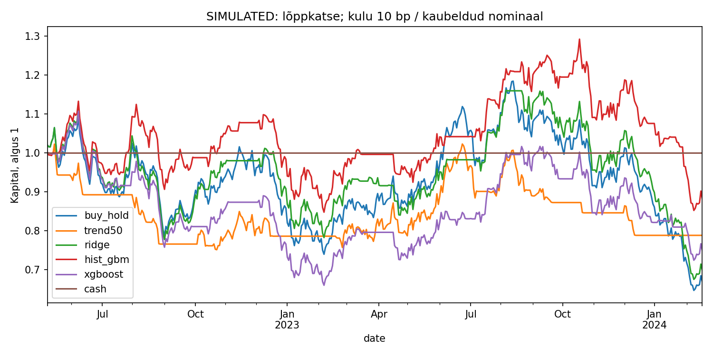
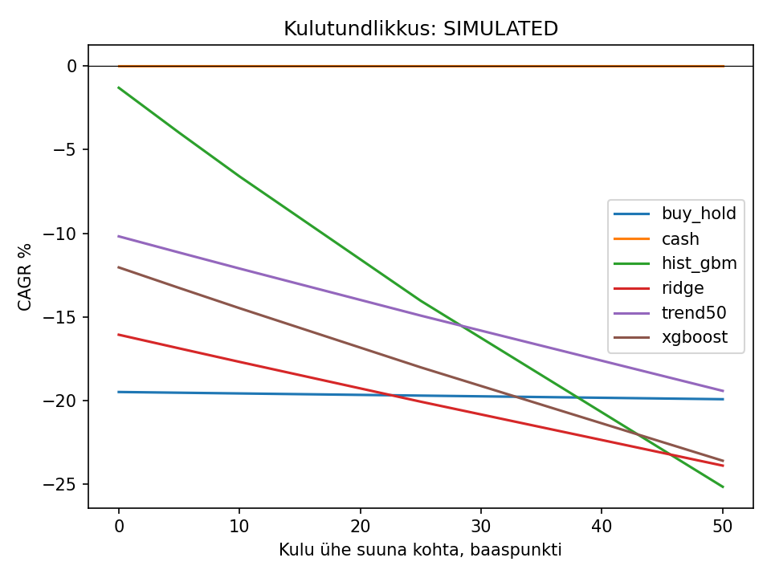

# Kvantitatiivne investeerimine AI ajastul

**Minevik, olevik ja tulevik · eestikeelne praktiline õppepakett · 29.10.2026**

Stefan Janseni *Machine Learning for Trading, Third Edition* (2026) põhjal koostatud iseseisev juhend. Raamatu teksti ei asendata ega kopeerita; sisu, selgitused ja täiendused on märgistatud. [Allikad ja tõendi piirid](ALLIKAD.md).

**Põhisõnum:** AI muutis uurimise kiirust, andmete töötlemist ja automatiseerimise ulatust. Ta ei kaotanud statistikat, tehingukulusid, ebakindlust ega vajadust ausa kontrolli järele.

## Alusta siit

1. Loe [30 põhimõtet ja 20 tööriista](30_POHIMOTET_20_TOORIISTA.md).
2. Vaata [raamatukaarti ja õppimisjärjekorda](RAAMATU_KAART.md).
3. Ava [projekti käivitusjuhend](PROJEKT.md), käivita Thonnys `kood/projekt.py`.
4. Loe [kontrollitud tulemusi ja piiranguid](KONTROLL.md).

| Kiht | Põhiküsimus | Näide | Mida see ei garanteeri |
|---|---|---|---|
| Klassikaline statistika | Kuidas mõõta seost ja riski? | Regressioon, kovariatsioon | Mudelieelduste kehtimine |
| Masinõpe | Kas tunnustest saab ennustada? | Ridge, XGBoost, närvivõrk | Tehingukasum pärast kulusid |
| Generatiivne AI | Kuidas teksti ja uurimistööd töödelda? | LLM, RAG | Faktivigadeta vastused |
| Agent | Milline lubatud samm on järgmisena vajalik? | Tõendi otsing ja kontroll | Vajadus agendi järele ega alfa |

## 16 moodulit

1. [Kvantinvesteerimise ajalugu ja areng](moodulid/01.md)
2. [Klassikaline statistika, faktorid ja portfellid](moodulid/02.md)
3. [Masinõpe aktsiaturu analüüsis](moodulid/03.md)
4. [XGBoost, süvaõpe ja aegridade prognoos](moodulid/04.md)
5. [Fundamentaalse, tehnilise ja kvantanalüüsi ühendamine](moodulid/05.md)
6. [Finantsandmed, alternatiivandmed ja ajaline korrektsus](moodulid/06.md)
7. [AI abil hüpoteeside genereerimine ja kontrollimine](moodulid/07.md)
8. [LLM, RAG, teadmistegraaf ja AI-agent](moodulid/08.md)
9. [Algoritmiline kauplemine ja järeltestimine](moodulid/09.md)
10. [Optsioonid, futuurid, ETF-id ja muud instrumendid](moodulid/10.md)
11. [Portfelli optimeerimine ja riskijuhtimine](moodulid/11.md)
12. [Realistlik hindamine, kulud ja üleõppimine](moodulid/12.md)
13. [Tänapäevase kvandi tööriistad ja tööpäev](moodulid/13.md)
14. [AI eelised, piirangud ja riskid](moodulid/14.md)
15. [Tõenäolised arengud 2027–2030](moodulid/15.md)
16. [Isiklik õppe- ja arenguplaan](moodulid/16.md)

## Lisamaterjalid

- [Õpetaja käsiraamat: 16 × 90 min](opetaja/KASIRAAMAT.md)
- [Töölehed](harjutused/TOOLEHED.md), [lahendused](harjutused/LAHENDUSED.md), [lõputöö ja lõputest](harjutused/LOPUTEST.md)
- [ChatGPT ja Worki promptid](CHATGPT_WORK.md)
- [Valemid ja arvulised kontrollid](VALEMID.md)
- [Mõistete sõnastik](SONASTIK.md)
- [2026 täiendused ja tulevikustsenaariumid](TAIENDUSED_2026.md)
- [Colab 01: analüüsi põhiprojekt](markmikud/01_projekt.ipynb)
- [Colab 02: RAG ja piiratud agent](markmikud/02_rag_agent.ipynb)
- [Colab 03: instrumendid ja aegrida](markmikud/03_instrumendid_aegrida.ipynb)

## Joonised

Graafikud kasutavad paketi fiktiivseid andmeid. Need pole investeerimistulemused ega prognoos USA aktsiaturule. Ajaloolise allalaadimise järel uuesti käivitamine loob vastava andmeversiooni joonised.

## Eelteadmised ja maht

Vajalikud on Pythoni funktsioonid, tabelandmed, protsendid, keskmine ja lihtne algebra. SQL/API testimise kogemus aitab eriti andmete kvaliteedis. Tõenäosus, regressioon ja portfelliarvutused selgitatakse näidetega. Soovitus: 24 nädalat × 10 h, sh 16 kontakttundi × 90 min ning iseseisev töö. Kiire ülevaade: moodulite intuitsioonid, võrdlustabelid ja meelespea.

## GitHub ja Colab

Paki ZIP lahti ning laadi `kvant-ai-ee` kausta **sisu** oma repositooriumi juurkausta. Paljude failide puhul sobib GitHub Desktopi „Add local repository” ja avaldamine või Git CLI. Seda paketti pole automaatselt sinu GitHubi kontole avaldatud.

Colabis vali File → Upload notebook ja ava üks `markmikud` fail. Märkmikud on iseseisvad: nende kood loob oma töökaustad; välise repositooriumi kloonimist pole vaja. Paigalduslahter on valikuline. Ära käivita LLM-i lippudega lahtrit enne, kui oled API-kulu ja andmete saatmisega arvestanud.

## Ulatus

Kaasas on käivitatud sünteetiline põhiprojekt, kohalik tekstiallikate otsing ja instrumendiarvutused. Päris-LLM-i ning Yahoo ühendus on valikuline ja selles keskkonnas kontrollimata. LSTM/transformer, RL ja institutsionaalne täitmisinfrastruktuur on selgitatud, kuid mitte täielikult realiseeritud. Pärisraha tehinguid pole ning maakleri API puudub.
