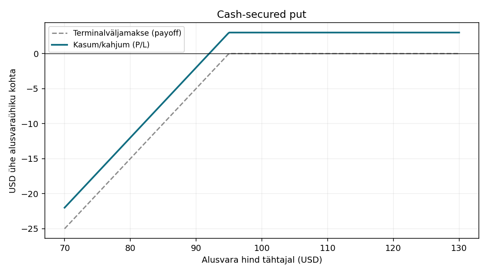

# Cash-secured put

[Atlas](README.md) · [Riskijuhtimine](../05-riskijuhtimine/oppetukk.md)

[RAAMAT] Teemaseos: peatükk 8; kapitalireserv on täiendus; täpsed PDF-vahemikud on [kaardil](../00-oppekava.md). [NÄIDE] Kõik allolevad hinnad ja tulemused on kursuse enda arvutused.

## 1. Koosseis

| Jalg | Kogus | Strike | Preemia ühiku kohta |
|---|---:|---:|---:|
| Müü put | 1 | 95 | 3 |

Algne netoväljaminek koos aktsiatega: **-300,00 USD**; negatiivne number tähendab krediiti.

## 2. Eesmärk ja 3. turuvaade

Sama müüdud put, kuid ostukohustuseks reserveeritakse 9500 USD. Eesmärk on tingimuslik ost koos krediidiga.

## 4. Millal kaaluda ja lihtne analoogia

[ANALOOGIA] Mõtle igast ostetud jalast kui õiguse ostmisest ja müüdud jalast kui võõrale antud valikust. Kogu pakett peab teenima kirjeldatud eesmärki. Piirang: ükski jalg ei tunne teise olemasolu; varajane täitmine võib neid ajaliselt lahutada. Kontrolli enne, kas sama eesmärk on saavutatav lihtsamalt.

## 5. Kasum, 6. kahjum ja 7. tasuvuspiir

- Maksimaalne kasum: **300,00 USD**.
- Maksimaalne kahju: **9200,00 USD**.
- Tasuvuspiir(id) tähtajal: **92,00 USD**.

[MATEMAATIKA] Payoff ühe ühiku kohta: `0 − P(95)`. P/L: `0 − P(95) + 3,00`. Siin C ja P tähendavad lõpptähtaja sisemisi väärtusi, mitte tänaseid preemiaid.

| S tähtajal | Payoff ühiku kohta | P/L ühiku kohta | P/L kogu kombinatsioonile |
|---:|---:|---:|---:|
| 0 | -95,00 | -92,00 | -9200,00 |
| 80 | -15,00 | -12,00 | -1200,00 |
| 90 | -5,00 | -2,00 | -200,00 |
| 95 | 0,00 | 3,00 | 300,00 |
| 100 | 0,00 | 3,00 | 300,00 |
| 105 | 0,00 | 3,00 | 300,00 |
| 110 | 0,00 | 3,00 | 300,00 |
| 120 | 0,00 | 3,00 | 300,00 |
| 130 | 0,00 | 3,00 | 300,00 |

Graafik näitab hinnavahemikku 70–130; tabeli S=0 rida näitab languse äärmust. Piiramatu risk või kasum jätkub graafiku servast edasi.

## 8. Aeg ja volatiilsus

Sama optsioonirisk nagu short put’il; sularaha ei muuda väljamakset. Enne tähtaega tuleb positsiooni väärtus arvutada kõigi jalgade hetkehinnast; terminaltasuvuspiir ei ole kohustuslik tingimus vahepealse kasumi jaoks.

## 9. Riskid ja levinud viga

Raha olemasolu vähendab rahastamisriski, mitte aktsia langusriski. Languse korral ostad endiselt 95-ga. Üldine viga on võrrelda ainult saadud preemiat, jättes tähelepanuta netokapitali ja äärmise stsenaariumi.

## 10. Lihtsam alternatiiv

Ostu limiitorder; see ei maksa preemiat ega loo sama kohustust.

## 11. Selgita algajale ühe minutiga

Alusta eesmärgist: Sama müüdud put, kuid ostukohustuseks reserveeritakse 9500 USD. Eesmärk on tingimuslik ost koos krediidiga. Seejärel loe koosseisust ette, millised õigused ostad ja millised kohustused müüd. Võta tabelist hind 100 ja hind 120 ning näita mõlema jala panust. Ütle eraldi algne rahavoog ja lõpptulemus. Lõpeta piiranguga: Raha olemasolu vähendab rahastamisriski, mitte aktsia langusriski. Languse korral ostad endiselt 95-ga.

## Meelespea

[PÕHIMÕTE] Liida kõik jalad enne hinnangu andmist. Preemia muudab P/L-i, mitte lepingu väljamakse reeglit. Kasumi ülempiir ei ütle midagi kahjumi ülempiiri kohta.

## Kolm küsimust vastustega

1. **Mis on tulemus S=100 korral?** 300,00 USD: asenda S valemis 100-ga ja korruta 100-ga. Viga oleks algne rahavoog unustada.
2. **Mis on tulemus S=120 korral?** 300,00 USD. See kontrollib, kas arvestasid müüdud call’ide kohustust ja võimalikke aktsiaid.
3. **Kas 9200,00 USD tähendab igal hetkel just nii suurt rahavajadust?** Ei. See on terminalmudeli kahjupiir (või piiramatus); tagatis, varajane assignment ja aktsiate üleandmine vajavad eraldi kontrolli.
