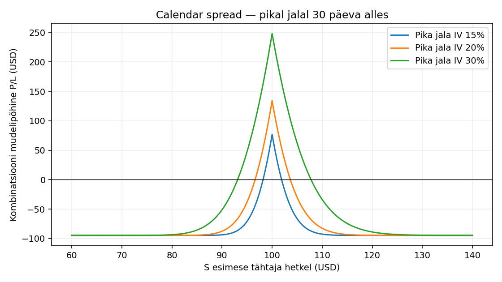
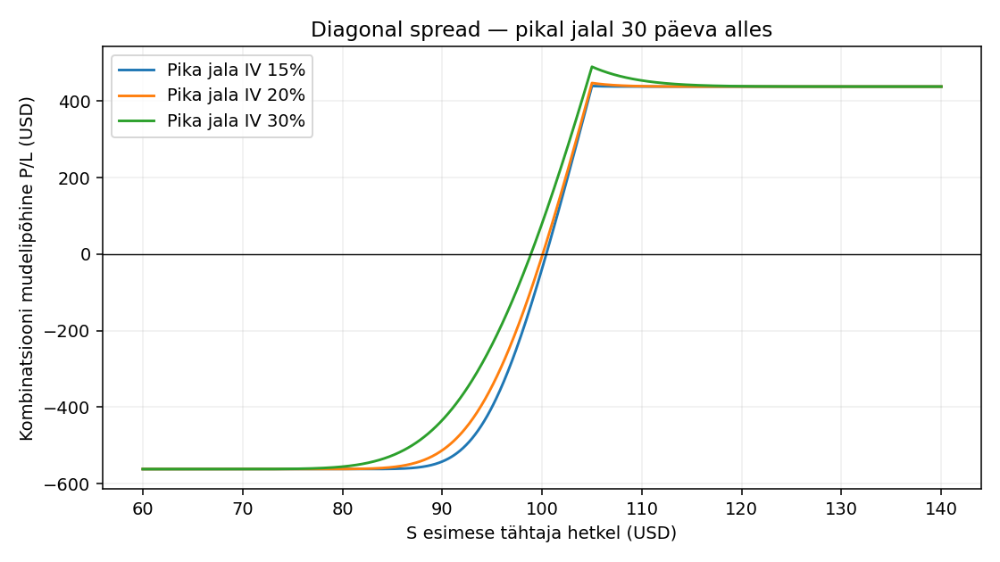

# Calendar ja diagonal spread

[Atlas](README.md)

[RAAMAT] Peatükk 12, PDF 124–134. [TÄIENDUS] Allpool kasutatakse Euroopa optsioone ja Black–Scholesi mudelit, et tähtajad oleksid üheselt eristatavad. Kõik S₀=100, σ=20%, r=q=0, M=100. Müüdud jalg lõpeb 30 päeva ja ostetud jalg 60 päeva pärast. Lühikese jala lõppemisel jääb pikale 30 päeva.

## Calendar spread

### Koosseis ja eesmärk

Osta 60 päeva call K=100, müü 30 päeva call K=100. Algne netodeebet on 0.9469 ühiku kohta ehk 94.69 USD. Eesmärk on hinna püsimine esimese tähtaja juures strike’i lähedal; pikal jalal säilib ajaväärtus.

### Mehhanism ja analoogia

Ostad pikema kasutusaja ja müüd lühema. Võrdlus kahe eri pikkusega broneeringuga aitab mõista ajavahet; piirang on see, et optsiooni hinnad ja täitmisotsused sõltuvad turust, mitte kindlast renditasust.

### Aeg, IV ja risk

Pikk jalg kannab sageli rohkem vegat, kuid lühikese tähtaja IV võib uudise ümber muutuda rohkem. Ära asenda kahte IV-d ühega ilma eeldust märkimata. Netotheta võib soodsas piirkonnas olla positiivne, kuid suure hinnaliikumise korral võib see pöörduda. Ameerika optsioonidel lisandub varajane assignment. Siin kasutatakse Euroopa mudelit; füüsiliselt arveldatud short-jala lõppedes tuleb tekkinud aktsiapositsioon eraldi sulgeda või juhtida.

### P/L esimese tähtaja hetkel

`P/L = C_BSM(S,100,30/365,IV) − max(S−100,0) − 0.946926`. See on **mudelipõhine turuväärtus**, mitte mõlema optsiooni lõplik payoff.

| S 30. päeval | IV 15% | IV 20% | IV 30% |
|---:|---:|---:|---:|
| 80 | -94.69 | -94.69 | -93.55 |
| 90 | -93.74 | -87.63 | -51.24 |
| 95 | -70.83 | -38.02 | 47.47 |
| 100 | 76.85 | 134.02 | 248.32 |
| 105 | -66.47 | -30.20 | 61.95 |
| 110 | -92.59 | -82.65 | -33.82 |
| 120 | -94.69 | -94.57 | -88.93 |

Tabelis on USD kogu kombinatsiooni kohta. Fikseeritud 20% IV korral on mudeli tasuvuspiirid ligikaudu 96.61, 103.64. Vahemikus 60–140 otsitud suurim mudelikasum on 134.02 USD. See ei ole universaalne maksimaalne kasum: teistsugune IV muudab seda.

Antud Euroopa mudelis, r=q=0 ja K_long≤K_short, katab pika call’i väärtus lühikese jala sisemise väärtuse; esimese tähtaja hetkel on seetõttu teoreetiline kahju piiratud algse deebetiga 94.69 USD. Pärast short-jala arveldust allesjäävate positsioonide edasine risk tuleb uuesti arvutada. Tehingukulud ja teostus võivad tulemust halvendada.

### Alternatiiv ja ühe minuti selgitus

Lihtsam alternatiiv on sama tähtajaga vertikaalne spread. Selgita õppijale: kaks lõppkuupäeva tähendab, et esimese lepingu lõppedes pole teise tulemus veel lõplik. Võtame S=100 rea: lühike jalg on kas sisemise väärtusega või väärtusetu, pikk jalg sisaldab veel tuleviku võimalust. Selle hind sõltub allesjäänud IV-st. Seetõttu ei saa kalendrile joonistada üht universaalset lõpptähtaja telki nagu butterfly’le.

### Põhimõtted ja kolm küsimust

[PÕHIMÕTE] Kaks tähtaega vajavad kahte ajavaadet. Järelejäänud ajaväärtus on hind, mitte kindel rahalaekumine. Positiivne theta ei välista hinnariski.

1. **Kas tabel on garanteeritud tulemus?** Ei, pika jala hind on mudelihinnang fikseeritud IV korral.
2. **Miks on tasuvuspiirid ligikaudsed?** Need lahendavad mudeli P/L=0 antud IV ja kuupäeva korral; IV muutudes liiguvad.
3. **Kas pärast 30. päeva on kogu tehing läbi?** Ei, pikk jalg ja võimaliku assignment’i aktsiapositsioon vajavad uut otsust.

## Diagonal spread

### Koosseis ja eesmärk

Osta 60 päeva call K=95, müü 30 päeva call K=105. Algne netodeebet on 5.6184 ühiku kohta ehk 561.84 USD. Erinevad strike’id lisavad suunavaate. Siin on pikem call madalama strike’iga; mõõdukas tõus võib olla kasulik, kuid mõju sõltub IV-st ja ajast.

### Mehhanism ja analoogia

Ostad pikema kasutusaja ja müüd lühema. Võrdlus kahe eri pikkusega broneeringuga aitab mõista ajavahet; piirang on see, et optsiooni hinnad ja täitmisotsused sõltuvad turust, mitte kindlast renditasust.

### Aeg, IV ja risk

Pikk jalg kannab sageli rohkem vegat, kuid lühikese tähtaja IV võib uudise ümber muutuda rohkem. Ära asenda kahte IV-d ühega ilma eeldust märkimata. Netotheta võib soodsas piirkonnas olla positiivne, kuid suure hinnaliikumise korral võib see pöörduda. Ameerika optsioonidel lisandub varajane assignment. Siin kasutatakse Euroopa mudelit; füüsiliselt arveldatud short-jala lõppedes tuleb tekkinud aktsiapositsioon eraldi sulgeda või juhtida.

### P/L esimese tähtaja hetkel

`P/L = C_BSM(S,95,30/365,IV) − max(S−105,0) − 5.618449`. See on **mudelipõhine turuväärtus**, mitte mõlema optsiooni lõplik payoff.

| S 30. päeval | IV 15% | IV 20% | IV 30% |
|---:|---:|---:|---:|
| 80 | -561.84 | -561.65 | -555.45 |
| 90 | -542.04 | -512.67 | -433.91 |
| 95 | -398.88 | -344.57 | -235.98 |
| 100 | -37.98 | -5.17 | 80.32 |
| 105 | 439.61 | 447.52 | 490.02 |
| 110 | 438.19 | 439.14 | 454.05 |
| 120 | 438.16 | 438.16 | 439.08 |

Tabelis on USD kogu kombinatsiooni kohta. Fikseeritud 20% IV korral on mudeli tasuvuspiirid ligikaudu 100.06. Vahemikus 60–140 otsitud suurim mudelikasum on 447.52 USD. See ei ole universaalne maksimaalne kasum: teistsugune IV muudab seda.

Antud Euroopa mudelis, r=q=0 ja K_long≤K_short, katab pika call’i väärtus lühikese jala sisemise väärtuse; esimese tähtaja hetkel on seetõttu teoreetiline kahju piiratud algse deebetiga 561.84 USD. Pärast short-jala arveldust allesjäävate positsioonide edasine risk tuleb uuesti arvutada. Tehingukulud ja teostus võivad tulemust halvendada.

### Alternatiiv ja ühe minuti selgitus

Lihtsam alternatiiv on sama tähtajaga vertikaalne spread. Selgita õppijale: kaks lõppkuupäeva tähendab, et esimese lepingu lõppedes pole teise tulemus veel lõplik. Võtame S=100 rea: lühike jalg on kas sisemise väärtusega või väärtusetu, pikk jalg sisaldab veel tuleviku võimalust. Selle hind sõltub allesjäänud IV-st. Seetõttu ei saa kalendrile joonistada üht universaalset lõpptähtaja telki nagu butterfly’le.

### Põhimõtted ja kolm küsimust

[PÕHIMÕTE] Kaks tähtaega vajavad kahte ajavaadet. Järelejäänud ajaväärtus on hind, mitte kindel rahalaekumine. Positiivne theta ei välista hinnariski.

1. **Kas tabel on garanteeritud tulemus?** Ei, pika jala hind on mudelihinnang fikseeritud IV korral.
2. **Miks on tasuvuspiirid ligikaudsed?** Need lahendavad mudeli P/L=0 antud IV ja kuupäeva korral; IV muutudes liiguvad.
3. **Kas pärast 30. päeva on kogu tehing läbi?** Ei, pikk jalg ja võimaliku assignment’i aktsiapositsioon vajavad uut otsust.
