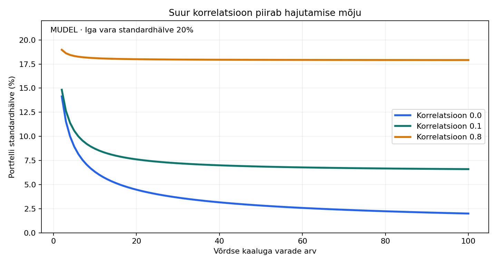

# Labor 2. Hajutamine korrelatsioonistressis

[Õppekava](../00-oppekava.md) · [Kood](../python/02_hajutamine.py) · [Tulemused](../tulemused/02.json) · [Lahendused](lahendused.md)

## Sisukord

- [Kiirtase](#kiirtase)
- [Tuletus](#tuletus)
- [Arvutuskatse](#arvutuskatse)
- [Piirangud ja pärisandmete plaan](#piirangud-ja-pärisandmete-plaan)
- [Harjutused ja väitlus](#harjutused-ja-väitlus)

## Kiirtase

**[ANALÜÜS] Portfelli nimede arv ei ütle, kui palju sõltumatut riski portfellis on.**

Õpieesmärk: oskad tuletada võrdsete kaaludega portfelli standardhälbe, lahutada korrelatsiooni ja volatiilsuse mõju ning selgitada hajutamise jääkriski.

[SCHWAGER] Peatükk 9 käsitleb korrelatsiooni tõlgendamist, 17–18 hajutamise kasu ja piiranguid ning 21 portfelli koostamist. [PAPP] Peatüki 7 korrelatsiooni- ja optimeerimisnäited annavad arvutusliku lähtekoha.

[NÄIDE] Kümme ettevõtet võivad kuuluda eri sektoritesse, aga sõltuda samast rahastamisolukorrast. Nimetuste erinevus ei kõrvalda ühist riskitegurit.

## Tuletus

Kahe vara korral:

$$\sigma_p^2=w_1^2\sigma_1^2+w_2^2\sigma_2^2+2w_1w_2\rho\sigma_1\sigma_2.$$

[MUDEL] Olgu $n$ vara võrdse kaaluga $1/n$, iga vara tootluse standardhälve $\sigma$ ning kõigi erinevate varapaaride korrelatsioon $\rho$. Siis on dispersioonide summas $n$ diagonaalliiget ja $n(n-1)$ kovariatsiooniliiget:

$$\sigma_p^2=\frac{n\sigma^2+n(n-1)\rho\sigma^2}{n^2}
=\sigma^2\left(\rho+\frac{1-\rho}{n}\right).$$

Standardhälve on dispersiooni ruutjuur. Kui $\rho\ge0$, siis fikseeritud korrelatsiooni korral:

$$\lim_{n\to\infty}\sigma_p=\sigma\sqrt{\rho}.$$

Ühine risk ei kao lõpmatu arvu nimedega. Samas ei tähenda $\rho=0$ statistilist sõltumatust üldise jaotuse korral: nullkorrelatsioon välistab lineaarse seose, mitte iga sõltuvuse.

Võrdsete korrelatsioonide maatriks on lubatav üksnes siis, kui $-1/(n-1)\le\rho\le1$. Seda kontrollib ka skript. Negatiivset korrelatsiooni ei saa hoida suvaliselt suure varade arvu juures muutumatuna.

## Arvutuskatse

Võtame 10 vara. Standardhälbed on aastase tootluse stsenaariumiparameetrid; päevaseid kriisiandmeid pole siin aastaseks teisendatud.

| Stsenaarium | Iga vara standardhälve | Kõigi paaride korrelatsioon | Portfelli standardhälve |
|---|---:|---:|---:|
| Rahulik mudel | 20% | 0.10 | 8.72% |
| Ainult korrelatsiooni stress | 20% | 0.80 | 18.11% |
| Korrelatsiooni ja volatiilsuse stress | 40% | 0.80 | 36.22% |

Esimese ja teise rea erinevus tuleb ainult korrelatsioonist. Kolmanda rea lisakasv tuleb üksikvarade standardhälbe kahekordistamisest. See on kontrollitud stsenaariumianalüüs, mitte empiiriline tõend, et kriisis muutub korrelatsioon alati 0.80-ks.

Kolmandas reas vähendab hajutamine endiselt standardhälvet võrreldes ühe 40% standardhälbega varaga. Väide „hajutamine enam ei tööta” oleks siin liiga tugev. Täpsem on öelda, et selle mõju on väiksem ja portfelli absoluutne risk suurem.

## Piirangud ja pärisandmete plaan

Valem kirjeldab tootluse dispersiooni kindlate kaalude ning kovariatsioonide korral. See ei kirjelda maksimaalset võimalikku kahju, marginaalinõuet, turu likviidsust ega kõiki sabasõltuvuse vorme. Kui kaalud aja jooksul triivivad, ei saa ühte fikseeritud kaaludega valemit ilma täpsustuseta kogu hinnateekonnale rakendada.

**Empiiriline uuring tuleks korraldada nii:**

1. Vali varaklassid ja nende investeeritavad esindajad enne tulemusi. Dokumenteeri fondide algusajad, valuuta ja kogutootluse andmed.
2. Määra rahulikud ja stressiperioodid välise sündmuse või eelnevalt määratud reegli järgi. Ära vali aknaid selle järgi, kus joonis kõige mõjusam paistab.
3. Võrdle nii korrelatsiooni, kovariatsiooni kui ka üksikvarade standardhälbeid. Kasuta samu vaatluspäevi.
4. Näita ka portfelli tegelikke kumulatiivseid kahjusid ja taastumist, mitte ainult korrelatsioonitabelit.
5. Kontrolli tulemuse tundlikkust akna pikkuse ja varade valiku suhtes.
6. Kui uurid ainult turu languspäevi, kirjelda tingimuslikku valimit. Selline filtreerimine ise muudab sõltuvusstruktuuri tõlgendust; see pole sama mis ette määratud kriisiperioodi analüüs.

Lühikese kriisiakna hinnangud on mürased. Ajalooline korrelatsioon ei ole tulevase korrelatsiooni garantii. Selles versioonis ei ole tehtud 2008., 2020. ega 2022. aasta empiirilist kordusuuringut.

## Harjutused ja väitlus

1. Leia 10 vara portfelli standardhälve, kui $\rho=0$ ja $\sigma=20\%$.
2. Leia riskipiir lõpmata paljude varade korral, kui $\rho=0.10$ ning $\sigma=20\%$.
3. Kas 100 vara ning $\rho=0.80$ annavad väiksema standardhälbe kui 10 vara ning $\rho=0.10$, kui üksikvarade standardhälve on sama?
4. Selgita, miks riskimõõdiku halvenemine ei tõesta hajutamise täielikku kasutust.

**Väitlusküsimus:** „Kriisis langeb kõik koos, seega pole hajutamisest kasu.” Poolt: ühised šokid võivad vähendada tavaliselt nähtavat kaitset. Vastu: ka kõrge korrelatsiooni korral võib hajutamine riski vähendada ning kõik varapaarid ei pea käituma ühtemoodi. Loogikaviga on osalise mõju vähenemise samastamine mõju puudumisega.

**Foorumivastus:** „Hajutamise kasu sõltub varade koosliikumisest. Stressis võib kaitse nõrgeneda, kuid selle hindamiseks tuleb vaadata korrelatsiooni kõrval ka üksikvarade riski ja portfelli tegelikku kahju.”
