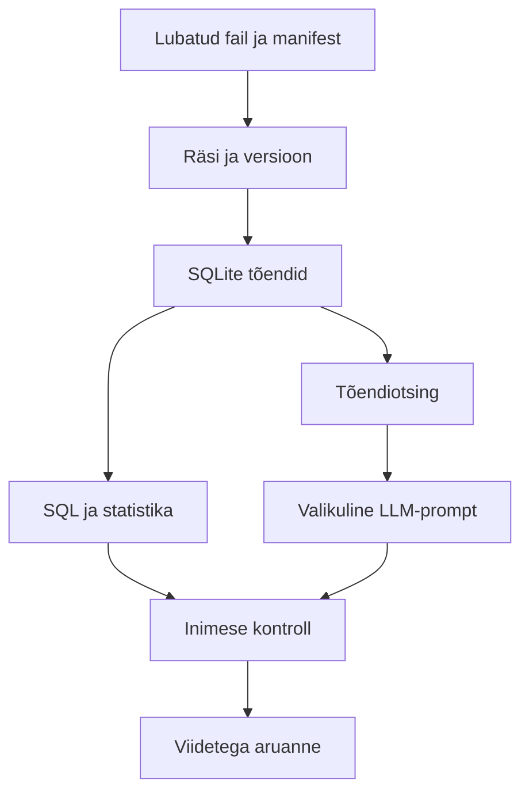

# Eesti OSINT-analüütiku viis tööpäeva AI ajastul — tervikõpik

Ühendatud lugemisversioon. Käivitusjuhend ja eraldi moodulid on README.md failis.


---

# Raamatu struktuur ja kasutuskaart

[RAAMAT] Michael Bazzell ja Jason Edison, *OSINT Techniques: Resources for Uncovering Online Information*, 11. trükk, november 2024. Üleslaaditud failis on 47 peatükki. Leheküljenumbrid allpool pärinevad sisukorrast; kontrollitud valikutes langevad trüki- ja PDF-lehekülg kokku. Raamatu teksti ega tööriistakogu ei levitata projektiga.

Analüüsimeetod: kogu faili tekst eraldati; kaardistati kõik peatükid ning loeti sihipäraselt uurimistööks asjakohaseid osi, eriti 12, 17–22, 27–30, 34 ja 44–47. See ei ole kõigi raamatu käskude ega veebivõtete läbiproovimine. Raamatu 2024. aasta teenusejuhiseid ei käsitleta 2026. aastal kontrollimata kehtivana.

Märgised: **[RAAMAT]** tähistab raamatu teemakokkuvõtet, **[SELGITUS]** autori koostatud selgitust, **[NÄIDE]** sünteetilist juhtumit, **[TÄIENDUS]** Eesti, SQL-i, statistika, ML-i ja RAG-i osa, mida ei omistata raamatule.

| Peatükk | Pealkiri | Algus lk | Rakendus õppeprojektis |
|---|---|---:|---|
| 1 | WHY VIRTUAL MACHINES? | 9 | Moodulid 2–5: keskkond, skriptid, API; minimaalne kohandus |
| 2 | MACOS HOST OPTIMIZATION | 11 | Moodulid 2–5: keskkond, skriptid, API; minimaalne kohandus |
| 3 | MACOS VM SOFTWARE | 22 | Moodulid 2–5: keskkond, skriptid, API; minimaalne kohandus |
| 4 | LINUX HOST OPTIMIZATION | 27 | Moodulid 2–5: keskkond, skriptid, API; minimaalne kohandus |
| 5 | LINUX VM SOFTWARE | 31 | Moodulid 2–5: keskkond, skriptid, API; minimaalne kohandus |
| 6 | WINDOWS HOST OPTIMIZATION | 38 | Moodulid 2–5: keskkond, skriptid, API; minimaalne kohandus |
| 7 | WINDOWS VM SOFTWARE | 42 | Moodulid 2–5: keskkond, skriptid, API; minimaalne kohandus |
| 8 | OSINT VM OPERATING SYSTEMS | 49 | Moodulid 2–5: keskkond, skriptid, API; minimaalne kohandus |
| 9 | OSINT VM WEB BROWSERS | 64 | Moodulid 2–5: keskkond, skriptid, API; minimaalne kohandus |
| 10 | OSINT VM APPLICATIONS | 85 | Moodulid 2–5: keskkond, skriptid, API; minimaalne kohandus |
| 11 | OSINT VM SCRIPTS | 136 | Moodulid 2–5: keskkond, skriptid, API; minimaalne kohandus |
| 12 | OSINT VM APIS | 148 | Moodulid 2–5: keskkond, skriptid, API; minimaalne kohandus |
| 13 | OSINT VM MAINTENANCE | 159 | Moodulid 2–5: keskkond, skriptid, API; minimaalne kohandus |
| 14 | OSINT VM AUTOMATED BUILD | 162 | Moodulid 2–5: keskkond, skriptid, API; minimaalne kohandus |
| 15 | ANDROID VIRTUALIZATION | 163 | Taust; Androidi virtualiseerimist pole juhtumile vaja |
| 16 | CUSTOM SEARCH TOOLS | 175 | Moodulid 1 ja 3: küsimusest otsinguplaanini |
| 17 | SEARCH ENGINES | 186 | Moodulid 1 ja 3: küsimusest otsinguplaanini |
| 18 | SOCIAL NETWORKS: FACEBOOK | 212 | Moodulid 9–11: avalikud projektikanalid; isikupõhiseid võtteid ei rakendata |
| 19 | SOCIAL NETWORKS: X (TWITTER) | 228 | Moodulid 9–11: avalikud projektikanalid; isikupõhiseid võtteid ei rakendata |
| 20 | SOCIAL NETWORKS: INSTAGRAM | 243 | Moodulid 9–11: avalikud projektikanalid; isikupõhiseid võtteid ei rakendata |
| 21 | SOCIAL NETWORKS: TIKTOK | 254 | Moodulid 9–11: avalikud projektikanalid; isikupõhiseid võtteid ei rakendata |
| 22 | ONLINE COMMUNITIES | 259 | Moodulid 9–11: avalikud projektikanalid; isikupõhiseid võtteid ei rakendata |
| 23 | EMAIL ADDRESSES | 292 | Teadlikult välja jäetud: isikuotsing ja identiteedi rikastamine ei kuulu ulatusse |
| 24 | USERNAMES | 303 | Teadlikult välja jäetud: isikuotsing ja identiteedi rikastamine ei kuulu ulatusse |
| 25 | PEOPLE SEARCH ENGINES | 309 | Teadlikult välja jäetud: isikuotsing ja identiteedi rikastamine ei kuulu ulatusse |
| 26 | TELEPHONE NUMBERS | 320 | Teadlikult välja jäetud: isikuotsing ja identiteedi rikastamine ei kuulu ulatusse |
| 27 | ONLINE MAPS | 329 | Moodulid 4 ja 12: dokumendid, pildid, aeg ja ruum |
| 28 | DOCUMENTS | 345 | Moodulid 4 ja 12: dokumendid, pildid, aeg ja ruum |
| 29 | IMAGES | 355 | Moodulid 4 ja 12: dokumendid, pildid, aeg ja ruum |
| 30 | VIDEOS | 372 | Moodulid 4 ja 12: dokumendid, pildid, aeg ja ruum |
| 31 | BROADCAST STREAMS | 384 | Taust; infrastruktuuri või isikute jälitamine pole vajalik |
| 32 | DOMAIN NAMES | 396 | Taust; infrastruktuuri või isikute jälitamine pole vajalik |
| 33 | IP ADDRESSES | 416 | Taust; infrastruktuuri või isikute jälitamine pole vajalik |
| 34 | GOVERNMENT & BUSINESS RECORDS | 424 | Moodulid 3, 6–8: Eesti registrite kohandus |
| 35 | VIRTUAL CURRENCIES | 433 | Välja jäetud: krüptouurimine, lekked, varastatud logid ja lunavara |
| 36 | BREACHES: INVESTIGATIVE BENEFITS | 438 | Välja jäetud: krüptouurimine, lekked, varastatud logid ja lunavara |
| 37 | BREACHES: HARDWARE CONFIGURATION | 440 | Välja jäetud: krüptouurimine, lekked, varastatud logid ja lunavara |
| 38 | BREACHES: SOFTWARE CONFIGURATION | 445 | Välja jäetud: krüptouurimine, lekked, varastatud logid ja lunavara |
| 39 | BREACHES: TERMINAL COMMANDS | 459 | Välja jäetud: krüptouurimine, lekked, varastatud logid ja lunavara |
| 40 | DATA LEAKS | 471 | Välja jäetud: krüptouurimine, lekked, varastatud logid ja lunavara |
| 41 | DATA BREACHES | 495 | Välja jäetud: krüptouurimine, lekked, varastatud logid ja lunavara |
| 42 | STEALER LOGS | 518 | Välja jäetud: krüptouurimine, lekked, varastatud logid ja lunavara |
| 43 | RANSOMWARE | 534 | Välja jäetud: krüptouurimine, lekked, varastatud logid ja lunavara |
| 44 | QUERIES, SCRIPTS, DATABASES, & BACKUPS | 539 | Moodulid 2 ja 7: ainult üldine korrastamise/varundamise idee; lekkeandmeid ei kasutata |
| 45 | METHODOLOGY & WORKFLOW | 561 | Moodulid 1, 3 ja 19: infovajadus, töövoog, kontrollpunktid |
| 46 | DOCUMENTATION & REPORTING | 572 | Moodulid 4, 12, 15 ja 19: tõendid, ajajoon, seosed, raport |
| 47 | POLICY, ETHICS, & DEVELOPMENT | 582 | Moodulid 1, 3 ja 20: eetika ja ulatus; Eesti õiguse eraldi kontroll |

## Põhisüntees

[RAAMAT] Peatükk 45 alustab ülesande ja infovajaduse täpsustamisest ning käsitleb korratavat uurimistöövoogu. Peatükk 46 seob uurimismärkmed, seosejoonised, ajajoone ja tõendilisad aruandega. Peatükk 47 rõhutab uurimisulatuse ja organisatsiooni reeglite sõnastamist. Need on projekti metoodiline selgroog.

[SELGITUS] Raamatu USA õiguskaitse näiteid, isikuotsinguid ega autorite õiguslikke hinnanguid ei kanta automaatselt Eesti konteksti. Avalikult tehniliselt kättesaadav materjal ei tähenda piiramatut taaskasutusõigust. Siin uuritakse fiktiivse avaliku projekti dokumente ja väiteid.

[TÄIENDUS] SQLite versioonitud tõenditabel, hinnavõrdlused, sünteetiline ML-korpus, leksikaalne RAG ja õpetamise raamistik on selle projekti jaoks loodud. Raamat ei ole nende algoritmide ega Eesti teenuste dokumentatsioon.


---

# Eesti OSINT-allikate kataloog

Koostatud ja valitud allikate dokumentatsioon kontrollitud **30.10.2026**. 40 kirjet; **esimesed 15 on esmased**. Kataloog eristab päriselt kontrollitud kirjeldusi, ebaõnnestunud avamisi ja veel kinnitamata lisakanaleid. See ei ole väide, et 40 liidest on tehniliselt läbi testitud.

**A** = dokumenteeritud ametlik API; **D** = avaldatud failid või dokumentide allalaadimine; **M** = käsitsi uuritav kanal; **P** = konto, leping, tasu, juurdepääsupiirang või osaliselt piiratud sisu. Sama teenuse eri osadel võivad olla eri reeglid. D ei tähenda automaatselt hulgiallalaadimise või edasilevitamise õigust. Puuduv A ei tähenda, et API-d kindlasti ei eksisteeri: selle kasutust pole siin kinnitatud.

Valikupõhimõte: esmased 15 katavad organisatsiooni, otsuse, hinna, loa, ruumi, rahastuse, meediaväite ja sõltumatu kontrolli. RIKi otsing ja avaandmed on eraldi töökanalid samas teenuses; KOV ja piirkondlik meedia on konkreetsed näited, mida asendada uuritava piirkonna kanaliga. 40 kirje hulgas on ka rahvusvahelisi platvorme, mille Eesti avalikku sisu saab uurida.

| Nr | Allikas | Ligipääs | Kasutus | Kontrolliallikas | Staatus/piirang |
|---|---|---|---|---|---|
| 1 ★ | [e-äriregistri avalik otsing](https://ariregister.rik.ee/) | M/P | Organisatsiooni registritunnus ja staatus | S1 | Ametlik juhend kontrollitud; portaalis dokumentide tingimused eraldi |
| 2 ★ | [e-äriregistri avaandmed ja API](https://avaandmed.ariregister.rik.ee/et/avaandmete-allalaadimine) | D/A/P | Organisatsioonide andmefailid; XML API eraldi lepingu alusel | S1,S2 | Dokumentatsioon kontrollitud; kasusaajad pole avaandmed alates 10.07.2026 |
| 3 ★ | [Riigihangete register](https://riigihanked.riik.ee/) | M/D | Hange, leping, muudatus, vaidlustus | S3,S4 | Juhend kontrollitud; veebiliidese automatiseerimiseks ei anta siin luba |
| 4 ★ | [Statistikaamet PxWeb](https://andmed.stat.ee/) | A/D/M | Hinnaindeksid ja piirkondlik taust | S5 | API dokumentatsioon kontrollitud; valikulise GETi tulemus testiraportis |
| 5 ★ | [Maa- ja Ruumiameti geoportaal](https://geoportaal.maaamet.ee/) | A/D/M | Kaardikihid ja ajaloolised ortofotod | S6 | WMS/WFS juhend kontrollitud; viita kihile ja ajale |
| 6 ★ | [PLANIS planeeringute infosüsteem](https://planeerimine.ee/digi/menetluse-infosysteem/) | M/A | Planeeringud, menetlus, WMS/WFS | S7 | Ametlik üleminekujuhis kontrollitud; PLANKi asemel PLANIS |
| 7 ★ | [Ehitisregister](https://www.ehr.ee/) | M/P | Ehitusload ja ehitise andmed | S8 | Ametlik kirjeldus kontrollitud; portaal tööriistaga ei avanenud; API kasutus ei kinnitatud |
| 8 ★ | [KOTKAS](https://kotkas.envir.ee/) | M/P | Keskkonnaload ja avalikud menetlusdokumendid | S9 | Ametlik kirjeldus kontrollitud; portaali otseavamisel 403 |
| 9 ★ | [Riigi Teataja](https://www.riigiteataja.ee/) | M/D | Kehtiv õigus ja kohalikud määrused | S10 | Avaleht nõuab JavaScripti; vali kehtiv redaktsioon käsitsi |
| 10 ★ | [Ametlikud Teadaanded](https://www.ametlikudteadaanded.ee/) | M/P | Planeeringu- ja menetlusteated | S11 | RIKi ametlik kirjeldus kontrollitud; arhiveeritud teatel võivad olla piirangud |
| 11 ★ | [KOV ametlik veeb ja dokumendiregister: Tartu näide](https://tartu.ee/) | M/D | Volikogu otsus, eelarve, protokoll | S12 | Avaleht ja planeeringute viide kontrollitud; konkreetne register valida KOV järgi |
| 12 ★ | [RTK toetatud projektid](https://rtk.ee/toetuste-ulevaated-oigusaktid/ulevaade-toetatud-projektidest/toetatud-projektid) | D/M | Toetuse otsused ja projektide tabelid | S13 | Ametlik tabelite leht kontrollitud; otsus ei ole väljamakse |
| 13 ★ | [ERR](https://www.err.ee/) | M | Avalikud uudised ja parandused | S14 | Avaleht kontrollitud; täisteksti masskogumine ei kuulu projekti |
| 14 ★ | [Riigikontroll](https://www.riigikontroll.ee/) | M/D | Auditiaruanded ja metoodiline taust | S15 | Ametlik aruannete leht kontrollitud |
| 15 ★ | [Andmete teabevärav](https://andmed.eesti.ee/) | M/D | Andmestike ja litsentside leidmine | S16 | Portaal avanes tekstita; konkreetse andmestiku tingimusi kontrollida eraldi |
| 16 | [e-kinnistusraamat](https://www.rik.ee/et/e-kinnistusraamat/e-kinnistusraamat) | P/M | Projektiala kinnistu õiguste kontroll vajadusel | S17 | Ametlik kirjeldus kontrollitud; tasu ja ligipääsu alus |
| 17 | [AKI juhised](https://www.aki.ee/teabe-avalikkus/teabe-valdajale/avaliku-teabe-taaskasutamine-avaandmed) | M | Avaliku teabe ja isikuandmete taaskasutuse piirid | S18 | Ametlik juhend kontrollitud |
| 18 | [Eesti Pank](https://www.eestipank.ee/) | M/D | Majanduslik taust ja analüüsid | S19 | Avaleht kontrollitud; konkreetne statistikatabel valida eraldi |
| 19 | [Keskkonnaportaal](https://keskkonnaportaal.ee/) | M/D | Keskkonnaandmete leidmine | - | Otseavamine ebaõnnestus 502; ligipääsu ja failide tingimusi kontrollida |
| 20 | [Kultuurimälestiste register](https://register.muinas.ee/) | M/P | Muinsuskaitse tingimuste lähtekoht | - | Otseavamine andis 403; kasutaja peab ametlikus veebis kontrollima |
| 21 | [Rahvusarhiiv](https://www.ra.ee/) | M/P | Projektiala ajaloolised dokumendid | - | Otseavamisel ajalimiit; digikoopia ja juurdepääsu tingimused eraldi |
| 22 | [DIGAR](https://www.digar.ee/) | M/P | Ajaloolised väljaanded ja ajalehed | - | Otseavamisel 403; autoriõigus ja kohalkasutuse piirangud kontrollida |
| 23 | [TED Euroopa hanketeated](https://ted.europa.eu/) | M/D | Eesti rahvusvahelise piirmääraga hanked | S3 | RHR ametlik juhend kinnitab teadete saatmist; otsene API selles projektis testimata |
| 24 | [Postimees](https://www.postimees.ee/) | M/P | Uudised, algväited ja parandused | - | Kataloogikandidaat; konkreetse lehe juurdepääs ja taaskasutus kontrollimata |
| 25 | [Tartu Postimees](https://tartu.postimees.ee/) | M/P | Kohaliku arendusprojekti kajastus | - | Kataloogikandidaat; tasuline sisu ainult lubatud ligipääsuga |
| 26 | [Delfi](https://www.delfi.ee/) | M/P | Uudised, faktikontroll ja avalik debatt | - | Kataloogikandidaat; täistekstide kogumise tingimused kontrollida |
| 27 | [Äripäev](https://www.aripaev.ee/) | M/P | Äri- ja ehitusvaldkonna kajastus | - | Kataloogikandidaat; tellimus ei tähenda masskopeerimise luba |
| 28 | [Facebooki avalikud projektilehed](https://www.facebook.com/) | M/P | Avalikud ametlikud projektiteated | - | Käsitsi; nähtavus ja tingimused kontrollida konkreetsel lehel |
| 29 | [Instagrami avalikud projektikanalid](https://www.instagram.com/) | M/P | Projektifotod ja avalikud teated | - | Käsitsi; ei koguta jälgijaid ega autoriprofiile |
| 30 | [TikToki avalikud projektivideod](https://www.tiktok.com/) | M/P | Avalikud videoväited ja nende päritolu | - | Käsitsi; ilma juurdepääsutõketest möödumiseta |
| 31 | [YouTube ametlikud KOV kanalid](https://www.youtube.com/) | M/P | Volikogu istungite ja arutelude salvestised | - | Kataloogikandidaat; kanali ametlikkus ja video tingimused eraldi |
| 32 | [X avalikud asutuste teated](https://x.com/) | M/P | Avalik kommunikatsioon ja viited | - | API-d ei eeldata tasuta ega lubatuks; ainult käsitsi hinnatud avalik sisu |
| 33 | [Hinnavaatluse foorum](https://foorum.hinnavaatlus.ee/) | M/P | Tehniliste väidete ja aruteluteemade avastamine | - | Kataloogikandidaat; foorum ei ole registriandmete asendus |
| 34 | [Ehitusfoorum](https://www.ehitusfoorum.com/) | M/P | Ehitusväidete ja terminite arutelu | - | Kataloogikandidaat; arvamused kontrollida tehniliste algallikatega |
| 35 | [Reddit r/Eesti](https://www.reddit.com/r/Eesti/) | M/P | Eesti avaliku debati teemad | - | Kataloogikandidaat; valikukallutatus, ei profileerita kasutajaid |
| 36 | [Tallinna ametlik veeb](https://www.tallinn.ee/) | M/D | Võrdlusprojekti eelarve ja menetlus | - | Kataloogikandidaat; iga dokumendiregistri piirang eraldi |
| 37 | [Transpordiamet](https://www.transpordiamet.ee/) | M/D | Taristuprojektide ja liiklusmõju taust | - | Kataloogikandidaat; allalaaditav fail kinnitada enne importi |
| 38 | [Keskkonnaamet](https://www.keskkonnaamet.ee/) | M/D | Avalikustamised ja selgitused | S9 | Ametlikud KMH ja loateadete juhised kontrollitud |
| 39 | [Riigi kinnisvararegistri avaandmed](https://www.fin.ee/riigihaldus-ja-avalik-teenistus-kinnisvara/riigi-kinnisvararegister/avaandmed) | D/M | Riigi kinnisvara aruanded | S20 | Ametlik XML aruannete suunaleht kontrollitud |
| 40 | [RIHA](https://www.riha.ee/) | M | Registri vastutaja, andmekoosseis ja dokumentatsioon | S21 | RHR ja EHR kirjeldused kontrollitud; RIHA ei anna iseenesest andmetele ligipääsu |

## Olulised kontrollitulemused

- RIKi avalikud failid ja XML API on eri ligipääsuteed; API üldjuhul eeldab lepingut. Tegelike kasusaajate andmed eemaldati avaandmetest 10.07.2026. [RIKi teade](https://avaandmed.ariregister.rik.ee/et/avaandmete-allalaadimine).
- RHRi tingimused eristavad avaandmeid veebiliidese eriotstarbelise programmiga kasutamisest. Projektil pole luba veebiliidest kraapida [S4]. Kasuta ametlikku eksporti ja dokumente.
- PLANK on ajalooline nimetus; uute planeeringute esitamine toimub alates 08.01.2026 PLANISes [S7]. Vana URLi ei tohi käsitleda ajakohase andmekogu tagatisena.
- WMS on kaardipiltide teenus; WFS annab objektandmeid. Kihtide ajakohasus ja viitamisnõuded tuleb üle kontrollida [S6].
- Avalik teave võib sisaldada isikuandmeid; avalikkus ei anna piiramatut taaskasutusõigust [S18]. Õppeprojekt ei tee eraisikute masskogumist.

## Kogumise otsustusreegel

1. Kirjuta konkreetne uurimisküsimus ja vajalikud väljad.
2. Ava ametlik dokumentatsioon ning salvesta selle versioon ja kontrolliaeg.
3. Vali esmalt lubatud allalaadimine või dokumenteeritud API. Kui neid pole, tee piiratud käsitsi väljavõte lubatud ulatuses.
4. Konto, tasu, captcha, 401/403 või teenusetingimuse takistuse korral peata vastav tee. Ära vaheta selle vältimiseks identiteeti.
5. Säilita ainult vajalik tekst, viide, aeg ja päritolu. Autoriõigusega täistekste ei lisata avalikku GitHubi.

## Kontrollitud viited

- **S1**: <https://www.rik.ee/et/e-ariregister/avaandmete-teenus>
- **S2**: <https://avaandmed.ariregister.rik.ee/et/node/2>
- **S3**: <https://www.rtk.ee/riigihangete-register>
- **S4**: <https://rtk.ee/riigihangete-korraldamine/registri-haldamine/rhr-kasutustingimused>
- **S5**: <https://www.stat.ee/sites/default/files/2021-02/API-juhend.pdf>
- **S6**: <https://geoportaal.maaamet.ee/est/Teenused/WMSWFS-teenused-p65.html>
- **S7**: <https://planeerimine.ee/plank-juhendid/>
- **S8**: <https://kliimaministeerium.ee/e-ehitus>
- **S9**: <https://www.keskkonnaamet.ee/keskkonnateadlikkus-avalikustamised/raagi-kaasa/keskkonnamoju-hindamiste-avalik-valjapanek>
- **S10**: <https://www.riigiteataja.ee/>
- **S11**: <https://www.rik.ee/et/muud-teenused/ametlikud-teadaanded>
- **S12**: <https://tartu.ee/>
- **S13**: <https://rtk.ee/toetuste-ulevaated-oigusaktid/ulevaade-toetatud-projektidest/toetatud-projektid>
- **S14**: <https://www.err.ee/>
- **S15**: <https://www.riigikontroll.ee/>
- **S16**: <https://www.aki.ee/teabe-avalikkus/teabe-valdajale/avaliku-teabe-taaskasutamine-avaandmed>
- **S17**: <https://www.rik.ee/et/e-kinnistusraamat/e-kinnistusraamat>
- **S18**: <https://www.aki.ee/teabe-avalikkus/teabe-valdajale/avaliku-teabe-taaskasutamine-avaandmed>
- **S19**: <https://www.eestipank.ee/>
- **S20**: <https://www.fin.ee/riigihaldus-ja-avalik-teenistus-kinnisvara/riigi-kinnisvararegister/avaandmed>
- **S21**: <https://www.riha.ee/Infos%C3%BCsteemid/Vaata/RHR>

---

# Juhtum: Rannavärava õppekeskus

Kõik juhtumi organisatsioonid, dokumendid, lepingud ja summad on fiktiivsed. Nimed sisaldavad OSINT-õppetähist, identifikaatorid algavad SYN-iga ning .example URLid ei ole pärisallikad. Sarnasus pärisprojektiga pole taotluslik. Päris Eesti teenused kataloogis kirjeldavad, kust analoogseid dokumente õiguspäraselt otsida.

Tellija on Näidisvald-OSINT volikogu analüüsitöörühm. Sinu roll on sõltumatu analüütik, kes peab viie päevaga selgitama, mida avalike dokumentide põhjal saab projekti hinnast ja menetlusest öelda. Ülesanne ei ole leida süüdlast.

**Uurimisküsimused:** milline on lepingu summa ja millise eelarvega seda võrreldakse; kust pärineb 1,5 miljoni väide; kas loa puudumise väide on tõendatud; mida tähendab ettevõtete sama aadress; millised andmed puuduvad otsuse tegemiseks?

## Sündmustik ja töökorraldus

Simuleeritud tööpäevad: 26.–30.10.2026. Pakett on tehnilise mugavuse tõttu kohe tervikuna olemas; rollimängus avaldab õpetaja esmaspäeval E01 ja E04, teisipäeval E02, E03, E09, E10, kolmapäeval E05–E08 ja E11, neljapäeval võrdlusandmed ning reedel E12 ründetesti. Tõendite avaldamiskuupäevad ja nende kättesaamine õppijale on eri asjad. Manifesti kogumisaeg on fiktiivne ühtne laboriaeg.

| Tõend | Roll juhtumis | Mida ei tõenda |
|---|---|---|
| E01 | Esialgne eelarve 1 000 000 | Tegelikud maksed |
| E02 | Leping 1 200 000; 3 pakkumust | Lõplik kulu või nõuetekohane täitmine |
| E03 | Muudetud eelarve 1 250 000 | Et kõik lisaeraldise põhjused on uuritud |
| E04–E06 | Vale väide, parandus, kordus | Kolm sõltumatut kinnitust |
| E07 | Foorumiarvamus loa puudumisest | Loa tegelik puudumine |
| E08 | Loa väljavõte ja kuupäev | Kõigi tingimuste täitmine |
| E09 | Ühine ärimaja aadress | Ühine omand või kontroll |
| E10 | Võrdlusvalimi kirjeldus ja failiräsid | Eesti hangete üldkogum |
| E11 | Sademeveetingimus | Üldine ehituskeeld |
| E12 | AI ründetekst | Ükski sisuline süüdistus |

Arvuline kontroll: (1 200 000 / 1 000 000 − 1) × 100 = 20%; (1 200 000 / 1 250 000 − 1) × 100 = −4%. Kõik võrreldavad summad on ilma käibemaksuta. 1,5 miljoni uudis ei nimeta maksubaasi ja on hiljem parandatud; ära paranda seda ise oletusliku maksumääraga.

## Uurimislogi näidis

| Küsimus | Hüpotees | Toetab | Piirab/välistab | Järgmine samm |
|---|---|---|---|---|
| Kas kasv oli 50%? | Uudis on täpne | E04, sellest sõltuv E06 | E02, E05 | Kasutada lepingut ja selgitada parandust |
| Kas ehitati loata? | Luba puudus | E07 väidab otsingu ebaõnnestumist | E08 väljavõte | Küsida tööde algus ja loa tingimuste täitmine |
| Kas ettevõtted on ühe kontrolli all? | Ühine aadress tähendab omandit | E09 aadress | Puudub omanditõend | Mitte järeldada ühist kontrolli |

Kõrgema kindluse hinnang käib ainult sünteetilise korpuse sees. Päriselus tuleks kontrollida väljavõtete ehtsust ja kehtivust. Algallikatega võrdlemine selles juhtumis tähendab kaasasolevate E01–E12 tekstide ja CSV-failide kontrolli, mitte päris Rannavärava projekti olemasolu kontrolli.


---

# Käivitamine Thonnys ja Colabis

## Thonny — esimene valik

1. Laadi ZIP alla ja paki **kogu kaust** lahti. Ära käivita faili ZIPi seest.
2. Kasuta Python 3.10 või uuemat. Ava Thonnys `src/assistant.py`, vajuta F5.
3. Tulemuseks on `reports/raport.md` ja `reports/research.sqlite`. Põhiversioon ei vaja pip-pakette ega internetti.
4. Moodulite jaoks ava `src/labs.py`. Thonnys saab programmi argumentide rea sisse lülitada menüüst View/Program arguments (menüü nimetus võib versiooniti erineda). Anna mooduli number, näiteks `13`. Alternatiiv: Thonny Shellis `import labs; labs.run(13)` pärast skripti avamist/käivitamist.
5. ML jaoks ava Tools → Manage packages ja paigalda `scikit-learn==1.8.0`. Ava `src/ml_demo.py`, F5. Kui paigaldus ei sobi sinu Pythoniga, kasuta Colabi; põhikursus ei sõltu ML-i paigaldusest.
6. RAG tõendipaketi jaoks ava `src/rag.py`, F5. See loob prompti, kuid ei saada midagi välisele mudelile.

Terminalis projekti juurkaustas:

```bash
python src/assistant.py
python src/labs.py 13
python src/api_demo.py
python src/rag.py
python -m unittest discover -s tests -v
python -m pip install -r requirements-optional.txt
python src/ml_demo.py
```

Windowsis võib käsu `python` asemel vaja olla `py`. `sqlite3` on Pythoni standardteegis, seda ei paigaldata pipiga. Failid on UTF-8. Põhiversioon on testitud käesoleva keskkonna Pythonis; Thonny kasutajaliidest selles töös eraldi ei käivitatud.

## Colab — teine valik

Ava kaasasolev `notebooks/viis_paeva.ipynb` Google Colabis. Esimene lahter palub üles laadida projekti ZIPi. Järgmine lahter pakib selle `/content/osint` alla, leiab projekti juure ja käivitab baasrakenduse. Käivita lahtrid järjekorras. ML-i paigaldus on eraldi lahtris. Laadi loodud raport alla enne sessiooni sulgemist. Märkmik kasutab ainult sünteetilist õppepaketti; päristöö materjale pilve ei kanta vaikimisi.

## Elus API päring

```bash
python src/api_demo.py --live
```

See teeb **ühe GETi** Statistikaameti dokumenteeritud kataloogi-URLile. Vaikimisi näide on võrguta. Vea korral programm lõpetab ega varja ebaõnnestumist näidisandmetega. Hetke kontrolli tulemus on testiraportis. Tegelikku teenusemahtu, autentimist ega registrite lepinguid see näide ei simuleeri.

## Taastamine ja GitHub

Demo alustamiseks uuesti eemalda ainult genereeritud `reports/research.sqlite` ja käivita põhiskript. Algandmeid ära kustuta. Õpetaja kohandatud sünteetilise sisendi korral märgi see uue juhtumiversioonina. Tootmises ei kustutata uurimise tõendeid sellisel viisil.

GitHubi jaoks loo uus repositoorium ja laadi projekti failid üles GitHub Desktopiga või Gitiga. `.gitignore` välistab jooksva SQLite andmebaasi ja API toorvastused; sünteetilised õppetekstid ja raportid võib lisada. Originaalraamatut, võtmeid ega päris isikuandmeid repositooriumisse ei lisata. Veebilehe failiüleslaadimise piirangute korral on GitHub Desktop sobiv ka terve kausta jaoks.


---

# Estonian OSINT Research Assistant

Põhitoru: lubatud fail → manifesti kontroll → SHA-256 → versioonitud hetktõmmis → SQLite → SQL kontrollid → raport. Baasprogramm ei tee võrgupäringuid. Valikuline API näide kogub ühe ametliku kataloogivastuse eraldi; seda ei ühendata automaatselt fiktiivse juhtumi tõenditega.



## Andmeleping

`manifest.json`: evidence_id, source_id, title, url, path, published_at, captured_at, synthetic, rights. `.example` on fiktiivse päritolu marker, mitte töötav välisviide. Failide algallikad on `data/evidence`; muutumatud koopiad tekivad `reports/snapshots`. SQLite säilitab ka teksti ja igal tõendil oma URLi. `sources.url` on esimese sisestatud allikakirje algusviide; dokumendi täpne URL on `evidence.url`.

`contracts.csv`: contract_id, buyer, supplier, base_eur, award_eur, bids, evidence_id, synthetic. `base_eur` = algne eelarve; `award_eur` = sõlmitud lepingu hind, eurot ilma käibemaksuta. Puuduvad maksed, pindala, töömahu muutused ja keerukus. Failiräsi on E10-s. `edges.csv` sisaldab ainult kolme tõendatud sünteetilist serva. `nlp.csv` on eraldi teemaklassifikatsiooni õppestend, mitte juhtumi lisatõend.

## Import ja pärisandmetele üleminek

Pärast uue lubatud dokumendi käsitsi salvestamist `data` alla lisa manifestikirje; märgi `synthetic=false`, tegelik URL, õiguste põhjendus ja päris kogumisaeg. Käivita import ning kontrolli loodud tõendirida. **Kaasasolev raporti tekst on fiktiivse juhtumi mall**: selle järeldused ei kohandu automaatselt uue juhtumiga. Päristööks loo eraldi projektikaust ja uus käsitsi kontrollitud raporti mall. Ära sega sünteetilist ja tegelikku andmestikku.

Statistikaameti näide salvestab vastuse ja päritolumetaandmed, kuid kataloogi metaandmed pole lepingute faktid. RIKi või RHRi reaalsete eksportide jaoks on vaja ametliku skeemi adapterit ja õiguste kontrolli; siin pole välja mõeldud ega testimata registri-API ühendusi.

## AI kasutusotsused

| Kiht | Kasu | Hindamine | Piirang |
|---|---|---|---|
| SQL ja reeglid | Täpsed summad ning võtmekontrollid | Arvuline etalon ja testid | Ei tõlgenda dokumendi konteksti |
| TF-IDF + logistiline regressioon | Tekstide teemade eelsorteerimine | Grupi järgi jaotus, macro-F1 vs enamusrühm | Sünteetiline väike korpus |
| Leksikaalne tõendiotsing | Viidatud tekstide leidmine | Recall@3, vastuseta päring | Käänded ja sünonüümid |
| LLM | Kontrollitava mustandi sõnastamine | Viidete/tsitaatide kontroll + inimese semantiline ülevaatus | Ei käivitatud ega mõõdetud selles paketis |
| Agent | Praegu ei rakendata | Võrdle enne käsitsi tööaja ja veamääraga | Puudub tõend autonoomia lisakasust |

Terviklik RAG katse käib nii: käivita `rag.py`, anna loodud prompt valitud lubatud mudelile, salvesta vastus `reports/llm_answer.json`, käivita `python src/rag.py --answer reports/llm_answer.json` sama küsimusega ning kontrolli seejärel väidete sisulist järeldumist. Väljundit ei avaldata automaatselt. Mudeli nimi, versioon, aeg, prompt ja inimese parandused tuleb logida.

Tulevane piiratud agent võib ainult pakkuda järgmist kontrolli heakskiidetud allikaloendist. Autonoomne kontode loomine, juurdepääsu laiendamine, isikuotsing, väline sõnum ja avaldamine ei kuulu tööriistade hulka. Esmalt mõõda 20 juhtumil, kas soovitus vähendab koguaega ilma vigade kasvuta.


---

# Mõisted ja eelteadmised

| Eesti | Inglise | Tähendus selles projektis |
|---|---|---|
| Avalike allikate luureanalüüs | OSINT | Avalikust teabest küsimusele kontrollitava vastuse loomine |
| Infovajadus | Intelligence requirement | Teadmine, mida otsustaja vajab |
| Päritolu | Provenance | Kust, millal ja kuidas andmed saadi |
| Tõendiahel | Chain of custody | Tõendi käsitlemise jälg; lihtne logi pole võltsimiskindel |
| Räsi | Hash | Baidijada sõrmejälg |
| Idempotentsus | Idempotency | Kordus ei lisa identseid tulemusi |
| Üksuste ühendamine | Entity resolution | Kirjete seostamine sama tegeliku üksusega |
| Baasjoon | Baseline | Lihtne võrdlusmeetod |
| Segav tegur | Confounder | Mõlemat võrreldavat nähtust mõjutav tegur |
| Valikukallutatus | Selection bias | Vaadeldud andmestik erineb süstemaatiliselt sihtrühmast |
| Täpsus positiivsetes | Precision | Õiged positiivsed / kõik ennustatud positiivsed |
| Saagis | Recall | Leitud õiged / kõik etaloni õiged |
| F1 | F1 score | 2 × precision × recall / (precision + recall) |
| Makrokeskmine F1 | Macro-F1 | Klasside F1 aritmeetiline keskmine |
| Andmeleke | Data leakage | Testi või tuleviku info satub õppimisse |
| Tõenditega täiendatud genereerimine | RAG | Otsingutulemuste põhjal vastuse koostamine |
| Juhisesüst | Prompt injection | Andmeteksti kaudu püütakse anda mudelile soovimatuid käske |
| Inimese kontrollpunkt | Human review | Semantilise järelduse teadlik kontroll |

Eelteadmised: failid/kaustad, Pythonis list ja dict, funktsioonid, CSV/JSON, SELECT ja JOIN, protsentarvutus. Enesekontroll: oska arvutada 1,2/1−1; selgitada NULLi ja nulli vahet; avada UTF-8 CSV; lugeda tracebacki. Kui mõni puudub, tee 2–4 tundi eeltööd moodulite 2, 6 ja 8 näidetega.

Õppejärjekord: küsimus → allikas → tõend → struktureerimine → kontroll → analüüs → automatiseerimise hindamine → aruanne → õpetamine. ML enne usaldusväärset andmemudelit võimendaks vigu.


---

# Moodul 01: Uurimisküsimus ja konkureerivad seletused

**Päev 1 · 90 minutit · Raamatuseos:** 45, lk 561–571; 47, lk 582–585.

## Professionaalne tööolukord

Esmaspäeval kell 9 saabub tellimus: „Selgita, miks õppekeskus läks poole kallimaks.” Sa ei võta tellija eeldust faktina. Päeva esimene töö on muuta kahtlus kontrollitavaks küsimuseks.

## Teooria ja mõttekäik

[SELGITUS] OSINT ehk avalike allikate luureanalüüs algab infovajadusest (intelligence requirement). Eralda vaatlus, väide, hüpotees ja otsus. H1: võrreldakse sama töömahtu samal maksubaasil. H2: segi on eelarve, leping ja maksed. H3: algses uudises on viga. Otsi iga seletuse vastu rääkivat tõendit. Peatumisreegel määrab, millal vastus on piisav ning milline teadmatus tuleb üle anda.

[NÄIDE] Võrdle E01, E02 ja E03: 1 miljon, 1,2 miljonit ning 1,25 miljonit kirjeldavad eri otsuseid. Eesti tegelikus töös otsiksid vastavaid volikogu otsuseid ja hankelepingut.

## Tehniline töötuba

Eeldus: ZIP on lahti pakitud; terminal on projekti juurkaustas. Thonnys ava `src/labs.py`, lülita programmile argumentide andmine sisse ja anna `1`; lihtsam alternatiiv on avada allpool viidatud skript. Vaata ka [keskkonnajuhendit](docs/keskkond.md).

```bash
python src/labs.py 1
```

**Oodatav väljund:** Uurimisplaan JSON-vormis; küsimus ei sisalda süüdistust.

Teostus: [labs.py](src/labs.py), [põhirakendus](src/assistant.py). Moodulid 1–4 ja 9–12 on osaliselt analüütiku töölehed: skript teeb korratava kontrolli, sisulise hinnangu kirjutab õppija. Moodul 16 vajab valikulist scikit-learni. Tõendite vaatamiseks ava [manifest](data/manifest.json) ja vastav fail `data/evidence` kaustas.

## Harjutused ja lahendused

1. **Mõistan:** Kirjuta tellija algne küsimus ümber kaheks mõõdetavaks küsimuseks.
   **Lahendus:** Kas lepingu hind ületas algset eelarvet? Kas see ületas viimast kinnitatud eelarvet? Tegelike maksete küsimus jääb eraldi.
2. **Oskan teha:** käivita mooduli labor, salvesta tulemus ja võrdle vähemalt ühte väärtust sisendfailiga. Märgi täpne evidence_id või sisendrea võti ning üks piirang.
   **Kontroll:** Uurimisplaan JSON-vormis; küsimus ei sisalda süüdistust. Ära loe skripti edukat lõppu sisulise järelduse kinnituseks; kontrolli teoorias toodud tõlgendust.
3. **Oskan õpetada:** selgita selle mooduli tööolukorda 3 minutiga. Kaaslane esitab teise kontrollküsimuse ja küsib, milline lisatõend muudaks su vastust.
   **Hindamisvastus:** hea selgitus nimetab kasutatud meetodi, sisendi ja piirangu, avab algtõendi ning eristab tuletist algandmetest. Õige vastus ilma põhjenduseta ei saa täispunkte.

## Kontrollküsimused ja vastused

**1. Kas kolme samasisulist uudist võib pidada kolmeks kinnituseks?**

Vastus: Ei, esmalt tuleb tuvastada nende päritolu. Üks pressiteade võib tekitada kolm sõltuvat avaldamist.

**2. Mis lükkaks ümber hüpoteesi „hind kasvas 50%”?**

Vastus: Võrreldava lepingu 1,2 miljoni summa ja uudise parandus nõrgestavad seda; algse eelarvega kasv on 20%.

**3. Miks ei saa tellija küsimust muutmata automatiseerida?**

Vastus: Küsimus võib sisaldada tõendamata eeldust. Automatiseerimine võimendaks seda kogu töövoos.

**4. Millal lõpetada otsing?**

Vastus: Kui ulatuse küsimustele on piisav tõend, vasturääkivused käsitletud ja allesjäänud puudused kirjas; mitte siis, kui tekib meeldiv vastus.

**5. Mis eristab uurimisküsimust otsingusõnast?**

Vastus: Küsimus määrab otsustamiseks vajaliku teadmise; otsingusõna on üks vahend selle leidmiseks.

## Õpetaja selgitus

Alusta tööolukorra otsustuskohast. Lase õppijal enne programmi tulemust ennustada ja pärast ühe tõendi avamisega kontrollida. Selle mooduli keskne väärarusaam on esimese kontrollküsimuse eeldus. Kasuta selle ümberlükkamiseks vastuses toodud põhjendust. Töötoa jaotus: 10 min olukord, 15 min teooria, 20 min demo, 30 min iseseisev harjutus, 10 min paariskontroll, 5 min väljumispilet. Väljumispilet: „Mida ma tean, millest järeldan ja mida veel ei tea?”


---

# Moodul 02: Töökeskkond ja korratavus

**Päev 1 · 90 minutit · Raamatuseos:** 1–14, lk 9–162; 44, lk 539–560.

## Professionaalne tööolukord

Esmaspäeval kell 10 peab kolleeg sinu töö üle võtma. Tema arvutis puuduvad sinu brauseri vahelehed ja installitud teegid.

## Teooria ja mõttekäik

[SELGITUS] Korratavus (reproducibility) tähendab, et sama sisend ja kirjeldatud meetod annavad kontrollitava väljundi. Hoia lähtefailid, kood ja väljund eraldi. Virtuaalmasin eraldab keskkonda, kuid ei anna anonüümsust ega andmete kogumise õigust. Käesoleva sünteetilise projekti jaoks piisab Pythonist ja Thonnyst. Colab sobib ainult lubatud andmetele, sest failid liiguvad pilve.

[NÄIDE] Windowsis paki ZIP tervikuna lahti. Ava Thonnys src/assistant.py ja vajuta F5. Failiteed leitakse __file__ kaudu, mitte kasutaja hetke töökaustast.

## Tehniline töötuba

Eeldus: ZIP on lahti pakitud; terminal on projekti juurkaustas. Thonnys ava `src/labs.py`, lülita programmile argumentide andmine sisse ja anna `2`; lihtsam alternatiiv on avada allpool viidatud skript. Vaata ka [keskkonnajuhendit](docs/keskkond.md).

```bash
python src/labs.py 2
```

**Oodatav väljund:** Pythoni versioon ja projekti absoluutne asukoht.

Teostus: [labs.py](src/labs.py), [põhirakendus](src/assistant.py). Moodulid 1–4 ja 9–12 on osaliselt analüütiku töölehed: skript teeb korratava kontrolli, sisulise hinnangu kirjutab õppija. Moodul 16 vajab valikulist scikit-learni. Tõendite vaatamiseks ava [manifest](data/manifest.json) ja vastav fail `data/evidence` kaustas.

## Harjutused ja lahendused

1. **Mõistan:** Käivita programm teisest töökataloogist ja selgita, miks see töötab.
   **Lahendus:** ROOT tuletatakse skripti asukohast. Suvaline suhteline data/ tee sõltuks terminali töökaustast.
2. **Oskan teha:** käivita mooduli labor, salvesta tulemus ja võrdle vähemalt ühte väärtust sisendfailiga. Märgi täpne evidence_id või sisendrea võti ning üks piirang.
   **Kontroll:** Pythoni versioon ja projekti absoluutne asukoht. Ära loe skripti edukat lõppu sisulise järelduse kinnituseks; kontrolli teoorias toodud tõlgendust.
3. **Oskan õpetada:** selgita selle mooduli tööolukorda 3 minutiga. Kaaslane esitab teise kontrollküsimuse ja küsib, milline lisatõend muudaks su vastust.
   **Hindamisvastus:** hea selgitus nimetab kasutatud meetodi, sisendi ja piirangu, avab algtõendi ning eristab tuletist algandmetest. Õige vastus ilma põhjenduseta ei saa täispunkte.

## Kontrollküsimused ja vastused

**1. Kas virtuaalmasin teeb kogumise automaatselt seaduslikuks?**

Vastus: Ei. See muudab tehnilist keskkonda, mitte õiguslikku alust ega teenusetingimusi.

**2. Miks on standardteek alguses eelis?**

Vastus: Vähem paigaldusvigu ja sõltuvusi; tõendi salvestamiseks, räsimiseks ning SQLite päringuteks sellest piisab.

**3. Millal Colabi vältida?**

Vastus: Kui andmete pilve üleslaadimine ei ole lubatud või andmed sisaldavad tööks mittevajalikke isikuandmeid.

**4. Kas requirements-fail tagab täieliku korratavuse?**

Vastus: Ei. Vaja on ka sisendversioone, Pythoni versiooni, juhuslikkuse seemet ning süsteemi ja sammude kirjeldust.

**5. Mida varundada esimesena?**

Vastus: Asendamatud lubatud algtõendid ja päritoluandmed; genereeritav raport on taastatav.

## Õpetaja selgitus

Alusta tööolukorra otsustuskohast. Lase õppijal enne programmi tulemust ennustada ja pärast ühe tõendi avamisega kontrollida. Selle mooduli keskne väärarusaam on esimese kontrollküsimuse eeldus. Kasuta selle ümberlükkamiseks vastuses toodud põhjendust. Töötoa jaotus: 10 min olukord, 15 min teooria, 20 min demo, 30 min iseseisev harjutus, 10 min paariskontroll, 5 min väljumispilet. Väljumispilet: „Mida ma tean, millest järeldan ja mida veel ei tea?”


---

# Moodul 03: Allikaplaan ja ligipääs

**Päev 1 · 90 minutit · Raamatuseos:** 12, lk 148–158; 16–17, lk 175–211; 34, lk 424–432.

## Professionaalne tööolukord

Esmaspäeva keskpäevaks on laual 40 veebilehte. Pead valima allikad, mis tegelikult vastavad küsimusele, ilma kõiki lehti kogumata.

## Teooria ja mõttekäik

[SELGITUS] Allika autoriteetsus sõltub väitest. Hankeregister on lepinguandmete jaoks tugevam kui kommentaarium; kohapealne video võib näidata tööde seisu paremini kui vana registrikanne. Juurdepääs, taaskasutusõigus, täpsus ja ajakohasus on eri mõõtmed. Ametlik API (application programming interface) ei tähenda alati võtmeta või lepinguta ligipääsu. Kataloogis tähistame A: API, D: andmefail, M: käsitsi, P: piiratud.

[NÄIDE] Äriregistri failide ja XML-teenuste tingimused erinevad. PLANIS asendas PLANKi kasutuse 2026. aastal; vana raamatu või juhendi link vajab kontrolli.

## Tehniline töötuba

Eeldus: ZIP on lahti pakitud; terminal on projekti juurkaustas. Thonnys ava `src/labs.py`, lülita programmile argumentide andmine sisse ja anna `3`; lihtsam alternatiiv on avada allpool viidatud skript. Vaata ka [keskkonnajuhendit](docs/keskkond.md).

```bash
python src/labs.py 3
```

**Oodatav väljund:** Manifest näitab 12 õppetõendi avaldamisaega ja päritolu; pärisallikad on eraldi kataloogis.

Teostus: [labs.py](src/labs.py), [põhirakendus](src/assistant.py). Moodulid 1–4 ja 9–12 on osaliselt analüütiku töölehed: skript teeb korratava kontrolli, sisulise hinnangu kirjutab õppija. Moodul 16 vajab valikulist scikit-learni. Tõendite vaatamiseks ava [manifest](data/manifest.json) ja vastav fail `data/evidence` kaustas.

## Harjutused ja lahendused

1. **Mõistan:** Vali kolm allikat loa, hinna ja avaliku arutelu kontrollimiseks.
   **Lahendus:** EHR loa jaoks, RHR lepingu jaoks, avalik projektiarutelu arvamuste jaoks. Kolmas ei tõenda esimese kahe dokumente.
2. **Oskan teha:** käivita mooduli labor, salvesta tulemus ja võrdle vähemalt ühte väärtust sisendfailiga. Märgi täpne evidence_id või sisendrea võti ning üks piirang.
   **Kontroll:** Manifest näitab 12 õppetõendi avaldamisaega ja päritolu; pärisallikad on eraldi kataloogis. Ära loe skripti edukat lõppu sisulise järelduse kinnituseks; kontrolli teoorias toodud tõlgendust.
3. **Oskan õpetada:** selgita selle mooduli tööolukorda 3 minutiga. Kaaslane esitab teise kontrollküsimuse ja küsib, milline lisatõend muudaks su vastust.
   **Hindamisvastus:** hea selgitus nimetab kasutatud meetodi, sisendi ja piirangu, avab algtõendi ning eristab tuletist algandmetest. Õige vastus ilma põhjenduseta ei saa täispunkte.

## Kontrollküsimused ja vastused

**1. Kas 404 vastus tõendab dokumendi puudumist?**

Vastus: Ei, võimalikud on kolimine, URLi viga, kustumine või ligipääsupiirang. Salvesta kontrolli tingimused.

**2. Miks ei piisa robots.txt lubavusest?**

Vastus: See ei ole isikuandmete töötlemise alus ega autoriõiguse või lepingu asendus.

**3. Kas tasuta teenus on tingimata avaandmed?**

Vastus: Ei. Tasuta käsitsi vaatamine ja masinloetava andmestiku taaskasutus on erinevad õigused.

**4. Mida teha 429 korral?**

Vastus: Peata päringud, järgi teenuse juhendit ja Retry-After teavet; ära vaheta piirangu vältimiseks identiteeti ega IPd.

**5. Miks valida esmased allikad?**

Vastus: Piiratud ajaga tuleb kõigepealt katta otsust mõjutavad faktid ja nende algdokumendid, mitte maksimeerida linkide arvu.

## Õpetaja selgitus

Alusta tööolukorra otsustuskohast. Lase õppijal enne programmi tulemust ennustada ja pärast ühe tõendi avamisega kontrollida. Selle mooduli keskne väärarusaam on esimese kontrollküsimuse eeldus. Kasuta selle ümberlükkamiseks vastuses toodud põhjendust. Töötoa jaotus: 10 min olukord, 15 min teooria, 20 min demo, 30 min iseseisev harjutus, 10 min paariskontroll, 5 min väljumispilet. Väljumispilet: „Mida ma tean, millest järeldan ja mida veel ei tea?”


---

# Moodul 04: Tõendite säilitamine ja uurimislogi

**Päev 1 · 90 minutit · Raamatuseos:** 28, lk 345–354; 46, lk 572–581.

## Professionaalne tööolukord

Esmaspäeva lõpus märkad, et uudise tekst on muutunud. Ainult URLi salvestanud kolleeg ei saa enam algset väidet näidata.

## Teooria ja mõttekäik

[SELGITUS] Päritolu (provenance) hõlmab URLi, väljaandjat, avaldamisaega, kogumisaega, meetodit ja säilitatud versiooni. SHA-256 on baidijada sõrmejälg: muutus failis muudab räsi. See ei tõenda sisu tõesust, autorit ega kogumiskuupäeva usaldusväärsust. Hoia muutmata originaal eraldi OCRist ja puhastatud tekstist. Eri versioone ei kirjutata tõenditabelis üle.

[NÄIDE] E04 ja E05 on eri dokumendid. Ühe URLi muutumisel kasutaksime sama evidence_id all eri räsiga versioone. Näidismanifesti captured_at on fiktiivne laboriaeg, ingested_at tegelik käivitusaeg.

## Tehniline töötuba

Eeldus: ZIP on lahti pakitud; terminal on projekti juurkaustas. Thonnys ava `src/labs.py`, lülita programmile argumentide andmine sisse ja anna `4`; lihtsam alternatiiv on avada allpool viidatud skript. Vaata ka [keskkonnajuhendit](docs/keskkond.md).

```bash
python src/labs.py 4
```

**Oodatav väljund:** 12 tõendi räsi võrdluse tulemus on True.

Teostus: [labs.py](src/labs.py), [põhirakendus](src/assistant.py). Moodulid 1–4 ja 9–12 on osaliselt analüütiku töölehed: skript teeb korratava kontrolli, sisulise hinnangu kirjutab õppija. Moodul 16 vajab valikulist scikit-learni. Tõendite vaatamiseks ava [manifest](data/manifest.json) ja vastav fail `data/evidence` kaustas.

## Harjutused ja lahendused

1. **Mõistan:** Muuda E04 koopias ühte märki ja arvuta räsi; ära muuda algtõendit.
   **Lahendus:** Uus räsi erineb. Tõendi muutumatuse tõestamiseks tuleb võrdlusväärtus hoida usaldusväärses eraldi registris.
2. **Oskan teha:** käivita mooduli labor, salvesta tulemus ja võrdle vähemalt ühte väärtust sisendfailiga. Märgi täpne evidence_id või sisendrea võti ning üks piirang.
   **Kontroll:** 12 tõendi räsi võrdluse tulemus on True. Ära loe skripti edukat lõppu sisulise järelduse kinnituseks; kontrolli teoorias toodud tõlgendust.
3. **Oskan õpetada:** selgita selle mooduli tööolukorda 3 minutiga. Kaaslane esitab teise kontrollküsimuse ja küsib, milline lisatõend muudaks su vastust.
   **Hindamisvastus:** hea selgitus nimetab kasutatud meetodi, sisendi ja piirangu, avab algtõendi ning eristab tuletist algandmetest. Õige vastus ilma põhjenduseta ei saa täispunkte.

## Kontrollküsimused ja vastused

**1. Kas sama räsi kinnitab õiget väidet?**

Vastus: Ei, ka valeuudise muutumatu koopia annab sama räsi.

**2. Miks eristada kolme ajatemplit?**

Vastus: Sündmuse, avaldamise ja kogumise aeg vastavad eri küsimustele; nende segamine tekitab vale ajajoone.

**3. Mida teha OCRi veaga 1 ja 7 vahel?**

Vastus: Võrdle renderdatud algdokumendiga, säilita paranduse logi ja ära asenda originaali.

**4. Kas SQLite audit on võltsimiskindel?**

Vastus: Ei, faili muutmise õigusega kasutaja saab muuta ka logi. Tootmises on vaja sõltumatut ligipääsukontrolli ja auditilahendust.

**5. Kas iga lehe täiskoopia on vajalik?**

Vastus: Ei. Säilita eesmärgi jaoks piisav ja lubatud ulatus; täielik koopia võib sisaldada tarbetuid isikuandmeid või piiratud sisu.

## Õpetaja selgitus

Alusta tööolukorra otsustuskohast. Lase õppijal enne programmi tulemust ennustada ja pärast ühe tõendi avamisega kontrollida. Selle mooduli keskne väärarusaam on esimese kontrollküsimuse eeldus. Kasuta selle ümberlükkamiseks vastuses toodud põhjendust. Töötoa jaotus: 10 min olukord, 15 min teooria, 20 min demo, 30 min iseseisev harjutus, 10 min paariskontroll, 5 min väljumispilet. Väljumispilet: „Mida ma tean, millest järeldan ja mida veel ei tea?”


---

# Moodul 05: API päring ja vastuse kontroll

**Päev 2 · 90 minutit · Raamatuseos:** 12, lk 148–158; Eesti API-d on [TÄIENDUS].

## Professionaalne tööolukord

Teisipäeval soovib tellija lisada ehitushindade tausta. Enne tabeli valimist kontrollid, mida Statistikaameti API üldse pakub.

## Teooria ja mõttekäik

[SELGITUS] HTTP vastuse edukus ei tõenda andmete sobivust. Kontrolli koodi, sisu vormingut, skeemi, mõõtühikuid ja ajaperioodi. PxWebi kataloogi GET annab metaandmed; tabeli väärtuste päring vajab tabeli mõõtmete põhjal koostatud keha. Ära mõtle tabelikoode välja. Meie üks piiratud GET ei tee isikupäringuid ega kogu kogu andmebaasi.

[NÄIDE] api_demo.py töötab vaikimisi sünteetilise näidisega. --live küsib ametliku dokumentatsiooni järgi statistikatabelite kataloogi ja säilitab vastuse koos räsiga.

## Tehniline töötuba

Eeldus: ZIP on lahti pakitud; terminal on projekti juurkaustas. Thonnys ava `src/labs.py`, lülita programmile argumentide andmine sisse ja anna `5`; lihtsam alternatiiv on avada allpool viidatud skript. Vaata ka [keskkonnajuhendit](docs/keskkond.md).

```bash
python src/labs.py 5
```

**Oodatav väljund:** Võrguta näidises SYN-TABLE; eluspäringul eraldi pxweb fail ja metaandmed.

Teostus: [labs.py](src/labs.py), [põhirakendus](src/assistant.py). Moodulid 1–4 ja 9–12 on osaliselt analüütiku töölehed: skript teeb korratava kontrolli, sisulise hinnangu kirjutab õppija. Moodul 16 vajab valikulist scikit-learni. Tõendite vaatamiseks ava [manifest](data/manifest.json) ja vastav fail `data/evidence` kaustas.

## Harjutused ja lahendused

1. **Mõistan:** Käivita võrguta näide; kirjuta, millest eluspäringu tõend koosneks.
   **Lahendus:** Vastuse toorbaidid, URL, kogumisaeg, räsi ning eesmärk; kataloogi kirje ei ole veel statistiline näitaja.
2. **Oskan teha:** käivita mooduli labor, salvesta tulemus ja võrdle vähemalt ühte väärtust sisendfailiga. Märgi täpne evidence_id või sisendrea võti ning üks piirang.
   **Kontroll:** Võrguta näidises SYN-TABLE; eluspäringul eraldi pxweb fail ja metaandmed. Ära loe skripti edukat lõppu sisulise järelduse kinnituseks; kontrolli teoorias toodud tõlgendust.
3. **Oskan õpetada:** selgita selle mooduli tööolukorda 3 minutiga. Kaaslane esitab teise kontrollküsimuse ja küsib, milline lisatõend muudaks su vastust.
   **Hindamisvastus:** hea selgitus nimetab kasutatud meetodi, sisendi ja piirangu, avab algtõendi ning eristab tuletist algandmetest. Õige vastus ilma põhjenduseta ei saa täispunkte.

## Kontrollküsimused ja vastused

**1. Miks on GET ja POST eristus oluline?**

Vastus: GETiga avastad sageli skeemi, POSTiga saadad tabeli valiku; vale meetod või keha ei anna võrreldavat andmestikku.

**2. Kas JSON edukas parsimine on piisav?**

Vastus: Ei, struktuur, ühikud, kohustuslikud väljad ja periood peavad vastama ootustele.

**3. Miks keeldub näidiskood suunamisest?**

Vastus: See hoiab ühe kontrollitud lõpp-punkti piiri; kolimise korral peab analüütik uue aadressi teadlikult kinnitama.

**4. Kas API võrgutest tõendab teenuse tulevast tööd?**

Vastus: Ei, see kirjeldab üht hetke. Vaja on veakäsitlust ja dokumenteeritud varuteed.

**5. Kuidas vältida võtme sattumist GitHubi?**

Vastus: Ära kirjuta seda koodi ega logisse; kasuta keskkonnamuutujat või saladuste hoidlat. Selles näites võtit pole.

## Õpetaja selgitus

Alusta tööolukorra otsustuskohast. Lase õppijal enne programmi tulemust ennustada ja pärast ühe tõendi avamisega kontrollida. Selle mooduli keskne väärarusaam on esimese kontrollküsimuse eeldus. Kasuta selle ümberlükkamiseks vastuses toodud põhjendust. Töötoa jaotus: 10 min olukord, 15 min teooria, 20 min demo, 30 min iseseisev harjutus, 10 min paariskontroll, 5 min väljumispilet. Väljumispilet: „Mida ma tean, millest järeldan ja mida veel ei tea?”


---

# Moodul 06: Üksuste ja tunnuste normaliseerimine

**Päev 2 · 90 minutit · Raamatuseos:** 34, lk 424–432; andmemudel [TÄIENDUS].

## Professionaalne tööolukord

Teisipäeval kell 10 leiad kaks sarnase nimega pakkujat. Vale ühendamine muudaks kogu seoseanalüüsi ekslikuks.

## Teooria ja mõttekäik

[SELGITUS] Üksuste ühendamine (entity resolution) peab eelistama püsivat registritunnust nimele. Nime normaliseerimine aitab otsida kandidaate, mitte lõplikku identiteeti kinnitada. Hoia raw_name ja canonical_id eraldi. Kuupäevad vii ISO-vormingusse; raha säilita koos valuuta, maksukäsitluse ja näitaja liigiga. Puuduv väärtus ei ole null.

[NÄIDE] SYN-O02 on teadlikult mittetegelik tunnus. Nime sarnasus ei seo seda ühegi päris Eesti ettevõttega. Juhtumis on organisatsioonid, mitte eraisikute profiilid.

## Tehniline töötuba

Eeldus: ZIP on lahti pakitud; terminal on projekti juurkaustas. Thonnys ava `src/labs.py`, lülita programmile argumentide andmine sisse ja anna `6`; lihtsam alternatiiv on avada allpool viidatud skript. Vaata ka [keskkonnajuhendit](docs/keskkond.md).

```bash
python src/labs.py 6
```

**Oodatav väljund:** Lepingute ostjate ja tarnijate tunnused.

Teostus: [labs.py](src/labs.py), [põhirakendus](src/assistant.py). Moodulid 1–4 ja 9–12 on osaliselt analüütiku töölehed: skript teeb korratava kontrolli, sisulise hinnangu kirjutab õppija. Moodul 16 vajab valikulist scikit-learni. Tõendite vaatamiseks ava [manifest](data/manifest.json) ja vastav fail `data/evidence` kaustas.

## Harjutused ja lahendused

1. **Mõistan:** Loo kaks sama nimega sünteetilist organisatsiooni eri IDga. Kas JOIN peaks ühendama? 
   **Lahendus:** Ei. Nimi annab kontrollimist vajava kandidaadi; erinevad püsitunnused jäävad eri üksusteks.
2. **Oskan teha:** käivita mooduli labor, salvesta tulemus ja võrdle vähemalt ühte väärtust sisendfailiga. Märgi täpne evidence_id või sisendrea võti ning üks piirang.
   **Kontroll:** Lepingute ostjate ja tarnijate tunnused. Ära loe skripti edukat lõppu sisulise järelduse kinnituseks; kontrolli teoorias toodud tõlgendust.
3. **Oskan õpetada:** selgita selle mooduli tööolukorda 3 minutiga. Kaaslane esitab teise kontrollküsimuse ja küsib, milline lisatõend muudaks su vastust.
   **Hindamisvastus:** hea selgitus nimetab kasutatud meetodi, sisendi ja piirangu, avab algtõendi ning eristab tuletist algandmetest. Õige vastus ilma põhjenduseta ei saa täispunkte.

## Kontrollküsimused ja vastused

**1. Miks mitte ühendada OÜ eemaldamise järel nime järgi?**

Vastus: Õigusliku vormi eemaldamine võib muuta eri üksused samanimeliseks. Vaja on registritunnust ja kehtivusaega.

**2. Kas aadress on identifikaator?**

Vastus: Ei, samas majas võib tegutseda palju sõltumatuid ettevõtteid.

**3. Miks säilitada toorväärtus?**

Vastus: Siis on normaliseerimine kontrollitav ning teisenduse vea saab parandada algandmeid kaotamata.

**4. Kas puuduv makse tähendab null eurot?**

Vastus: Ei. NULL tähendab teadmata, null tähendab mõõdetud või dokumenteeritud puudumist.

**5. Kuidas käsitleda nimevahetust?**

Vastus: Sama püsitunnuse juurde lisatakse ajaliselt kehtivad nimed; mineviku dokumenti ei nimetata vaikimisi ümber.

## Õpetaja selgitus

Alusta tööolukorra otsustuskohast. Lase õppijal enne programmi tulemust ennustada ja pärast ühe tõendi avamisega kontrollida. Selle mooduli keskne väärarusaam on esimese kontrollküsimuse eeldus. Kasuta selle ümberlükkamiseks vastuses toodud põhjendust. Töötoa jaotus: 10 min olukord, 15 min teooria, 20 min demo, 30 min iseseisev harjutus, 10 min paariskontroll, 5 min väljumispilet. Väljumispilet: „Mida ma tean, millest järeldan ja mida veel ei tea?”


---

# Moodul 07: SQLite andmemudel ja idempotentsus

**Päev 2 · 90 minutit · Raamatuseos:** 44, lk 539–560; SQLite skeem [TÄIENDUS].

## Professionaalne tööolukord

Teisipäeva pärastlõunal käivitad impordi teist korda. Kui read kahekordistuvad, muutuvad ka statistika ja allikate arv.

## Teooria ja mõttekäik

[SELGITUS] Idempotentne import tähendab, et sama sisendi kordus ei loo uusi tõendiversioone. Tabeli evidence võti on evidence_id ja sha256 paar. sources kirjeldab päritolu, contracts normaliseeritud hinnavõrdlust ja audit tegevusi. Tehing (transaction) aitab vältida poolikut importi. SQL parameetrid eraldavad andmed päringukoodist. Meie lepingutabel on taastoodetav hetkeseis, tõenditabel säilitab versioone.

[NÄIDE] Kahekordne import jätab tõendite arvu 12 peale. Kordusimpordi auditikirje siiski lisandub: sündmus toimus, andmesisu ei muutunud.

## Tehniline töötuba

Eeldus: ZIP on lahti pakitud; terminal on projekti juurkaustas. Thonnys ava `src/labs.py`, lülita programmile argumentide andmine sisse ja anna `7`; lihtsam alternatiiv on avada allpool viidatud skript. Vaata ka [keskkonnajuhendit](docs/keskkond.md).

```bash
python src/labs.py 7
```

**Oodatav väljund:** Enne/pärast: 12 12 puhtas andmebaasis.

Teostus: [labs.py](src/labs.py), [põhirakendus](src/assistant.py). Moodulid 1–4 ja 9–12 on osaliselt analüütiku töölehed: skript teeb korratava kontrolli, sisulise hinnangu kirjutab õppija. Moodul 16 vajab valikulist scikit-learni. Tõendite vaatamiseks ava [manifest](data/manifest.json) ja vastav fail `data/evidence` kaustas.

## Harjutused ja lahendused

1. **Mõistan:** Põhjenda, miks ainult evidence_id primaarvõtmeks ei sobi.
   **Lahendus:** Ühe dokumendi uus versioon kaoks või kirjutaks vana üle. Räsi lisamine eristab versioone.
2. **Oskan teha:** käivita mooduli labor, salvesta tulemus ja võrdle vähemalt ühte väärtust sisendfailiga. Märgi täpne evidence_id või sisendrea võti ning üks piirang.
   **Kontroll:** Enne/pärast: 12 12 puhtas andmebaasis. Ära loe skripti edukat lõppu sisulise järelduse kinnituseks; kontrolli teoorias toodud tõlgendust.
3. **Oskan õpetada:** selgita selle mooduli tööolukorda 3 minutiga. Kaaslane esitab teise kontrollküsimuse ja küsib, milline lisatõend muudaks su vastust.
   **Hindamisvastus:** hea selgitus nimetab kasutatud meetodi, sisendi ja piirangu, avab algtõendi ning eristab tuletist algandmetest. Õige vastus ilma põhjenduseta ei saa täispunkte.

## Kontrollküsimused ja vastused

**1. Miks ei kasutata SQLi jaoks f-stringi?**

Vastus: Kasutajasisend võib muuta päringu tähendust; parameetrid käsitlevad seda väärtusena.

**2. Kas INSERT OR IGNORE sobib igale tabelile?**

Vastus: Ei, see võib peita andmeprobleemi. Siin kasutatakse seda teadlikult identse tõendiversiooni kordusel.

**3. Mida tagab võõrvõti?**

Vastus: Viidatava rea olemasolu, mitte dokumendi usaldusväärsust ega sisulist seost.

**4. Miks säilitada lepingufail tõendina?**

Vastus: Arvutatud rida peab olema algandmeteni jälgitav; SQL tabel üksinda ei kirjelda allika konteksti.

**5. Millal migratsiooni vaja?**

Vastus: Kui skeem muutub; CREATE TABLE IF NOT EXISTS ei lisa vanasse tabelisse uusi veerge.

## Õpetaja selgitus

Alusta tööolukorra otsustuskohast. Lase õppijal enne programmi tulemust ennustada ja pärast ühe tõendi avamisega kontrollida. Selle mooduli keskne väärarusaam on esimese kontrollküsimuse eeldus. Kasuta selle ümberlükkamiseks vastuses toodud põhjendust. Töötoa jaotus: 10 min olukord, 15 min teooria, 20 min demo, 30 min iseseisev harjutus, 10 min paariskontroll, 5 min väljumispilet. Väljumispilet: „Mida ma tean, millest järeldan ja mida veel ei tea?”


---

# Moodul 08: SQL kontrollid ja summade võrdlus

**Päev 2 · 90 minutit · Raamatuseos:** 34; 46; arvutused [TÄIENDUS].

## Professionaalne tööolukord

Teisipäeva lõpuks nõutakse vastust, mitu protsenti ehitus kallines. Enne jagamist otsustad, milliseid summasid üldse võrrelda saab.

## Teooria ja mõttekäik

[SELGITUS] Suhteline muutus on (uus − vana) / vana. 1,2/1,0 − 1 = 20%; 1,2/1,25 − 1 = −4%. Mõlemad on õiged, kui nimetad võrdlusbaasi. SQL JOIN võib ridu paljundada, kui seos on mitu-mitmele. Kontrolli enne ja pärast liitmist ridade arvu, võtmete unikaalsust ning summasid. SUM lepingute üle ei ole tehtud maksete summa.

[NÄIDE] queries.sql reastab õppelepingud kasvu järgi ja summeerib tarnijate lepingu hinnad. Aruanne ei kasuta sõna „kulutatud”.

## Tehniline töötuba

Eeldus: ZIP on lahti pakitud; terminal on projekti juurkaustas. Thonnys ava `src/labs.py`, lülita programmile argumentide andmine sisse ja anna `8`; lihtsam alternatiiv on avada allpool viidatud skript. Vaata ka [keskkonnajuhendit](docs/keskkond.md).

```bash
python src/labs.py 8
```

**Oodatav väljund:** SYN-C12 kasv 50%; SYN-C01 20%; versioonipäring alguses tühi.

Teostus: [labs.py](src/labs.py), [põhirakendus](src/assistant.py). Moodulid 1–4 ja 9–12 on osaliselt analüütiku töölehed: skript teeb korratava kontrolli, sisulise hinnangu kirjutab õppija. Moodul 16 vajab valikulist scikit-learni. Tõendite vaatamiseks ava [manifest](data/manifest.json) ja vastav fail `data/evidence` kaustas.

## Harjutused ja lahendused

1. **Mõistan:** Arvuta 1,2 miljoni erinevus 1,25 miljonist eurodes ja protsentides.
   **Lahendus:** −50000 eurot; −4%. Vastupidi jagades saad muu protsendi, sest baas muutub.
2. **Oskan teha:** käivita mooduli labor, salvesta tulemus ja võrdle vähemalt ühte väärtust sisendfailiga. Märgi täpne evidence_id või sisendrea võti ning üks piirang.
   **Kontroll:** SYN-C12 kasv 50%; SYN-C01 20%; versioonipäring alguses tühi. Ära loe skripti edukat lõppu sisulise järelduse kinnituseks; kontrolli teoorias toodud tõlgendust.
3. **Oskan õpetada:** selgita selle mooduli tööolukorda 3 minutiga. Kaaslane esitab teise kontrollküsimuse ja küsib, milline lisatõend muudaks su vastust.
   **Hindamisvastus:** hea selgitus nimetab kasutatud meetodi, sisendi ja piirangu, avab algtõendi ning eristab tuletist algandmetest. Õige vastus ilma põhjenduseta ei saa täispunkte.

## Kontrollküsimused ja vastused

**1. Kas 20% ja −4% on vastuolu?**

Vastus: Ei, need kasutavad erinevaid eelarveversioone.

**2. Miks DISTINCT ei paranda alati valet JOINi?**

Vastus: See võib peita sümptomi ja eemaldada õiguspäraseid kordusi; esmalt paranda seose võti ja kardinaalsus.

**3. Mida teha nullise baasiga?**

Vastus: Suhtelist kasvu ei saa jagamisega leida; märgi määramatuks ja käsitle eraldi.

**4. Millal eurodes keskmine eksitab?**

Vastus: Kui projektide töömaht või tüüp erineb. Vajalik võib olla eurot ruutmeetri kohta või võrreldav alamvalim.

**5. Miks võrrelda käibemaksuta summasid?**

Vastus: Ühtne maksubaas väldib kunstlikku erinevust; see ei lahenda töömahu ja ajaperioodi erinevusi.

## Õpetaja selgitus

Alusta tööolukorra otsustuskohast. Lase õppijal enne programmi tulemust ennustada ja pärast ühe tõendi avamisega kontrollida. Selle mooduli keskne väärarusaam on esimese kontrollküsimuse eeldus. Kasuta selle ümberlükkamiseks vastuses toodud põhjendust. Töötoa jaotus: 10 min olukord, 15 min teooria, 20 min demo, 30 min iseseisev harjutus, 10 min paariskontroll, 5 min väljumispilet. Väljumispilet: „Mida ma tean, millest järeldan ja mida veel ei tea?”


---

# Moodul 09: Meedia päritoluahel ja parandused

**Päev 3 · 90 minutit · Raamatuseos:** 17, lk 186–211; 28, lk 345–354.

## Professionaalne tööolukord

Kolmapäeva hommikul ilmub tuttav 1,5 miljoni väide kolmandas kanalis. Tellija peab seda uuteks tõenditeks.

## Teooria ja mõttekäik

[SELGITUS] Faktikontroll (fact-checking) jälgib väidet algdokumendini. Allikate sõltumatus tähendab eraldi teadmisallikat, mitte eraldi domeeni. Parandus ei kustuta algset avaldamist: säilita mõlemad ning märgi, kumba kasutatakse kehtiva info alusena. Pealkirja, teksti ja alusdokumendi lahknevus tuleb avada.

[NÄIDE] E06 viitab E04-le. E05 parandab E04 summat. Kinnitus lepingu hinna kohta tuleb E02-st, mitte sellest, et kaks teksti kordavad sama arvu.

## Tehniline töötuba

Eeldus: ZIP on lahti pakitud; terminal on projekti juurkaustas. Thonnys ava `src/labs.py`, lülita programmile argumentide andmine sisse ja anna `9`; lihtsam alternatiiv on avada allpool viidatud skript. Vaata ka [keskkonnajuhendit](docs/keskkond.md).

```bash
python src/labs.py 9
```

**Oodatav väljund:** Päritoluahel E04 → E06 ning parandus E05.

Teostus: [labs.py](src/labs.py), [põhirakendus](src/assistant.py). Moodulid 1–4 ja 9–12 on osaliselt analüütiku töölehed: skript teeb korratava kontrolli, sisulise hinnangu kirjutab õppija. Moodul 16 vajab valikulist scikit-learni. Tõendite vaatamiseks ava [manifest](data/manifest.json) ja vastav fail `data/evidence` kaustas.

## Harjutused ja lahendused

1. **Mõistan:** Joonista kolme meediatõendi seosed ja lisa tugevam algtõend.
   **Lahendus:** E04 → E06; E05 parandab E04; E02 toetab paranduses nimetatud 1,2 miljonit.
2. **Oskan teha:** käivita mooduli labor, salvesta tulemus ja võrdle vähemalt ühte väärtust sisendfailiga. Märgi täpne evidence_id või sisendrea võti ning üks piirang.
   **Kontroll:** Päritoluahel E04 → E06 ning parandus E05. Ära loe skripti edukat lõppu sisulise järelduse kinnituseks; kontrolli teoorias toodud tõlgendust.
3. **Oskan õpetada:** selgita selle mooduli tööolukorda 3 minutiga. Kaaslane esitab teise kontrollküsimuse ja küsib, milline lisatõend muudaks su vastust.
   **Hindamisvastus:** hea selgitus nimetab kasutatud meetodi, sisendi ja piirangu, avab algtõendi ning eristab tuletist algandmetest. Õige vastus ilma põhjenduseta ei saa täispunkte.

## Kontrollküsimused ja vastused

**1. Miks mitte valida uusimat teksti automaatselt?**

Vastus: Uuem võib korrata vana viga; versiooni kuupäev ei asenda päritolukontrolli.

**2. Kas parandatud artikkel on kasutuskõlbmatu?**

Vastus: Ei, paranduse läbipaistvus on oluline; erista algset viga ja parandatud väidet.

**3. Mis on ringviitamine?**

Vastus: Allikad viitavad üksteisele ilma sõltumatu algtõendita; linkide hulk loob näilise kinnituse.

**4. Kas pressiteade on sõltumatu kontroll?**

Vastus: See on väljaandja seisukoha algallikas, kuid mitte tingimata sõltumatu hinnang väljaandja tegevusele.

**5. Mida teha puuduva algdokumendiga?**

Vastus: Märgi sõltuvus ja puudus; ära esita vahendatud väidet algallikaga kinnitatuna.

## Õpetaja selgitus

Alusta tööolukorra otsustuskohast. Lase õppijal enne programmi tulemust ennustada ja pärast ühe tõendi avamisega kontrollida. Selle mooduli keskne väärarusaam on esimese kontrollküsimuse eeldus. Kasuta selle ümberlükkamiseks vastuses toodud põhjendust. Töötoa jaotus: 10 min olukord, 15 min teooria, 20 min demo, 30 min iseseisev harjutus, 10 min paariskontroll, 5 min väljumispilet. Väljumispilet: „Mida ma tean, millest järeldan ja mida veel ei tea?”


---

# Moodul 10: Sotsiaalmeedia ja foorumite valim

**Päev 3 · 90 minutit · Raamatuseos:** 18–22, lk 212–291.

## Professionaalne tööolukord

Kolmapäeval kell 10 soovitakse mõõta, kas „kõik kohalikud on vastu”. Sul on mõned avalikud postitused ja foorumitekst.

## Teooria ja mõttekäik

[SELGITUS] Platvormivalim ei ole rahvastiku juhuvalim. Algoritmid, modereerimine, aktiivsuse erinevus ja enesevalik mõjutavad nähtavat sisu. Analüüsi projekti kohta esitatud väiteid ja teemasid, mitte autorite isikuomadusi. Märgi valimi aeg, kanal, otsingusõnad, kaasamise reeglid ja puudused. Avalikust lehest ei minda edasi kinnistesse gruppidesse.

[NÄIDE] Facebooki, TikToki ja Instagrami avalikke projektikanaleid uuritakse käsitsi lubatud ulatuses. Kataloog ei käsitle nende kasutajaliideseid vabade API-dena. Harjutuses on ainult sünteetilised tekstid.

## Tehniline töötuba

Eeldus: ZIP on lahti pakitud; terminal on projekti juurkaustas. Thonnys ava `src/labs.py`, lülita programmile argumentide andmine sisse ja anna `10`; lihtsam alternatiiv on avada allpool viidatud skript. Vaata ka [keskkonnajuhendit](docs/keskkond.md).

```bash
python src/labs.py 10
```

**Oodatav väljund:** Õppetõendite arv kanali järgi; see ei ole Eesti avaliku arvamuse jaotus.

Teostus: [labs.py](src/labs.py), [põhirakendus](src/assistant.py). Moodulid 1–4 ja 9–12 on osaliselt analüütiku töölehed: skript teeb korratava kontrolli, sisulise hinnangu kirjutab õppija. Moodul 16 vajab valikulist scikit-learni. Tõendite vaatamiseks ava [manifest](data/manifest.json) ja vastav fail `data/evidence` kaustas.

## Harjutused ja lahendused

1. **Mõistan:** Koosta 10 postituse hüpoteetiline valimireegel ilma autorite andmeteta.
   **Lahendus:** Ühe projekti avalikud postitused kindlas ajavahemikus, fikseeritud otsingusõnad, väite tekst ja viide; välista isikuandmed ja säilita valimipiirang.
2. **Oskan teha:** käivita mooduli labor, salvesta tulemus ja võrdle vähemalt ühte väärtust sisendfailiga. Märgi täpne evidence_id või sisendrea võti ning üks piirang.
   **Kontroll:** Õppetõendite arv kanali järgi; see ei ole Eesti avaliku arvamuse jaotus. Ära loe skripti edukat lõppu sisulise järelduse kinnituseks; kontrolli teoorias toodud tõlgendust.
3. **Oskan õpetada:** selgita selle mooduli tööolukorda 3 minutiga. Kaaslane esitab teise kontrollküsimuse ja küsib, milline lisatõend muudaks su vastust.
   **Hindamisvastus:** hea selgitus nimetab kasutatud meetodi, sisendi ja piirangu, avab algtõendi ning eristab tuletist algandmetest. Õige vastus ilma põhjenduseta ei saa täispunkte.

## Kontrollküsimused ja vastused

**1. Kas 80% negatiivseid kommentaare tähendab 80% elanike vastuseisu?**

Vastus: Ei, kommentaaride autorid ja nähtavus ei esinda elanikkonda.

**2. Kas meeldimised tõendavad väite õigsust?**

Vastus: Ei, need mõõdavad platvormikäitumist, mitte fakti.

**3. Mida tähendab puuduva postituse tulemus?**

Vastus: Ainult seda, et kirjeldatud tingimustel seda ei leitud; põhjus võib olla nähtavus või kustutamine.

**4. Miks vältida kasutajate ühendamist üle platvormide?**

Vastus: See pole juhtumi küsimustele vajalik ja looks eraisikute profileerimise riski.

**5. Kas sarkasmi võib automaatselt usaldusväärselt liigitada?**

Vastus: Sageli mitte; vaja on konteksti ja inimese kontrolli, eriti väikese eestikeelse valimi puhul.

## Õpetaja selgitus

Alusta tööolukorra otsustuskohast. Lase õppijal enne programmi tulemust ennustada ja pärast ühe tõendi avamisega kontrollida. Selle mooduli keskne väärarusaam on esimese kontrollküsimuse eeldus. Kasuta selle ümberlükkamiseks vastuses toodud põhjendust. Töötoa jaotus: 10 min olukord, 15 min teooria, 20 min demo, 30 min iseseisev harjutus, 10 min paariskontroll, 5 min väljumispilet. Väljumispilet: „Mida ma tean, millest järeldan ja mida veel ei tea?”


---

# Moodul 11: NLP ja väidete eraldamine

**Päev 3 · 90 minutit · Raamatuseos:** 22; 28; NLP [TÄIENDUS].

## Professionaalne tööolukord

Kolmapäeva keskpäeval on tekstide lugemine aeglane. Soovid eristada maksumust puudutavat kontrollitavat väidet üldisest arvamusest.

## Teooria ja mõttekäik

[SELGITUS] Loomuliku keele töötlus (NLP) võib aidata märksõnu ja teemasid leida. Tokeniseerimine jagab teksti üksusteks; lemmatiseerimine koondab käändevorme. Meie lihtne sagedusloendur ei lemmatiseeri ega mõista eitust. „Luba ei puudunud” ei võrdu „luba puudus”. Eemaldatud stoppsõna „ei” võib muuta väite tähendust. Nimetuvastus pakub kandidaate, mida inimene kontrollib.

[NÄIDE] E07 „mina ei leidnud” kirjeldab otsija kogemust. See ei tõenda loa puudumist. E08 on eraldi dokument, mille ulatust tuleb lugeda.

## Tehniline töötuba

Eeldus: ZIP on lahti pakitud; terminal on projekti juurkaustas. Thonnys ava `src/labs.py`, lülita programmile argumentide andmine sisse ja anna `11`; lihtsam alternatiiv on avada allpool viidatud skript. Vaata ka [keskkonnajuhendit](docs/keskkond.md).

```bash
python src/labs.py 11
```

**Oodatav väljund:** E04, E05 ja E07 sagedasemad tühikuga eraldatud sõnad; tulemus on lihtne baasjoon.

Teostus: [labs.py](src/labs.py), [põhirakendus](src/assistant.py). Moodulid 1–4 ja 9–12 on osaliselt analüütiku töölehed: skript teeb korratava kontrolli, sisulise hinnangu kirjutab õppija. Moodul 16 vajab valikulist scikit-learni. Tõendite vaatamiseks ava [manifest](data/manifest.json) ja vastav fail `data/evidence` kaustas.

## Harjutused ja lahendused

1. **Mõistan:** Eralda E07 tekstist vaatlus ja järeldus ning paranda viimane.
   **Lahendus:** Vaatlus: kirjutaja ei leidnud luba. Järeldus „ebaseaduslik” ei järgne sellest; loa olemasolu tuleb kontrollida.
2. **Oskan teha:** käivita mooduli labor, salvesta tulemus ja võrdle vähemalt ühte väärtust sisendfailiga. Märgi täpne evidence_id või sisendrea võti ning üks piirang.
   **Kontroll:** E04, E05 ja E07 sagedasemad tühikuga eraldatud sõnad; tulemus on lihtne baasjoon. Ära loe skripti edukat lõppu sisulise järelduse kinnituseks; kontrolli teoorias toodud tõlgendust.
3. **Oskan õpetada:** selgita selle mooduli tööolukorda 3 minutiga. Kaaslane esitab teise kontrollküsimuse ja küsib, milline lisatõend muudaks su vastust.
   **Hindamisvastus:** hea selgitus nimetab kasutatud meetodi, sisendi ja piirangu, avab algtõendi ning eristab tuletist algandmetest. Õige vastus ilma põhjenduseta ei saa täispunkte.

## Kontrollküsimused ja vastused

**1. Miks sõnasagedus pole faktikontroll?**

Vastus: See loendab esinemist ega kontrolli tõeväärtust või konteksti.

**2. Kas negatiivne sentiment tähendab rikkumist?**

Vastus: Ei, emotsioon ja õiguslik või faktiline hinnang on eri asjad.

**3. Mida kaotab lihtne tokeniseerimine eesti keeles?**

Vastus: Käändevormide ja liitsõnade seosed võivad jääda eraldi, mis vähendab otsingu katvust.

**4. Millal NLPst loobuda?**

Vastus: Kui väike tekstikogu on käsitsi kiiremini ja kindlamalt kontrollitav või automaatika vigu ei saa hinnata.

**5. Kuidas mõõta väiteeraldust?**

Vastus: Märgenda sõltumatu kontrollvalim; mõõda leitud õigete väidete osakaalu ja leidmata jäänud väiteid.

## Õpetaja selgitus

Alusta tööolukorra otsustuskohast. Lase õppijal enne programmi tulemust ennustada ja pärast ühe tõendi avamisega kontrollida. Selle mooduli keskne väärarusaam on esimese kontrollküsimuse eeldus. Kasuta selle ümberlükkamiseks vastuses toodud põhjendust. Töötoa jaotus: 10 min olukord, 15 min teooria, 20 min demo, 30 min iseseisev harjutus, 10 min paariskontroll, 5 min väljumispilet. Väljumispilet: „Mida ma tean, millest järeldan ja mida veel ei tea?”


---

# Moodul 12: Ajajoon ja visuaalse väite kontroll

**Päev 3 · 90 minutit · Raamatuseos:** 27–30, lk 329–383; 46.

## Professionaalne tööolukord

Kolmapäeva õhtul saad pildi, mille pealkiri väidab, et ehitus algas enne luba. Foto üleslaadimise aeg on ainus teadaolev kuupäev.

## Teooria ja mõttekäik

[SELGITUS] Ajaline kontroll eristab sündmust, jäädvustamist ja avaldamist. Metaandmeid saab muuta või eemaldada. Vastupidine pildiotsing aitab leida varasemaid avaldamisi, kuid ei tõesta üksinda asukohta. Geolokatsioon vajab mitut püsivat orientiiri ja õiget kaardikihti. WMS annab kaardipildi, WFS objektide andmed. Ka ortofoto lennuaeg võib erineda kaardilehe uuendusajast.

[NÄIDE] E08 näitab loa kuupäeva, kuid õppeandmetes puudub tööde alguse dokument. Õige järeldus on „tööde ajalist vastavust ei saa hinnata”.

## Tehniline töötuba

Eeldus: ZIP on lahti pakitud; terminal on projekti juurkaustas. Thonnys ava `src/labs.py`, lülita programmile argumentide andmine sisse ja anna `12`; lihtsam alternatiiv on avada allpool viidatud skript. Vaata ka [keskkonnajuhendit](docs/keskkond.md).

```bash
python src/labs.py 12
```

**Oodatav väljund:** Tõendite avaldamisaja järjestus; seda ei nimetata automaatselt sündmuste ajajooneks.

Teostus: [labs.py](src/labs.py), [põhirakendus](src/assistant.py). Moodulid 1–4 ja 9–12 on osaliselt analüütiku töölehed: skript teeb korratava kontrolli, sisulise hinnangu kirjutab õppija. Moodul 16 vajab valikulist scikit-learni. Tõendite vaatamiseks ava [manifest](data/manifest.json) ja vastav fail `data/evidence` kaustas.

## Harjutused ja lahendused

1. **Mõistan:** Kas 14.10 üles laaditud foto ja 15.10 loa väljastamine tõendavad rikkumist? 
   **Lahendus:** Ei. Vaja on foto ehtsust, võtteaega, objekti, töö liiki ja loa ulatust. Üleslaadimine üksi ei täida neid tingimusi.
2. **Oskan teha:** käivita mooduli labor, salvesta tulemus ja võrdle vähemalt ühte väärtust sisendfailiga. Märgi täpne evidence_id või sisendrea võti ning üks piirang.
   **Kontroll:** Tõendite avaldamisaja järjestus; seda ei nimetata automaatselt sündmuste ajajooneks. Ära loe skripti edukat lõppu sisulise järelduse kinnituseks; kontrolli teoorias toodud tõlgendust.
3. **Oskan õpetada:** selgita selle mooduli tööolukorda 3 minutiga. Kaaslane esitab teise kontrollküsimuse ja küsib, milline lisatõend muudaks su vastust.
   **Hindamisvastus:** hea selgitus nimetab kasutatud meetodi, sisendi ja piirangu, avab algtõendi ning eristab tuletist algandmetest. Õige vastus ilma põhjenduseta ei saa täispunkte.

## Kontrollküsimused ja vastused

**1. Kas EXIFi puudumine tähendab võltsingut?**

Vastus: Ei, platvormid eemaldavad sageli metaandmeid.

**2. Miks kaart ei tõenda omandit?**

Vastus: Kaardikiht näitab teatud ruumiandmeid; omandiõiguse kontroll vajab vastavat dokumenti.

**3. Kas varasem foto tõendab praegust olukorda?**

Vastus: Ei, see annab ajaloolise vaate.

**4. Miks ajavöönd salvestada?**

Vastus: Sama kellaaeg võib eri tsoonides viidata eri hetkele; järjestus võib muutuda.

**5. Mida tähendab „ei saa kinnitada”?**

Vastus: Tõendeid ei piisa kindla järelduse jaoks; see ei tähenda vastupidise väite kinnitamist.

## Õpetaja selgitus

Alusta tööolukorra otsustuskohast. Lase õppijal enne programmi tulemust ennustada ja pärast ühe tõendi avamisega kontrollida. Selle mooduli keskne väärarusaam on esimese kontrollküsimuse eeldus. Kasuta selle ümberlükkamiseks vastuses toodud põhjendust. Töötoa jaotus: 10 min olukord, 15 min teooria, 20 min demo, 30 min iseseisev harjutus, 10 min paariskontroll, 5 min väljumispilet. Väljumispilet: „Mida ma tean, millest järeldan ja mida veel ei tea?”


---

# Moodul 13: Kirjeldav statistika ja kõrvalekalded

**Päev 4 · 90 minutit · Raamatuseos:** Analüüs [TÄIENDUS]; aruandlus pt 46.

## Professionaalne tööolukord

Neljapäeva hommikul küsitakse, kas 20% kasv on erakordne. Sul on 12 õppelepingu eelarve ja lepingusumma.

## Teooria ja mõttekäik

[SELGITUS] Keskmine kasutab kõiki väärtusi ning on äärmustundlik; mediaan kirjeldab järjestatud valimi keskkohta. Meie muutuste mediaan on 5%, keskmine ligikaudu 9,75%. Üks 50% kõrvalekalle nihutab keskmist. Kõrvalekalle (outlier) on kontrollimisvajadus, mitte rikkumise tõend. Väikest eesmärgipärast valimit ei tohi käsitleda kogu turu juhuvalimina.

[NÄIDE] SYN-C12 50% kõrvalekalle võib tuleneda töömahu muutusest, baasveast või muust põhjusest. Andmestik põhjuseid ei sisalda.

## Tehniline töötuba

Eeldus: ZIP on lahti pakitud; terminal on projekti juurkaustas. Thonnys ava `src/labs.py`, lülita programmile argumentide andmine sisse ja anna `13`; lihtsam alternatiiv on avada allpool viidatud skript. Vaata ka [keskkonnajuhendit](docs/keskkond.md).

```bash
python src/labs.py 13
```

**Oodatav väljund:** n=12, mediaan 5%, min −5%, max 50%; kontrolli tegelikku keskmist programmi väljundist.

Teostus: [labs.py](src/labs.py), [põhirakendus](src/assistant.py). Moodulid 1–4 ja 9–12 on osaliselt analüütiku töölehed: skript teeb korratava kontrolli, sisulise hinnangu kirjutab õppija. Moodul 16 vajab valikulist scikit-learni. Tõendite vaatamiseks ava [manifest](data/manifest.json) ja vastav fail `data/evidence` kaustas.

## Harjutused ja lahendused

1. **Mõistan:** Arvuta mediaan ja võrdle keskmist 50% rea eemaldamisel.
   **Lahendus:** Mediaan jääb 5% juurde; keskmine langeb. See näitab tundlikkust, mitte õigust ebamugav rida kustutada.
2. **Oskan teha:** käivita mooduli labor, salvesta tulemus ja võrdle vähemalt ühte väärtust sisendfailiga. Märgi täpne evidence_id või sisendrea võti ning üks piirang.
   **Kontroll:** n=12, mediaan 5%, min −5%, max 50%; kontrolli tegelikku keskmist programmi väljundist. Ära loe skripti edukat lõppu sisulise järelduse kinnituseks; kontrolli teoorias toodud tõlgendust.
3. **Oskan õpetada:** selgita selle mooduli tööolukorda 3 minutiga. Kaaslane esitab teise kontrollküsimuse ja küsib, milline lisatõend muudaks su vastust.
   **Hindamisvastus:** hea selgitus nimetab kasutatud meetodi, sisendi ja piirangu, avab algtõendi ning eristab tuletist algandmetest. Õige vastus ilma põhjenduseta ei saa täispunkte.

## Kontrollküsimused ja vastused

**1. Miks 20% üle mediaani ei tõenda ülehinda?**

Vastus: Mediaan ei korrigeeri projekti mahtu, kvaliteeti ega hinnataset.

**2. Kas IQRi reegliga leitud rida tuleb kustutada?**

Vastus: Ei, uurida tuleb põhjuseid ja andmekvaliteeti; kustutamine vajab põhjendust.

**3. Mis vahe on kaalutud ja kaalumata muutusel?**

Vastus: Kaalumata keskmises mõjutavad väike ja suur leping võrdselt; kogusummade suhe kaalub baassummadega.

**4. Kas bootstrap parandab valikukallutatuse?**

Vastus: Ei, see resämplib olemasolevat valimit ega lisa puuduvaid projektitüüpe.

**5. Miks näidata valimi suurust?**

Vastus: See aitab hinnata tulemuse haprust ja hoiab ära põhjendamatu üldistamise.

## Õpetaja selgitus

Alusta tööolukorra otsustuskohast. Lase õppijal enne programmi tulemust ennustada ja pärast ühe tõendi avamisega kontrollida. Selle mooduli keskne väärarusaam on esimese kontrollküsimuse eeldus. Kasuta selle ümberlükkamiseks vastuses toodud põhjendust. Töötoa jaotus: 10 min olukord, 15 min teooria, 20 min demo, 30 min iseseisev harjutus, 10 min paariskontroll, 5 min väljumispilet. Väljumispilet: „Mida ma tean, millest järeldan ja mida veel ei tea?”


---

# Moodul 14: Seos, põhjuslikkus ja baasmäär

**Päev 4 · 90 minutit · Raamatuseos:** [TÄIENDUS].

## Professionaalne tööolukord

Neljapäeval kell 10 näitab tabel, et väiksema pakkujate arvuga lepingud kasvasid rohkem. Tellija pakub kohe põhjuseks konkurentsi puudumise.

## Teooria ja mõttekäik

[SELGITUS] Korrelatsioon kirjeldab koosmuutumist, mitte põhjuslikku mõju. Pearsone r on kovariatsioon jagatud standardhälvete korrutisega; vahemik −1 kuni 1. Keerukam projekt võib korraga vähendada pakkujate arvu ja suurendada maksumust: segav tegur (confounder). Väikese valimi, äärmuste ja valiku mõju tuleb uurida. Baasmäär (base rate) mõjutab hoiatuse tähendust.

[NÄIDE] Kui rikkumisi on 1% ning detektori tundlikkus 80% ja spetsiifilisus 90%, siis 10000 juhtumist on 80 õiget ja 990 valet häiret. Positiivse häire tegelik tabavus on 80/1070 ≈ 7,48%. Need on hüpoteetilised arvud.

## Tehniline töötuba

Eeldus: ZIP on lahti pakitud; terminal on projekti juurkaustas. Thonnys ava `src/labs.py`, lülita programmile argumentide andmine sisse ja anna `14`; lihtsam alternatiiv on avada allpool viidatud skript. Vaata ka [keskkonnajuhendit](docs/keskkond.md).

```bash
python src/labs.py 14
```

**Oodatav väljund:** Pakkumuste arvu ja hinnamuutuse Pearsoni korrelatsioon; juurde selge põhjuslikkuse piirang.

Teostus: [labs.py](src/labs.py), [põhirakendus](src/assistant.py). Moodulid 1–4 ja 9–12 on osaliselt analüütiku töölehed: skript teeb korratava kontrolli, sisulise hinnangu kirjutab õppija. Moodul 16 vajab valikulist scikit-learni. Tõendite vaatamiseks ava [manifest](data/manifest.json) ja vastav fail `data/evidence` kaustas.

## Harjutused ja lahendused

1. **Mõistan:** Arvuta baasmäära näite täpsus ja selgita otsustajale.
   **Lahendus:** 80/(80+990)=7,48%. Hoiatus suunab kontrolli, ei tõenda rikkumist.
2. **Oskan teha:** käivita mooduli labor, salvesta tulemus ja võrdle vähemalt ühte väärtust sisendfailiga. Märgi täpne evidence_id või sisendrea võti ning üks piirang.
   **Kontroll:** Pakkumuste arvu ja hinnamuutuse Pearsoni korrelatsioon; juurde selge põhjuslikkuse piirang. Ära loe skripti edukat lõppu sisulise järelduse kinnituseks; kontrolli teoorias toodud tõlgendust.
3. **Oskan õpetada:** selgita selle mooduli tööolukorda 3 minutiga. Kaaslane esitab teise kontrollküsimuse ja küsib, milline lisatõend muudaks su vastust.
   **Hindamisvastus:** hea selgitus nimetab kasutatud meetodi, sisendi ja piirangu, avab algtõendi ning eristab tuletist algandmetest. Õige vastus ilma põhjenduseta ei saa täispunkte.

## Kontrollküsimused ja vastused

**1. Kas suur absoluutne r annab põhjusliku seose?**

Vastus: Ei, võimalikud on segajad, valikukallutatus ja pöördpõhjuslikkus.

**2. Miks võrrelda r väärtust äärmuseta?**

Vastus: Tundlikkusanalüüs näitab, kas üks rida määrab tulemuse; mõlemad tulemused tuleb esitada.

**3. Kas p-väärtus on hüpoteesi tõesuse tõenäosus?**

Vastus: Ei, see kirjeldab andmete või äärmuslikuma tulemuse tõenäosust nullmudeli tingimustel.

**4. Miks vähene rikkumiste baasmäär tekitab palju valehäireid?**

Vastus: Mitterikkumisi on palju rohkem; ka väike veamäär selles suures rühmas annab palju häireid.

**5. Millist lisainfot põhjuslikuks analüüsiks vaja?**

Vastus: Töömaht, projekti keerukus, aeg, hanketingimused ja usutav võrdlusdisain; korrelatsioonitabelist ei piisa.

## Õpetaja selgitus

Alusta tööolukorra otsustuskohast. Lase õppijal enne programmi tulemust ennustada ja pärast ühe tõendi avamisega kontrollida. Selle mooduli keskne väärarusaam on esimese kontrollküsimuse eeldus. Kasuta selle ümberlükkamiseks vastuses toodud põhjendust. Töötoa jaotus: 10 min olukord, 15 min teooria, 20 min demo, 30 min iseseisev harjutus, 10 min paariskontroll, 5 min väljumispilet. Väljumispilet: „Mida ma tean, millest järeldan ja mida veel ei tea?”


---

# Moodul 15: Graafid ja seoste tõendus

**Päev 4 · 90 minutit · Raamatuseos:** 46, lk 576–578; graafiarvutused [TÄIENDUS].

## Professionaalne tööolukord

Neljapäeva pärastlõunal näitab seosegraaf, et ehitaja ja projekteerija kohtuvad aadressisõlmes. Visuaal võib jätta tugeva, kuid põhjendamatu mulje.

## Teooria ja mõttekäik

[SELGITUS] Graaf koosneb sõlmedest (nodes) ja servadest (edges). Serval peab olema tüüp, tõend ja vajadusel kehtivusaeg. Suunata graaf sobib ühendatuse õpetamiseks; lepingu tellija ja täitja tähendus tuleb säilitada servatüübis. Astme tsentraalsus loendab naabreid. Lühim tee näitab struktuurset ühendust, mitte mõju, omandit ega süüd.

[NÄIDE] SYN-O02 → SYN-ADDR1 ← SYN-O03 tähendab ainult aadressi kasutamist. Töötajate ega juhtide eraelu seoseid ei lisata.

## Tehniline töötuba

Eeldus: ZIP on lahti pakitud; terminal on projekti juurkaustas. Thonnys ava `src/labs.py`, lülita programmile argumentide andmine sisse ja anna `15`; lihtsam alternatiiv on avada allpool viidatud skript. Vaata ka [keskkonnajuhendit](docs/keskkond.md).

```bash
python src/labs.py 15
```

**Oodatav väljund:** Lühim tee kahe organisatsiooni vahel on kahe servaga läbi aadressi; sõlmede astmed.

Teostus: [labs.py](src/labs.py), [põhirakendus](src/assistant.py). Moodulid 1–4 ja 9–12 on osaliselt analüütiku töölehed: skript teeb korratava kontrolli, sisulise hinnangu kirjutab õppija. Moodul 16 vajab valikulist scikit-learni. Tõendite vaatamiseks ava [manifest](data/manifest.json) ja vastav fail `data/evidence` kaustas.

## Harjutused ja lahendused

1. **Mõistan:** Asenda graafil aadressiserv omandiservaga. Miks oleks see viga? 
   **Lahendus:** E09 ei sisalda omandiandmeid. Graafi ilus joon ei luba tõendi tähendust muuta.
2. **Oskan teha:** käivita mooduli labor, salvesta tulemus ja võrdle vähemalt ühte väärtust sisendfailiga. Märgi täpne evidence_id või sisendrea võti ning üks piirang.
   **Kontroll:** Lühim tee kahe organisatsiooni vahel on kahe servaga läbi aadressi; sõlmede astmed. Ära loe skripti edukat lõppu sisulise järelduse kinnituseks; kontrolli teoorias toodud tõlgendust.
3. **Oskan õpetada:** selgita selle mooduli tööolukorda 3 minutiga. Kaaslane esitab teise kontrollküsimuse ja küsib, milline lisatõend muudaks su vastust.
   **Hindamisvastus:** hea selgitus nimetab kasutatud meetodi, sisendi ja piirangu, avab algtõendi ning eristab tuletist algandmetest. Õige vastus ilma põhjenduseta ei saa täispunkte.

## Kontrollküsimused ja vastused

**1. Kas kõrge tsentraalsus tähendab võtmeisikut?**

Vastus: Mitte tingimata; aadress või hankija võib andmemudeli tõttu paljusid ühendada.

**2. Miks on serva kuupäev vajalik?**

Vastus: Eri aastate seosed ei pruugi korraga kehtida.

**3. Kas ühine naaber tõendab koostööd?**

Vastus: Ei, näiteks teenindusbüroo aadress seob sõltumatuid ettevõtteid.

**4. Mis vahe on graafi puudumisel ja seose puudumisel?**

Vastus: Esimene võib tuleneda kogumata andmetest; teine oleks sisuline väide, mis vajab tõendit.

**5. Kuidas graafi auditeerida?**

Vastus: Kontrolli iga serva algdokumenti, tüüpi, aega ning seda, kas sõlmede identiteet on õigesti lahendatud.

## Õpetaja selgitus

Alusta tööolukorra otsustuskohast. Lase õppijal enne programmi tulemust ennustada ja pärast ühe tõendi avamisega kontrollida. Selle mooduli keskne väärarusaam on esimese kontrollküsimuse eeldus. Kasuta selle ümberlükkamiseks vastuses toodud põhjendust. Töötoa jaotus: 10 min olukord, 15 min teooria, 20 min demo, 30 min iseseisev harjutus, 10 min paariskontroll, 5 min väljumispilet. Väljumispilet: „Mida ma tean, millest järeldan ja mida veel ei tea?”


---

# Moodul 16: Masinõpe tekstitriaažiks

**Päev 4 · 90 minutit · Raamatuseos:** [TÄIENDUS], scikit-learn dokumentatsioon.

## Professionaalne tööolukord

Neljapäeva lõpus katsetad, kas tekstide esmane teemajaotus säästab lugemisaega. Mudel ei hinda kellegi usaldusväärsust.

## Teooria ja mõttekäik

[SELGITUS] TF-IDF vähendab kogu korpuses tavaliste sõnade kaalu. Logistiline regressioon õpib seose tekstivektori ja teemamärgendi vahel. Enamusrühma baasjoon (baseline) näitab, mida saavutab lihtne ennustus. Pipeline sobitab sõnavara ainult treeningandmetele. Sama teksti variandid hoitakse grupina samas jaotuses; muidu lekib sisu testi. Macro-F1 annab igale klassile võrdse kaalu.

[NÄIDE] 72 sünteetilist teksti on jagatud 45 treeningu-, 9 arendus- ja 18 testireaks. Need on 24 tekstiperekonda; näiliselt suur ridade arv ei tähenda 72 sõltumatut näidet.

## Tehniline töötuba

Eeldus: ZIP on lahti pakitud; terminal on projekti juurkaustas. Thonnys ava `src/labs.py`, lülita programmile argumentide andmine sisse ja anna `16`; lihtsam alternatiiv on avada allpool viidatud skript. Vaata ka [keskkonnajuhendit](docs/keskkond.md).

```bash
python src/labs.py 16
```

**Oodatav väljund:** ml_metrics.json: baasjoone ja TF-IDF mudeli F1 ning segadusmaatriks.

Teostus: [labs.py](src/labs.py), [põhirakendus](src/assistant.py). Moodulid 1–4 ja 9–12 on osaliselt analüütiku töölehed: skript teeb korratava kontrolli, sisulise hinnangu kirjutab õppija. Moodul 16 vajab valikulist scikit-learni. Tõendite vaatamiseks ava [manifest](data/manifest.json) ja vastav fail `data/evidence` kaustas.

## Harjutused ja lahendused

1. **Mõistan:** Võrdle mudelit baasjoonega; ütle, miks kõrge skoor ei luba tootmiskasutust.
   **Lahendus:** Sünteetilise korpuse sõnavara on lihtne ja kitsas. Vaja on sõltumatut päristekstide hindamiskogu ja ajakulu mõõtmist.
2. **Oskan teha:** käivita mooduli labor, salvesta tulemus ja võrdle vähemalt ühte väärtust sisendfailiga. Märgi täpne evidence_id või sisendrea võti ning üks piirang.
   **Kontroll:** ml_metrics.json: baasjoone ja TF-IDF mudeli F1 ning segadusmaatriks. Ära loe skripti edukat lõppu sisulise järelduse kinnituseks; kontrolli teoorias toodud tõlgendust.
3. **Oskan õpetada:** selgita selle mooduli tööolukorda 3 minutiga. Kaaslane esitab teise kontrollküsimuse ja küsib, milline lisatõend muudaks su vastust.
   **Hindamisvastus:** hea selgitus nimetab kasutatud meetodi, sisendi ja piirangu, avab algtõendi ning eristab tuletist algandmetest. Õige vastus ilma põhjenduseta ei saa täispunkte.

## Kontrollküsimused ja vastused

**1. Miks jaotada grupi, mitte rea järgi?**

Vastus: Tekstivariandid võivad muidu sattuda mõlemale poole ja mudel mäletab sisu.

**2. Kas TF-IDFi võib enne jaotust sobitada?**

Vastus: Ei, siis mõjutab testikorpus sõnavara ja kaale; Pipeline väldib seda.

**3. Miks macro-F1, mitte ainult accuracy?**

Vastus: See toob nähtavale väiksemate klasside kvaliteedi, mis võib üldise tabavuse taha peituda.

**4. Kas mudeli teemaennustus on faktiline tõend?**

Vastus: Ei, see aitab tööjärjekorda seada; tõend tuleb dokumendist.

**5. Millal mudel kasutusele võtta?**

Vastus: Kui eraldi hindamises ületab see baasjoont ning säästab pärast parandusi aega vastuvõetava veakuluga.

## Õpetaja selgitus

Alusta tööolukorra otsustuskohast. Lase õppijal enne programmi tulemust ennustada ja pärast ühe tõendi avamisega kontrollida. Selle mooduli keskne väärarusaam on esimese kontrollküsimuse eeldus. Kasuta selle ümberlükkamiseks vastuses toodud põhjendust. Töötoa jaotus: 10 min olukord, 15 min teooria, 20 min demo, 30 min iseseisev harjutus, 10 min paariskontroll, 5 min väljumispilet. Väljumispilet: „Mida ma tean, millest järeldan ja mida veel ei tea?”


---

# Moodul 17: LLM kui kontrollitav abiline

**Päev 5 · 90 minutit · Raamatuseos:** [TÄIENDUS]; dokumenteerimine pt 46.

## Professionaalne tööolukord

Reede hommikul palutakse AI-l koostada kokkuvõte. Esimene reegel on anda talle ainult lubatud ja jälgitav tõendipakett.

## Teooria ja mõttekäik

[SELGITUS] Suur keelemudel (LLM) koostab tõenäolise teksti; sujuvus ei võrdu tõendatusega. Määra ülesanne, piiritle andmed ja nõua igale väitele toetavat tsitaati. JSON-skeem võimaldab kontrollida väljundi kuju, mitte selle loogilist õigsust. Tõendites leiduv käsk on andmed, mitte süsteemijuhis. Väldi tundlike materjalide saatmist välisele teenusele.

[NÄIDE] E12 sisaldab tahtlikku prompt injection katset. Rakenduse otsing jätab testallika tavapärasest tõendipaketist välja; ka muudes allikates võib rünne peituda, seega filtrist üksi ei piisa.

## Tehniline töötuba

Eeldus: ZIP on lahti pakitud; terminal on projekti juurkaustas. Thonnys ava `src/labs.py`, lülita programmile argumentide andmine sisse ja anna `17`; lihtsam alternatiiv on avada allpool viidatud skript. Vaata ka [keskkonnajuhendit](docs/keskkond.md).

```bash
python src/labs.py 17
```

**Oodatav väljund:** llm_prompt.txt ja retrieval.json; päris LLM-i ei käivitata automaatselt.

Teostus: [labs.py](src/labs.py), [põhirakendus](src/assistant.py). Moodulid 1–4 ja 9–12 on osaliselt analüütiku töölehed: skript teeb korratava kontrolli, sisulise hinnangu kirjutab õppija. Moodul 16 vajab valikulist scikit-learni. Tõendite vaatamiseks ava [manifest](data/manifest.json) ja vastav fail `data/evidence` kaustas.

## Harjutused ja lahendused

1. **Mõistan:** Lisa mudeli vastusesse olematu E99 viide ja kontrolli valideerijat.
   **Lahendus:** Valideerija peab viite tagasi lükkama. Õige IDga vale järelduse avastab endiselt inimene.
2. **Oskan teha:** käivita mooduli labor, salvesta tulemus ja võrdle vähemalt ühte väärtust sisendfailiga. Märgi täpne evidence_id või sisendrea võti ning üks piirang.
   **Kontroll:** llm_prompt.txt ja retrieval.json; päris LLM-i ei käivitata automaatselt. Ära loe skripti edukat lõppu sisulise järelduse kinnituseks; kontrolli teoorias toodud tõlgendust.
3. **Oskan õpetada:** selgita selle mooduli tööolukorda 3 minutiga. Kaaslane esitab teise kontrollküsimuse ja küsib, milline lisatõend muudaks su vastust.
   **Hindamisvastus:** hea selgitus nimetab kasutatud meetodi, sisendi ja piirangu, avab algtõendi ning eristab tuletist algandmetest. Õige vastus ilma põhjenduseta ei saa täispunkte.

## Kontrollküsimused ja vastused

**1. Kas täpne tsitaat muudab järelduse õigeks?**

Vastus: Ei, mudel võib tsitaati valesti tõlgendada või jätta olulise erandi välja.

**2. Miks nõuda teadmata asjaolude välja?**

Vastus: See loob koha ausale puudujäägile, selle asemel et sundida mudelit lünki täitma.

**3. Kas madal temperature tagab tõesuse?**

Vastus: Ei, see muudab genereerimise varieeruvust, mitte tõendite kvaliteeti.

**4. Mida prompt injection ründab?**

Vastus: Andmete ja juhiste piiri; dokument püüab muuta abilise käitumist või panna tööriistu kuritarvitama.

**5. Miks pole siin agenti vaja?**

Vastus: Viie päeva töövoog on fikseeritud ja inimesel on selged kontrollpunktid; autonoomne otsustamine ei anna veel mõõdetud kasu.

## Õpetaja selgitus

Alusta tööolukorra otsustuskohast. Lase õppijal enne programmi tulemust ennustada ja pärast ühe tõendi avamisega kontrollida. Selle mooduli keskne väärarusaam on esimese kontrollküsimuse eeldus. Kasuta selle ümberlükkamiseks vastuses toodud põhjendust. Töötoa jaotus: 10 min olukord, 15 min teooria, 20 min demo, 30 min iseseisev harjutus, 10 min paariskontroll, 5 min väljumispilet. Väljumispilet: „Mida ma tean, millest järeldan ja mida veel ei tea?”


---

# Moodul 18: RAG ja otsingu hindamine

**Päev 5 · 90 minutit · Raamatuseos:** [TÄIENDUS].

## Professionaalne tööolukord

Reedel kell 10 soovid küsida korpusest lepingu hinda. Enne AI-vastust kontrollid, kas otsing leiab õige dokumendi.

## Teooria ja mõttekäik

[SELGITUS] RAG (retrieval-augmented generation) ühendab tõendite otsingu ja nende toel genereerimise. Projekt rakendab sõltuvusteta leksikaalse otsingu ning ekspordib valikulise LLM-prompti; genereerimine on inimese vahendatud. Üks lühike dokument on üks fragment. Recall@k näitab, kui suur osa etalonis olulistest tõenditest leiti esimesest k tulemusest. Vastuseta küsimused peavad samuti hindamisse kuuluma. Otsinguskoor ei ole tõesuse tõenäosus.

[NÄIDE] Kuue õppeküsimuse etalon kontrollib lepingu, loa, paranduse ja seose leidmist ning üht korpusevälist küsimust. Testküsimused on väikesed ja nähtavad: tootmiskvaliteeti neist ei järeldu.

## Tehniline töötuba

Eeldus: ZIP on lahti pakitud; terminal on projekti juurkaustas. Thonnys ava `src/labs.py`, lülita programmile argumentide andmine sisse ja anna `18`; lihtsam alternatiiv on avada allpool viidatud skript. Vaata ka [keskkonnajuhendit](docs/keskkond.md).

```bash
python src/labs.py 18
```

**Oodatav väljund:** rag_metrics.json sisaldab tulemuste IDsid, Recall@3 ja tühja vastuse kontrolli.

Teostus: [labs.py](src/labs.py), [põhirakendus](src/assistant.py). Moodulid 1–4 ja 9–12 on osaliselt analüütiku töölehed: skript teeb korratava kontrolli, sisulise hinnangu kirjutab õppija. Moodul 16 vajab valikulist scikit-learni. Tõendite vaatamiseks ava [manifest](data/manifest.json) ja vastav fail `data/evidence` kaustas.

## Harjutused ja lahendused

1. **Mõistan:** Küsi tegelike väljamaksete summat. Kas leitud eelarved lubavad vastata? 
   **Lahendus:** Ei. Otsing võib leida teemakohase teksti, kuid maksed puuduvad. Vastuses tuleb öelda „ei tea”.
2. **Oskan teha:** käivita mooduli labor, salvesta tulemus ja võrdle vähemalt ühte väärtust sisendfailiga. Märgi täpne evidence_id või sisendrea võti ning üks piirang.
   **Kontroll:** rag_metrics.json sisaldab tulemuste IDsid, Recall@3 ja tühja vastuse kontrolli. Ära loe skripti edukat lõppu sisulise järelduse kinnituseks; kontrolli teoorias toodud tõlgendust.
3. **Oskan õpetada:** selgita selle mooduli tööolukorda 3 minutiga. Kaaslane esitab teise kontrollküsimuse ja küsib, milline lisatõend muudaks su vastust.
   **Hindamisvastus:** hea selgitus nimetab kasutatud meetodi, sisendi ja piirangu, avab algtõendi ning eristab tuletist algandmetest. Õige vastus ilma põhjenduseta ei saa täispunkte.

## Kontrollküsimused ja vastused

**1. Miks RAG ei kõrvalda hallutsinatsioone?**

Vastus: Vale otsing, puuduv tõend ja vale süntees jäävad võimalikuks.

**2. Kas vektorandmebaas on kohustuslik?**

Vastus: Ei, väikese korpuse puhul piisab lihtsast otsingust; keerukust lisatakse mõõdetud otsinguparanduse korral.

**3. Mida mõõdab Recall@3 ja mida mitte?**

Vastus: Oluliste dokumentide leidmist esimese kolme hulgas; mitte vastuse õigsust ega viite loogilist toetust.

**4. Miks eestikeelne päring võib ebaõnnestuda?**

Vastus: Käändevormid, sünonüümid ja liitsõnad võivad tokenite kattumise vähendada.

**5. Kuidas võrrelda leksikaalset ja semantilist otsingut?**

Vastus: Kasuta sama sõltumatut küsimuste etaloni, sama k väärtust ning mõõda ka kulu, viivitust ja põhjendamatut vastamist.

## Õpetaja selgitus

Alusta tööolukorra otsustuskohast. Lase õppijal enne programmi tulemust ennustada ja pärast ühe tõendi avamisega kontrollida. Selle mooduli keskne väärarusaam on esimese kontrollküsimuse eeldus. Kasuta selle ümberlükkamiseks vastuses toodud põhjendust. Töötoa jaotus: 10 min olukord, 15 min teooria, 20 min demo, 30 min iseseisev harjutus, 10 min paariskontroll, 5 min väljumispilet. Väljumispilet: „Mida ma tean, millest järeldan ja mida veel ei tea?”


---

# Moodul 19: Professionaalne aruanne ja ülevaatus

**Päev 5 · 90 minutit · Raamatuseos:** 45–46, lk 561–581.

## Professionaalne tööolukord

Reede pärastlõunal vajab juht kahe minuti jooksul otsustamiseks sobivat aruannet. Ta peab nägema nii põhitulemust kui ka selle piire.

## Teooria ja mõttekäik

[SELGITUS] Aruanne vastab algsele infovajadusele. Erista fakt, analüütiline järeldus ja teadmata. Märgi ulatus, ajaseis, meetod, tõendiviited, vasturääkivused, kindluse põhjendus ja järgmine samm. Kindluse sõna ei asenda tõendit. Teksti üldine ettevaatlikkus ei paranda tugevat põhjendamata süüdistust. Kollegiaalne ülevaatus (peer review) proovib järeldust ümber lükata.

[NÄIDE] Automaatne raport näitab 20% kasvu algse eelarve suhtes ja −4% muudetud eelarve suhtes. E07 väitest ei tehta rikkumisotsust.

## Tehniline töötuba

Eeldus: ZIP on lahti pakitud; terminal on projekti juurkaustas. Thonnys ava `src/labs.py`, lülita programmile argumentide andmine sisse ja anna `19`; lihtsam alternatiiv on avada allpool viidatud skript. Vaata ka [keskkonnajuhendit](docs/keskkond.md).

```bash
python src/labs.py 19
```

**Oodatav väljund:** reports/raport.md koos kõigi tõendite failiviidete ja räsitabeliga.

Teostus: [labs.py](src/labs.py), [põhirakendus](src/assistant.py). Moodulid 1–4 ja 9–12 on osaliselt analüütiku töölehed: skript teeb korratava kontrolli, sisulise hinnangu kirjutab õppija. Moodul 16 vajab valikulist scikit-learni. Tõendite vaatamiseks ava [manifest](data/manifest.json) ja vastav fail `data/evidence` kaustas.

## Harjutused ja lahendused

1. **Mõistan:** Kirjuta kolmelauseline juhtkokkuvõte, milles on üks kindel fakt ja üks teadmatus.
   **Lahendus:** Leping on 1,2 miljonit eurot käibemaksuta [E02]. See ületab algset eelarvet 20% [E01–E02]. Tegelikud väljamaksed pole teada.
2. **Oskan teha:** käivita mooduli labor, salvesta tulemus ja võrdle vähemalt ühte väärtust sisendfailiga. Märgi täpne evidence_id või sisendrea võti ning üks piirang.
   **Kontroll:** reports/raport.md koos kõigi tõendite failiviidete ja räsitabeliga. Ära loe skripti edukat lõppu sisulise järelduse kinnituseks; kontrolli teoorias toodud tõlgendust.
3. **Oskan õpetada:** selgita selle mooduli tööolukorda 3 minutiga. Kaaslane esitab teise kontrollküsimuse ja küsib, milline lisatõend muudaks su vastust.
   **Hindamisvastus:** hea selgitus nimetab kasutatud meetodi, sisendi ja piirangu, avab algtõendi ning eristab tuletist algandmetest. Õige vastus ilma põhjenduseta ei saa täispunkte.

## Kontrollküsimused ja vastused

**1. Miks aruanne ei ole linkide loend?**

Vastus: Tellija vajab vastust ja põhjendust; viited võimaldavad seda kontrollida, kuid ei asenda analüüsi.

**2. Millal kasutada sõna „kinnitatud”?**

Vastus: Kui väide on selges ulatuses algtõendiga toetatud; alati täpsusta, mida dokument tegelikult kinnitab.

**3. Miks esitada vastuargument?**

Vastus: See näitab, et alternatiivseid seletusi on kontrollitud, ning aitab hinnata järelduse tugevust.

**4. Kas mudeli väljund võib olla algallikas?**

Vastus: See on mudeli koostatud tuletis, mitte algdokumendi asendus.

**5. Mida teha pärast vea avastamist avaldatud raportis?**

Vastus: Väljastada versioonitud parandus, selgitada mõju ja säilitada varasema otsuse jälg.

## Õpetaja selgitus

Alusta tööolukorra otsustuskohast. Lase õppijal enne programmi tulemust ennustada ja pärast ühe tõendi avamisega kontrollida. Selle mooduli keskne väärarusaam on esimese kontrollküsimuse eeldus. Kasuta selle ümberlükkamiseks vastuses toodud põhjendust. Töötoa jaotus: 10 min olukord, 15 min teooria, 20 min demo, 30 min iseseisev harjutus, 10 min paariskontroll, 5 min väljumispilet. Väljumispilet: „Mida ma tean, millest järeldan ja mida veel ei tea?”


---

# Moodul 20: Õpetamine, kaitsmine ja edasiarendus

**Päev 5 · 90 minutit · Raamatuseos:** 47, lk 582 jj; pedagoogika [TÄIENDUS].

## Professionaalne tööolukord

Reede lõpus annad juhtumi järgmisele analüütikule ja õpetad 90-minutilise töötoa. Õppija peab suutma parandada ekslikku järeldust, mitte ainult skripti käivitada.

## Teooria ja mõttekäik

[SELGITUS] Kolm taset on mõistan, oskan teha ja oskan õpetada. Demonstratsioonis muuda üht eeldust ning lase õppijal ennustada tulemust. Hindamine vaatab tõendite jälgitavust, arvutuste korrektsust, piirangute mõistmist ja seletamise selgust. Edasiarendus algab mõõdetud kitsaskohast: rohkem tööriistu ei tähenda paremat analüüsi. Agendi kaalumiseks mõõda käsitsi tööaega ja vigade hinda.

[NÄIDE] Lõppkaitsmisel selgitab õppija, miks sama aadress pole omand ja 20% hinnamuutus pole automaatselt rikkumine. Ta avab viidatud tõendi ning taastoodab arvutuse.

## Tehniline töötuba

Eeldus: ZIP on lahti pakitud; terminal on projekti juurkaustas. Thonnys ava `src/labs.py`, lülita programmile argumentide andmine sisse ja anna `20`; lihtsam alternatiiv on avada allpool viidatud skript. Vaata ka [keskkonnajuhendit](docs/keskkond.md).

```bash
python src/labs.py 20
```

**Oodatav väljund:** Testide käsk ja õpetaja hindamisjuhendi asukoht.

Teostus: [labs.py](src/labs.py), [põhirakendus](src/assistant.py). Moodulid 1–4 ja 9–12 on osaliselt analüütiku töölehed: skript teeb korratava kontrolli, sisulise hinnangu kirjutab õppija. Moodul 16 vajab valikulist scikit-learni. Tõendite vaatamiseks ava [manifest](data/manifest.json) ja vastav fail `data/evidence` kaustas.

## Harjutused ja lahendused

1. **Mõistan:** Õpeta 5 minutiga eelarve ja makse erinevust ning kontrolli kaaslase arusaamist.
   **Lahendus:** Kasuta 1,0 / 1,2 / 1,25 miljoni näidet. Küsi maksete summat; oodatud vastus on „ei tea”, mitte üks kolmest arvust.
2. **Oskan teha:** käivita mooduli labor, salvesta tulemus ja võrdle vähemalt ühte väärtust sisendfailiga. Märgi täpne evidence_id või sisendrea võti ning üks piirang.
   **Kontroll:** Testide käsk ja õpetaja hindamisjuhendi asukoht. Ära loe skripti edukat lõppu sisulise järelduse kinnituseks; kontrolli teoorias toodud tõlgendust.
3. **Oskan õpetada:** selgita selle mooduli tööolukorda 3 minutiga. Kaaslane esitab teise kontrollküsimuse ja küsib, milline lisatõend muudaks su vastust.
   **Hindamisvastus:** hea selgitus nimetab kasutatud meetodi, sisendi ja piirangu, avab algtõendi ning eristab tuletist algandmetest. Õige vastus ilma põhjenduseta ei saa täispunkte.

## Kontrollküsimused ja vastused

**1. Kuidas eristada käivitamisoskust arusaamisest?**

Vastus: Muuda sisendi eeldust ja küsi enne käivitamist prognoosi ning pärast põhjendust.

**2. Miks agenti mitte kohe lisada?**

Vastus: Fikseeritud toru on kontrollitavam; agendi kasu peab ületama vead, kulu ja järelevalve.

**3. Milline võiks olla esimene lubatud agentülesanne?**

Vastus: Piiratud allikaloendist järgmise kontrolli soovitamine ilma iseseisva kogumise, avaldamise või ligipääsu laiendamiseta.

**4. Mida uuele analüütikule üle anda?**

Vastus: Kood, lubatud tõendid, manifest, skeem, otsustuslogi, raport, testid ja avatud küsimused.

**5. Millal projekt on õppe-eesmärgi mõttes lõpetatud?**

Vastus: Kui õppija taastoodab tulemuse, kaitseb piiranguid, leiab sisse pandud vea ning suudab meetodit teisele selgitada.

## Õpetaja selgitus

Alusta tööolukorra otsustuskohast. Lase õppijal enne programmi tulemust ennustada ja pärast ühe tõendi avamisega kontrollida. Selle mooduli keskne väärarusaam on esimese kontrollküsimuse eeldus. Kasuta selle ümberlükkamiseks vastuses toodud põhjendust. Töötoa jaotus: 10 min olukord, 15 min teooria, 20 min demo, 30 min iseseisev harjutus, 10 min paariskontroll, 5 min väljumispilet. Väljumispilet: „Mida ma tean, millest järeldan ja mida veel ei tea?”


---

# Kogumise ja avaldamise tööreeglid

Juhtum puudutab organisatsioonide avaliku arendusprojekti dokumente. Õppeandmed on sünteetilised ega sisalda eraisikute profiile. Tegelikus uurimises tuleb enne kogumist määrata eesmärk, vajalikud väljad, õiguslik alus, allika tingimused, ligipääs, säilitustähtaeg ja avaldamise ulatus. Need otsused dokumenteerib vastutav organisatsioon; raamat ega programm ei anna erivolitusi.

Avalik isikuandmeid sisaldav dokument ei ole piiramatuks masstöötluseks. Lähtu [AKI avaliku teabe taaskasutamise juhisest](https://www.aki.ee/teabe-avalikkus/teabe-valdajale/avaliku-teabe-taaskasutamine-avaandmed) ning kontrolli kohaldatavat õigust [Riigi Teatajast](https://www.riigiteataja.ee/) ja [GDPRi ametlikust tekstist](https://eur-lex.europa.eu/eli/reg/2016/679/oj). See on töökorraldus, mitte konkreetse pärisjuhtumi õigusliku aluse otsus.

Enne importi täida: eesmärk; allika URL; konkreetsed väljad; kasutustingimus; isikuandmete olemasolu; vajalikkuse põhjendus; ligipääsuõigus; ülevaatamise või kustutamise kuupäev; avaldatava väljavõtte ulatus. Õppelabori näidisotsus: isikuandmeid ei koguta; säilitame sünteetilise õppesisu kursuse korduskasutuseks.

Kinnised grupid, lekked, varastatud logid, identiteedi rikastamine, massilised kontopäringud ja juurdepääsutõkete ületamine ei kuulu projekti. Konto või tasulise ligipääsu olemasolu ei anna automaatselt luba sisu edasi levitada. Foorumiteksti puhul säilita vajalik väide, mitte kasutaja elulugu.

GitHubi lähevad ainult originaalne kood, enda õppematerjal ja sünteetilised andmed. Pärisdokumendi korral eelista aruandes vajalikku piiratud väljavõtet ja viidet. Kui hiljem tekib pärisandmetega töö, hoia selle tõendiregister eraldi piiratud ligipääsuga keskkonnas. Õppeprojekti SQLite pole turvaline mitme kasutaja uurimissüsteem.
