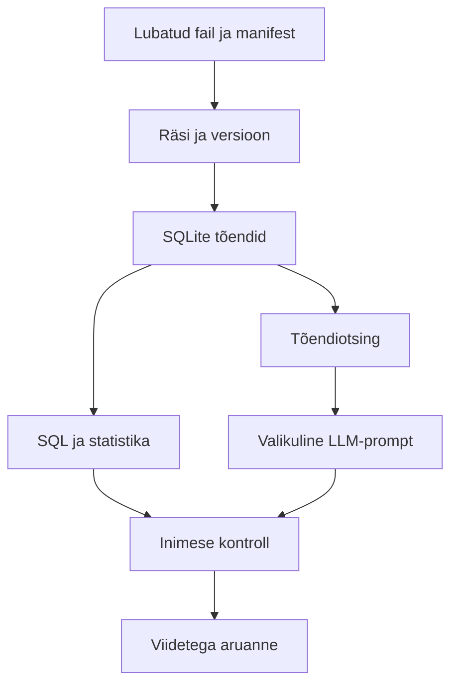

# Estonian OSINT Research Assistant

Põhitoru: lubatud fail → manifesti kontroll → SHA-256 → versioonitud hetktõmmis → SQLite → SQL kontrollid → raport. Baasprogramm ei tee võrgupäringuid. Valikuline API näide kogub ühe ametliku kataloogivastuse eraldi; seda ei ühendata automaatselt fiktiivse juhtumi tõenditega.

## Andmeleping

`manifest.json`: evidence_id, source_id, title, url, path, published_at, captured_at, synthetic, rights. `.example` on fiktiivse päritolu marker, mitte töötav välisviide. Failide algallikad on `data/evidence`; muutumatud koopiad tekivad `reports/snapshots`. SQLite säilitab ka teksti ja igal tõendil oma URLi. `sources.url` on esimese sisestatud allikakirje algusviide; dokumendi täpne URL on `evidence.url`.

`contracts.csv`: contract_id, buyer, supplier, base_eur, award_eur, bids, evidence_id, synthetic. `base_eur` = algne eelarve; `award_eur` = sõlmitud lepingu hind, eurot ilma käibemaksuta. Puuduvad maksed, pindala, töömahu muutused ja keerukus. Failiräsi on E10-s. `edges.csv` sisaldab ainult kolme tõendatud sünteetilist serva. `nlp.csv` on eraldi teemaklassifikatsiooni õppestend, mitte juhtumi lisatõend.

## Import ja pärisandmetele üleminek

Pärast uue lubatud dokumendi käsitsi salvestamist `data` alla lisa manifestikirje; märgi `synthetic=false`, tegelik URL, õiguste põhjendus ja päris kogumisaeg. Käivita import ning kontrolli loodud tõendirida. **Kaasasolev raporti tekst on fiktiivse juhtumi mall**: selle järeldused ei kohandu automaatselt uue juhtumiga. Päristööks loo eraldi projektikaust ja uus käsitsi kontrollitud raporti mall. Ära sega sünteetilist ja tegelikku andmestikku.

Statistikaameti näide salvestab vastuse ja päritolumetaandmed, kuid kataloogi metaandmed pole lepingute faktid. RIKi või RHRi reaalsete eksportide jaoks on vaja ametliku skeemi adapterit ja õiguste kontrolli; siin pole välja mõeldud ega testimata registri-API ühendusi.

## AI kasutusotsused

| Kiht | Kasu | Hindamine | Piirang |
|---|---|---|---|
| SQL ja reeglid | Täpsed summad ning võtmekontrollid | Arvuline etalon ja testid | Ei tõlgenda dokumendi konteksti |
| TF-IDF + logistiline regressioon | Tekstide teemade eelsorteerimine | Grupi järgi jaotus, macro-F1 vs enamusrühm | Sünteetiline väike korpus |
| Leksikaalne tõendiotsing | Viidatud tekstide leidmine | Recall@3, vastuseta päring | Käänded ja sünonüümid |
| LLM | Kontrollitava mustandi sõnastamine | Viidete/tsitaatide kontroll + inimese semantiline ülevaatus | Ei käivitatud ega mõõdetud selles paketis |
| Agent | Praegu ei rakendata | Võrdle enne käsitsi tööaja ja veamääraga | Puudub tõend autonoomia lisakasust |

Terviklik RAG katse käib nii: käivita `rag.py`, anna loodud prompt valitud lubatud mudelile, salvesta vastus `reports/llm_answer.json`, käivita `python src/rag.py --answer reports/llm_answer.json` sama küsimusega ning kontrolli seejärel väidete sisulist järeldumist. Väljundit ei avaldata automaatselt. Mudeli nimi, versioon, aeg, prompt ja inimese parandused tuleb logida.

Tulevane piiratud agent võib ainult pakkuda järgmist kontrolli heakskiidetud allikaloendist. Autonoomne kontode loomine, juurdepääsu laiendamine, isikuotsing, väline sõnum ja avaldamine ei kuulu tööriistade hulka. Esmalt mõõda 20 juhtumil, kas soovitus vähendab koguaega ilma vigade kasvuta.
