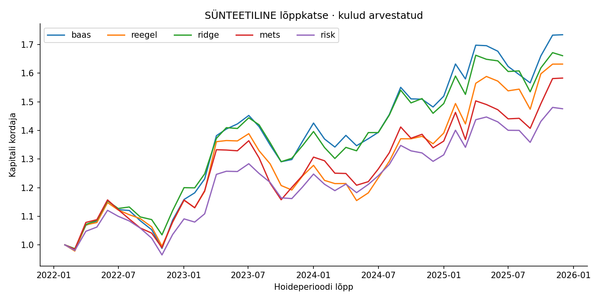
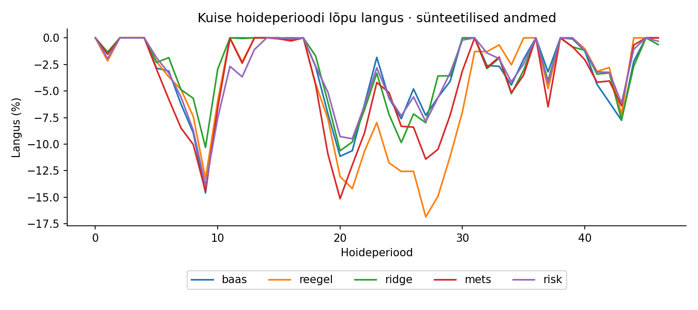
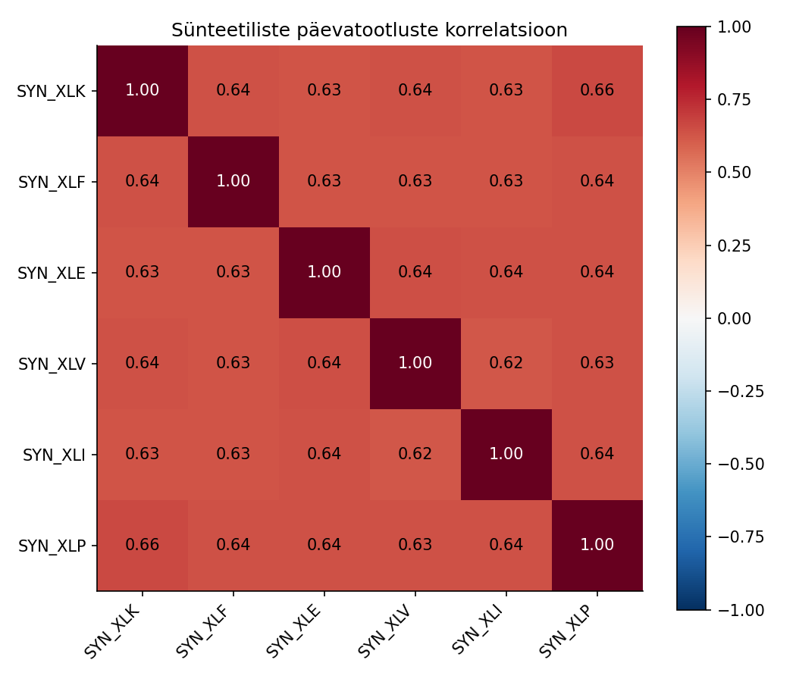

# Kontrollitud õppesimulatsiooni tulemused

**Kõik allpool olevad arvud on sünteetilised.** Arvutati kaasasoleva koodiga, mitte ei kirjutatud loosse soovitud tulemustena. Andmestik, juhuseeme ja parameetrid on paketis; räsi on `raportid/run.json`.

Lõppkatse hõlmab 46 täielikku kuist hoideperioodi. Signaalid 31.01.2022–31.10.2025, täitmiste vahemik 01.02.2022–01.12.2025. Novembri 2025 signaali lõppsilt vajaks jaanuari 2026 hindu, mistõttu see puudub. Aastaarvude üldmärge 2022–2025 ei tähenda nelja täisaasta kogutootlust.

CAGR ja volatiilsus on aastastatud, MDD mõõdetud kuiste kapitalipunktide järgi ning käive ostude+müükide kogumaht NAV-i suhtes. Sharpe'i riskivaba määr on 0. Puuduvad maksud, turumõju ja lõplik likvideerimine.

## Portfellid

| period | model | CAGR | vol | Sharpe_rf0 | max_drawdown_monthly | months | mean_turnover |
| --- | --- | --- | --- | --- | --- | --- | --- |
| valideerimine | baas | -0.52% | 16.95% | 0.0597 | -27.68% | 36 | 0.0465 |
| valideerimine | reegel | -3.44% | 17.21% | -0.1136 | -30.13% | 36 | 0.8105 |
| valideerimine | ridge | -1.87% | 17.57% | -0.0136 | -27.46% | 36 | 1.4209 |
| valideerimine | mets | -1.67% | 17.54% | -0.0030 | -27.32% | 36 | 1.3115 |
| valideerimine | risk | -0.49% | 14.83% | 0.0439 | -22.06% | 36 | 0.5293 |
| lopptest | baas | 15.45% | 15.00% | 1.0352 | -14.58% | 46 | 0.0399 |
| lopptest | reegel | 13.63% | 16.40% | 0.8613 | -16.84% | 46 | 0.7214 |
| lopptest | ridge | 14.16% | 14.20% | 1.0061 | -10.62% | 46 | 1.2860 |
| lopptest | mets | 12.73% | 16.30% | 0.8169 | -15.13% | 46 | 1.2206 |
| lopptest | risk | 10.69% | 13.25% | 0.8328 | -13.91% | 46 | 0.6291 |

Baas on kuue vara igakuine võrdkaal. Reegel, Ridge ja mets valivad kaks liidrit 50/50. Riskivariant valib kolm momentum-liidrit kuni 30% kaupa ning võib volatiilsuse järgi veel riski vähendada. Seetõttu on riskivariant teine kapitalijaotus, mitte sama portfelli puhas ML-võrdlus.

Selles lõppkatses oli baasi CAGR kõrgem kui reeglil ja mõlemal õpitud mudelil. Ridge'i realiseerunud volatiilsus ja kuine langus olid madalamad, kuid see ei tõenda üldist paremust. Valideerimisperioodi tulemused olid märgatavalt teistsugused.

## Prognoosi diagnostika

| period | model | RMSE | precision | recall | positive_rate |
| --- | --- | --- | --- | --- | --- |
| valideerimine | reegel | 0.0616 | 0.5786 | 0.6585 | 0.5694 |
| valideerimine | ridge | 0.0543 | 0.5503 | 0.6667 | 0.5694 |
| valideerimine | mets | 0.0544 | 0.5714 | 0.6829 | 0.5694 |
| lopptest | reegel | 0.0569 | 0.5200 | 0.5948 | 0.5543 |
| lopptest | ridge | 0.0495 | 0.5493 | 0.7647 | 0.5543 |
| lopptest | mets | 0.0502 | 0.5658 | 0.8431 | 0.5543 |

RMSE on tootluse kümnendmurru ühikutes. Precision/recall põhinevad prognoosi positiivsel märgil, kuigi kauplemisreegel valib suhtelised kaks liidrit. `positive_rate` näitab tegelike positiivsete siltide osakaalu. Reegli prognoos on `mom63/3` proksi; selle rahalist skaleeringut ei sobitatud.

## Kulutundlikkus

| bps | CAGR | vol | Sharpe_rf0 | max_drawdown_monthly | months |
| --- | --- | --- | --- | --- | --- |
| 0 | 14.62% | 16.44% | 0.9127 | -16.09% | 46 |
| 5 | 14.12% | 16.42% | 0.8870 | -16.46% | 46 |
| 10 | 13.63% | 16.40% | 0.8613 | -16.84% | 46 |
| 25 | 12.16% | 16.34% | 0.7834 | -17.96% | 46 |
| 50 | 9.75% | 16.27% | 0.6519 | -19.79% | 46 |

`bps` on ühe tehingupoole kulu. Tabel ei sisalda mahu kasvades kiirenevat turumõju. Nullkulu variant on diagnostika, mitte realistlik eeldus.

## Stabiilsus aastate lõikes

| exit_year | model | periods | compound_return |
| --- | --- | --- | --- |
| 2022 | baas | 10 | 8.69% |
| 2023 | baas | 12 | 25.31% |
| 2024 | baas | 12 | 8.81% |
| 2025 | baas | 12 | 17.04% |
| 2022 | reegel | 10 | 7.94% |
| 2023 | reegel | 12 | 14.95% |
| 2024 | reegel | 12 | 9.09% |
| 2025 | reegel | 12 | 20.57% |
| 2022 | ridge | 10 | 12.00% |
| 2023 | ridge | 12 | 20.24% |
| 2024 | ridge | 12 | 8.40% |
| 2025 | ridge | 12 | 13.80% |
| 2022 | mets | 10 | 8.08% |
| 2023 | mets | 12 | 14.95% |
| 2024 | mets | 12 | 7.80% |
| 2025 | mets | 12 | 18.21% |
| 2022 | risk | 10 | 3.63% |
| 2023 | risk | 12 | 16.01% |
| 2024 | risk | 12 | 7.47% |
| 2025 | risk | 12 | 14.23% |

Aasta on hoideperioodi **lõppemise** aasta. Esimene ja viimane aasta on poolikud. Tabelis on perioodide liittootlus, mitte annualiseeritud CAGR. Üksikut head aastat ei tohi tõlgendada uue sõltumatu strateegia tõendina.

## Ebakindlus ja stress

Reegli ja baasi kuiste netotootluste paarisvahe keskmise kolmekuulise ringplokk-bootstrap'i 95% vahemik, aastastatud aritmeetiline keskmine: **-6.51% kuni 3.47%**. Need on protsendipunktid aastas, mitte CAGR-i vahe usaldusvahemik. Ei korrigeeri kõiki uurimisvaliku mõjusid.

Viimase riskipiirangutega portfelli etteantud stress: **-11.23%**. Puudub väide šoki tõenäosuse või maksimaalse võimaliku kahju kohta.

## Otsus

Töövoog sobib õppimiseks ja tehniliseks lähtepunktiks. Päristuru eelis pole tõendatud. Järgmine katse vajab punkt-ajas pärisandmeid, valiku ja kulude protokolli, sõltumatut hindamist ning täitmiskontrolli.
